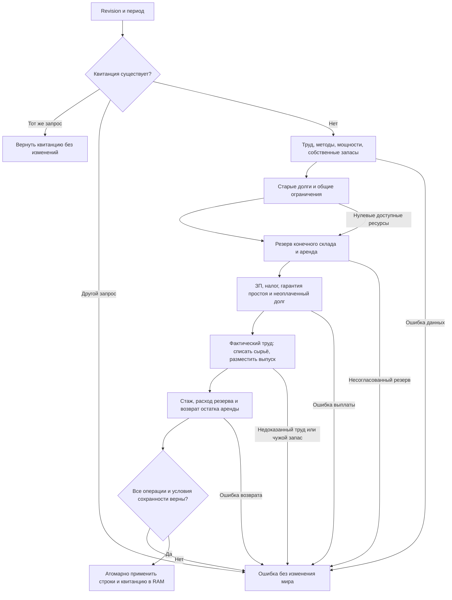

# Кингмейкер на Rust — чтение мира и нативное производство

Rust поддерживает чтение мира и изолированный производственный цикл в RAM через `kingmaker_sim::production::execute_production_cycle(&mut world, &request)`. **Полная нативная неделя ещё не реализована.** Запрос недели возвращает `INCOMPLETE_NATIVE_ENGINE` до изменения состояния. Прежнее заявление о неделе за 13–16 мс относилось к неполному расчёту и не доказывает ускорение игры.

Используется существующий `../Проект карты Тейванкаля/data/kingmaker/runtime.json`: выбранная база, кампания, параметры storage/workers и подписи. SQLite открывается только для чтения. Значение `maxHeapMiB` сохраняется в диагностике; ограничение памяти нативного процесса пока не реализовано.

Загрузчик сохраняет настоящие внешние ID, товары, провинции, владельцев, количества, деньги, дату и revision. Неперенесённые таблицы и поля остаются в исходных envelopes. Счета ищутся по владельцу, валюте и назначению; отсутствующий личный счёт ПОПа остаётся отсутствующим. Финансовый примитив проверяет атомарность и повтор операции, но его история ещё не сохраняется между процессами.

Производство использует текущий каталог, реальные назначения, договорные ставки, налоги, гарантии простоя, собственное сырьё, защищённые запасы и конечные склады. ДП выпускают утверждённые базовые ресурсы; заводы учитывают оборудование, клерков, стаж и инфраструктуру; кустари работают самостоятельно. Изменения затронутых строк готовятся до публикации. Ошибка отменяет фазу; тот же запрос возвращает сохранённую квитанцию, изменённый запрос под тем же периодом отвергается. Стаж начисляется по фактической работе. Складская аренда возвращается только за неиспользованное место; недостаток денег сохраняется долгом.

Старый `execute_world_production` с отдельными рецептами отказывает: этих аргументов недостаточно для оплаты труда, прав и склада. Поддержанный запрос содержит revision, period, policies, profile и доказательства содержания рабов. Готовый выпуск и ручная подмена FTE не принимаются. Деньги используют точные рациональные промежуточные вычисления и проверяемый конечный i64. Операции, текущие строки и квитанции фазы сохраняются в RAM; запись и повтор после загрузки новым процессом пока не реализованы.

Оплачиваемый рынок, покупки сырья, потребление ПОПов, перевозки, общий бюджет, автонайм, профессии/миграция, доходы владельцев, строительство, полные проверки прав, сохранение и полный API карты требуют дальнейшего переноса. Производственный цикл не подставляет за них деньги, работников или товары и пока не включён в недельный вход. Небольшие тесты и совпадение с JS не доказывают здоровье экономики полного мира. На полном мире проверяется только чтение; ни неделя, ни производственная фаза на нём не запускались.



## Запуск

Оба `Запустить кингмейкер на Rust.cmd` запускают актуальный `bin/kingmaker-server.exe` с существующим runtime. Сервер сообщает режим чтения и предоставляет поддержанные диагностические API на `127.0.0.1:8080`. Браузер автоматически не открывается: полный API viewer ещё не готов. Запрос execute выбранной кампании возвращает HTTP 503; неизвестной кампании — 404.

Только проверить выбранный мир:

```powershell
.\bin\kingmaker-cli.exe --runtime '..\Проект карты Тейванкаля\data\kingmaker\runtime.json' --inspect
```

Загрузка может занять время; прогресс печатается каждые 100 000 исходных записей. Время загрузки не является временем игровой недели. Вызов CLI без `--inspect` отказывает в расчёте недели до загрузки полного мира.

## Проверка и сборка

```powershell
cargo test --workspace --locked
cargo build --release --workspace --locked
```

Пять существующих crates сохраняются: core, io, sim, cli и server. Деньги представлены проверяемым `i64`; неподдерживаемые суммы отвергаются явно, при JSON-выдаче используется десятичный текст для точности.

Правила этапа: [спецификация](docs/superpowers/specs/2026-10-12-rust-recovery-design.md), [план](docs/superpowers/plans/2026-10-12-rust-recovery.md). Проверки и ограничения: [отчёт](reports/rust-recovery-2026-10-12/report.md). Исходный аудит сохранён в `reports/review-2026-10-12`; копия заменённых исходников и EXE — `work/rust-recovery-2026-10-12/before`.

Производственный этап: [спецификация](docs/superpowers/specs/2026-10-12-rust-production-design.md), [план](docs/superpowers/plans/2026-10-12-rust-production.md), [отчёт](reports/rust-production-2026-10-12/report.md). Копия до правок и журнал решений: `work/rust-production-2026-10-12`. Для проверки порядка операций используются настоящий JS и небольшие fixtures; Node сейчас v24.15.0, ICU78.2, `localeCompare` с `ru-UA`. Эта локаль закреплена в native ICU; смена локали JS требует повторной проверки.
