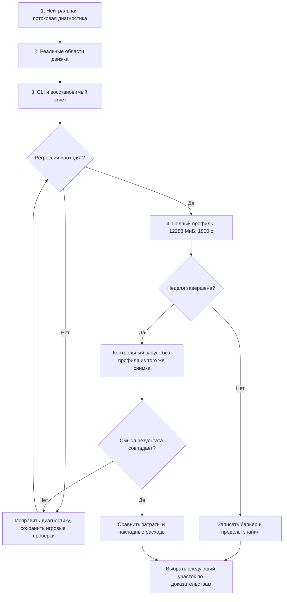

# Профиль полного хода перед адаптацией методов Alice — Implementation Plan

> **For agentic workers:** REQUIRED SUB-SKILL: Use superpowers:executing-plans to implement this plan task-by-task; superpowers:subagent-driven-development only if the user chooses that method.

**Goal:** Выявить, что задерживает цикл «правка → видимый результат», измерив полный путь хода и подготовку данных; выбрать первый участок адаптации Alice по измерениям при допустимых 8–12 ГиБ памяти.

**Architecture:** Небольшой отключаемый диагностический модуль в core предоставляет вложенные области и числовые счётчики. CLI сохраняет поток событий отдельно от игрового состояния; существующий Windows-измеритель ограничивает процесс, а отдельный скрипт собирает отчёт без двойного счёта вложенного времени. Экономика, расположение сущностей, формат checkpoint и read guards этим этапом не меняются.

**Tech Stack:** Rust/std + существующие serde/serde_json; PowerShell-измеритель и Python stdlib для отчёта. Новые зависимости не нужны.

**Spec:** `docs/superpowers/specs/2026-10-14-alice-methods-adaptation-design.md`, утверждена пользователем. Сохраняются контракты `docs/superpowers/specs/2026-10-14-rust-week-performance-design.md`.

Статус: согласованный измерительный этап выполнен inline 14.10.2026. Полный прогон остановлен по тайм-ауту1800с (0 недель, пик7.44ГиБ); выбран квадратичный обход в проверке запасов arrivals. Журнал исполнения, отклонения и доказательства: `work/alice-profile-first-2026-10-14/progress.md`. Список ниже сохранён как исходный согласованный план; условный контроль без профиля неприменим после timeout. Цель скорости всего движка не достигнута.

## Global Constraints

- Первый этап измеряет текущий код. Нельзя удалять fingerprints, пропускать аудит, отключать фазу, включать незавершённый архив или менять игровой расчёт ради успешного прогона.
- Сохраняются формулы, нормы количества, явные пустые приоритеты, выплаты, деньги по валютам, собственность, труд, люди, права, частичное исполнение, долги и детерминированное распределение дефицита.
- Ошибка/отмена до публикации не оставляет частичную неделю. Повтор и stale prepare/apply сохраняют прежнюю семантику, включая изменения без revision и появление нового участника выборки.
- Диагностика не входит в WorldState, квитанции, игровые события, fingerprints или replay identity. Существующие игровые timings не менять ради нового отчёта.
- Телеметрия сохраняется потоком; не копирует мир, JSON payload или историю. Имена областей — статические метки; никакой метки на каждый event_id/POP/товар.
- Скорость получения результата после правки приоритетнее экономии RAM. 8–12 ГиБ допустимы; снижать расход до 4 ГиБ больше не требуется. Холодный запуск, повторный пересчёт и сборка Rust показываются отдельно; неизмеренный участок доставки результата не считается нулевым.
- workers=1; release; private committed cap 12288 МиБ, включая загрузку и сохранение; конечный timeout 1800 с на первоначальный диагностический процесс. Повышение лимита ради результата не предусмотрено.
- Общая цель остаётся: две серии по 10 недель из одного снимка, медиана <=3 с, p95 <=5 с (19-е из 20), продолжение до 52 недель в пределах 12 ГиБ. Один профиль не заменяет эту приёмку.
- Активные runtime.json и база не изменяются. Диагностические недели запускаются только существующим runner в отдельной директории.
- Проект не Git-репозиторий: перед правками резервировать затронутые файлы и их SHA-256 в `work/alice-profile-first-2026-10-14/before/`. Не создавать репозиторий/ветку и не заявлять commits. Сохранять RED/GREEN и хеши итоговых файлов.

## Review Focus

1. Ошибка до первой фазы и ошибка внутри фазы: последняя область видна, незавершённая область не считается успешной — Tasks 1–3.
2. Вложенные fingerprints и индексы: вложенное время и байты не суммируются дважды — Tasks 1–3.
3. Невозможность записи диагностического файла: экономика не меняется; измерение явно непригодно — Tasks 1, 3.
4. Профиль включён/выключен, повтор, отмена и stale data: одни и те же экономические результаты и ошибки — Task 2.
5. Убийство процесса лимитом и частично записанная последняя строка: отчёт восстанавливает доступный префикс, не выдумывает итог и не затрагивает чужой процесс — Tasks 3–4.

## Files and Interfaces

| Файлы | Назначение |
|---|---|
| `crates/kingmaker-core/src/diagnostics.rs`, `src/lib.rs`; `tests/diagnostics_test.rs` | Отключаемые вложенные измерения и поток записей |
| `crates/kingmaker-core/src/row_store.rs`, `world_read.rs` | Стоимость построения индексов без изменения их устройства |
| `crates/kingmaker-sim/src/native_week.rs`, `read_guard.rs`, `operation_history.rs` | Неделя, guards, проверка истории |
| `crates/kingmaker-io/src/sqlite_loader.rs`, `production_projection.rs`, `source_store.rs`, `history_store.rs`, `checkpoint.rs` | Загрузка/проекция/сохранение и фактические обращения к кешу/SQLite |
| `crates/kingmaker-sim/tests/native_week_profile_test.rs` | Семантическая нейтральность диагностики |
| `crates/kingmaker-cli/src/main.rs`, `runner.rs`; `tests/runner_test.rs`, `tests/cli_test.rs` | Флаг профиля и полные границы жизненного цикла |
| `scripts/summarize-native-profile.py`, `scripts/tests/test_native_profile_summary.py` | Потоковая агрегация профиля и результата внешнего измерителя |
| `work/alice-profile-first-2026-10-14/` и существующий `work/rust-week-performance-2026-10-14/progress.md` | Замеры, доказательства и решение о первом участке |

### Task 1: Диагностические области с ограниченной памятью

**Interfaces:** экспортировать `kingmaker_core::diagnostics`:
- `ProfileSession::install(writer: Box<dyn std::io::Write>) -> std::io::Result<ProfileSession>`; одна сессия на текущий поток, вложенная установка возвращает ошибку. Объект сессии и области не Send. Writer открывается CLI до загрузки мира.
- `ProfileSession::is_healthy(&self) -> bool` сообщает sticky-состояние; CLI проверяет его после недели до начала следующей.
- `ProfileSession::finish(self) -> std::io::Result<()>`; закрывает поток, сохраняет footer; первая ошибка записи sticky, возвращается здесь. Drop восстанавливает отсутствие сессии и не паникует.
- `scope(name: &'static str, visibility: Visibility) -> ProfileSpan`; `Visibility::{Boundary, Detail}`.
- `ProfileSpan::finish(self, outcome: Outcome)`; `Outcome::{Ok, Error, Cancelled}`. Drop незавершённой области записывает Abandoned, никогда Ok. При отключённой сессии область — no-op без Instant и выделений.
- `add(metric: Metric, value: u64)`; `Metric::{HashCalls, HashBytes, IndexBuilds, IndexRows, SourceCacheHits, SourceCacheMisses, SourceSqlQueries, SourcePayloadBytes, HistoryCacheHits, HistoryCacheMisses, HistorySqlQueries, HistoryPayloadBytes}`. Накопление у наиболее глубокой активной области; сумма по непересекающимся областям не дублирует счётчики.

JSONL schema=1: header; begin с id,parent_id,name,relative_ns; end с id,outcome,elapsed_ns,self_ns,counters; footer с complete/error. Boundary begin/end немедленно flush; Detail сохраняется через буфер до ближайшей границы. До 64 одновременно активных областей, небольшой фиксированный массив счётчиков, буфер writer <=64 КиБ. Завершённые области в RAM не накапливаются. Переполнение глубины/счётчика отмечает профиль неполным и не затрагивает экономику. Незакрытая область при жёстком завершении остаётся begin без end. В footer указать allocation_bytes=null, physical_disk_bytes=null и причину: глобальный allocator/физический IO не инструментируются этим этапом.

- [ ] Создать резервные копии изменяемых файлов и записать SHA-256.
- [ ] Написать RED `nested_scopes_do_not_double_count`: root 100 нс, child 30 нс => root.self_ns=70, child.self_ns=30; сумма self=100; HashBytes, записанные в child, не копируются в root. Для временной арифметики использовать внутренний тестовый источник времени/чистый аккумулятор; не sleep-assertions.
- [ ] Добавить RED: выключенный профиль ничего не пишет; Drop после раннего выхода не выдаёт Ok; отказ writer sticky, функция пользователя возвращает свой прежний результат; повторная установка/выход из сессии не оставляет TLS; 65-я вложенная область инвалидирует профиль, не паникует; 100000 последовательных областей не оставляют 100000 записей в памяти. Последнюю проверку выполнить с discard writer, контролируя число живых служебных записей, не общий RSS.
- [ ] Run: `cargo test -p kingmaker-core --test diagnostics_test --locked`. Expected: RED из-за отсутствующего модуля/контрактов.
- [ ] Реализовать интерфейсы. При вызовах writer не держать изменяемое TLS-заимствование, допускающее повторный вход; ошибки диагностики не конвертировать в экономические ошибки. Учёт child времени выполняется при закрытии; завершение с открытыми областями помечается неполным.
- [ ] Повторить тест. Expected: GREEN. Записать лог; никаких изменений представления мира.

### Task 2: Подключить измерения к действительному пути недели

**Consumes:** Task 1, без изменения сигнатур экономических API.
**Produces:** статические области `world.index`, `index.rows`, `week.prepare`, `week.history`, `week.income_basis`, `week.transaction`, прежние имена фаз под `phase.*`, `week.finalize`, `week.apply`, `guard.world`, `guard.serialize`, `io.load`, `io.project`, `io.checkpoint.load`, `io.checkpoint.save`. Boundary использовать на внешних этапах и guard.world; мелкие индекс/serde вызовы — Detail.

- [ ] Написать RED `profile_preserves_week_and_replay`: две независимые малые исходные fixtures, одна с профилем. Проверить одинаковые счета/валюты, товары/владельцев, POPs/занятость, резервы, долги, campaign revision/date и operation/registry evidence. Служебные длительности исключать только через существующие правила canonical evidence; не требовать совпадения всех JSON-байтов. Повтор возвращает прежнюю квитанцию и не создаёт операций.
- [ ] Добавить RED: отмена в середине недели оставляет исходный опубликованный мир; изменение прочитанной строки без revision и добавление участника выборки отвергают apply одинаково с профилем и без; невалидный исходный запрос оставляет завершённую область с Error; явный пустой приоритет в поддерживаемом входе остаётся пустым. Для игровых ожиданий использовать существующие fixtures/контракты, не переписывать их под фактический ответ.
- [ ] Run: `cargo test -p kingmaker-sim --test native_week_profile_test --locked`. Expected: новые требования к профилю RED; обнаруженное расхождение игровых правил отдельно документировать, не исправлять скрыто в инструментировании.
- [ ] В `native_week.rs` измерить построение BorrowedWorld, validate_week_history, income basis, создание транзакции, финализацию после последней фазы и apply. Макрос phase обрамляет реальный body; end пишется и при Err. Не переносить контроль отмены и не изменять порядок стадий.
- [ ] В `read_guard.rs` локально считать принятые Writer байты и один HashCalls на fingerprint; передавать накопленный счётчик один раз, включая частичный расход при Err. Не добавлять TLS-вызов на каждый маленький write. SHA и результат сериализации остаются прежними. `world_fingerprint` обрамляет весь существующий список.
- [ ] В `BorrowedRows::new` считать действительно добавленные строки/построения. В IO обрамить load/project/checkpoint; cache hits/misses и SQL queries считать в фактических ветвях. PayloadBytes — длина прочитанного JSON payload там, где строка уже есть; не сериализовать Value ещё раз ради статистики. Это логические байты SQLite, не физическое чтение диска. Метрики не удерживают payload.
- [ ] Проверить чтение истории независимо от её хранения; активный MemoryHistory и тестовый HistoryBacking допустимы. Не добавлять production archiver и не снимать checkpoint-guard.
- [ ] Run: `cargo test -p kingmaker-sim --test native_week_profile_test --test native_week_test --test native_week_history_test --test read_guard_test --test world_transaction_test --test archived_week_test --locked`; затем `cargo test -p kingmaker-io --test checkpoint_test --test source_store_test --locked`. Expected: GREEN и прежние игровые assertions сохранены.

### Task 3: CLI-профиль и отчёт после прерывания

**Interfaces:**
- Добавить `--profile` только для `--run-weeks`; по умолчанию выключен. `runner::run(..., verify_save: bool, profile: bool) -> anyhow::Result<()>`. Профиль хранится в `<output>/profile.jsonl`; существующие run.json/weeks.jsonl совместимы, получают только дополнительные диагностические поля.
- Открыть профиль create_new после создания output, до native_fingerprint/load. Невозможность открытия — отказ до запуска расчёта. При ошибке записи во время работы сохранить экономический исход, пометить profile_status=failed, завершить обычное сохранение последнего доступного состояния и вернуть неуспешный итог измерения; не откатывать уже опубликованную неделю по ошибке телеметрии. После первого сбоя записи не выполнять следующие недели серии.
- Области CLI: `run.identity`, `run.load`, `run.initial_audit`, `run.initial_save`, `run.week` (от freeze_week_summary до конца записи отчёта недели), `run.summary`, `run.prepare`, `run.metrics`, `run.apply`, `run.week_report`, `run.final_save`. Сохранить прежний elapsed_ms=prepare+apply; дополнительно обозначить полный week pipeline. Начальный/конечный checkpoint остаются отдельными.
- `python scripts/summarize-native-profile.py --profile <profile.jsonl> --process <process.json> --output <new-summary.json>`; функция `summarize(profile_path: Path, process_path: Path) -> dict`. Читает JSONL построчно, агрегирует по статической метке и родительской метке; не загружает весь файл. process.json задаёт внешние outcome/peak_private_bytes/exit code, профиль — области и счётчики.

- [ ] Добавить CLI RED: --profile без --run-weeks отвергается; обычный запуск не создаёт profile.jsonl; профильный запуск малого checkpoint содержит загрузку/аудит/prepare/apply/save и footer; отказ исходного аудита не выглядит как готовая неделя. Проверка profile on/off использует один checkpoint с fingerprint текущего тестового CLI.
- [ ] В summary-тестах задать fixture root=100/child=30 и получить total self=100, не 130. Незакрытый begin, обрезанный финальный JSON, memory_limit/timeout, ненулевой exit без footer => complete=false и last_open_scopes; ни median/p95, ни успешная неделя не выдумываются. Некорректная строка в середине потока — corrupted, а не silently skipped. Ошибка writer отражается как непригодное измерение.
- [ ] Run: `cargo test -p kingmaker-cli --test cli_test --test runner_test --locked`; `python -m unittest discover -s scripts/tests -p test_native_profile_summary.py`. Expected: RED новых сценариев.
- [ ] Реализовать CLI/summary. События используют относительное монотонное время, внешний sampling связывается по запуску; дисковая запись может добавлять накладные расходы, они не вычитаются предположением. Summary показывает inclusive и self раздельно, завершённые и незавершённые области раздельно, покрытие счётчиков и null для неизмеренного. Не называть последнюю активную область доказанной причиной OOM: это место прерывания.
- [ ] Повторить команды. Expected: GREEN. Run `cargo check --workspace --locked`. Проверить весь допустимый workspace suite один раз после интеграции, исключая прямой неограниченный полный loader: `cargo test --workspace --locked -- --skip test_loads_2679_provinces_from_sqlite`. Не повторять успешные проверки без изменений.

### Task 4: Ограниченный полный прогон и выбор следующего участка

**Consumes:** Tasks 1–3; существующий `scripts/measure-native-performance.ps1`.
**Produces:** диагностический отчёт/summary, подтверждённая следующая техническая задача, актуальная запись progress.md. Этот этап не внедряет выбранную оптимизацию.

- [ ] Run `pwsh -NoProfile -File scripts/tests/measure-native-performance.tests.ps1` при первом использовании нового цикла измерений; ожидаются нормальное завершение, timeout, memory_limit и живой чужой одноимённый процесс. Не менять прошедший измеритель без обнаруженного дефекта.
- [ ] До замеров проследить существующий путь применения правки данных/правил до расчёта и выдачи результата: реальные точки входа, перезапуск/перезагрузка, кеши и потребитель результата. Записать подтверждённую схему Mermaid в журнале; непроверенные UI/доставку явно пометить. Это исследование, а не создание новой системы hot reload.
- [ ] `cargo build -p kingmaker-cli --release --locked`; определить фактический target_directory через `cargo metadata --format-version 1 --no-deps`, не предполагать target внутри репозитория. Сохранить SHA-256 executable/изменённых исходников, hardware/workers, путь и идентичность входа; source_hash берётся из проверенного входа, конфигурацию не редактировать.
- [ ] Создать arguments.json структурным JSON-массивом для `--runtime <existing-runtime> --run-weeks 1 --output <new-profile-run> --profile`. Запустить измеритель с абсолютными Executable/ArgumentFile/OutputDirectory, `-PrivateLimitMiB 12288 -TimeoutSeconds 1800`. Сам CLI напрямую на полном мире не запускать.
- [ ] Если достигнут memory_limit, timeout, исходный аудит, checkpoint-guard или иной отказ: обработать доступный профиль, сохранить последнее место/границы, точную ошибку и неподтверждённые причины. Не повышать cap, не отключать проверку и не повторять тот же неуспешный запуск без новой причины. Если профиль заблокирован до недели, это полезный результат этапа, но производительность недели остаётся неизвестной.
- [ ] Если подробный прогон завершился: из его неизменённого `initial` checkpoint запустить тот же executable с --resume, --run-weeks 1, новым output и выключенным профилем под теми же cap/timeout. Это тот же исходный мир, не следующая неделя. Сравнить экономическое состояние через существующую canonical семантику; оставить различия timings отдельно. Отметить различия прогрева/источника загрузки: одиночная пара даёт ориентир накладных расходов, не статистическую приёмку. Повтор разрешён для объяснения конкретного расхождения, не ради выгодной цифры.
- [ ] Свести: отдельно время загрузки/аудита/сохранения; prepare/apply и полный week pipeline; ранжирование self time; HashBytes/HashCalls/IndexRows/SQL queries; peak private committed; долю непокрытого времени и интервалы прерывания. Приложить raw logs и аргументы, а не только вывод.
- [ ] В отчёте отдельно описать задержку цикла правок: какие расходы повторяются каждый раз, какие оплачиваются один раз, какие границы ещё не измерены. Не запускать активную кампанию ради замера и не подменять полный цикл цифрой времени недели. Если повторная загрузка занимает минуты, учитывать её приоритет независимо от скорости prepare/apply.
- [ ] Выбрать следующую задачу по свидетельству: устранить подтверждённый барьер запуска либо крупнейший устранимый расход недели. Если это сериализация guards — проектировать проверку зависимостей без потери stale safety; если индексы/числовой проход — ограниченный компактный участок; если IO — загрузку/сохранение. Никакой заранее выбранной SoA-переписи.
- [ ] Проверить полученный diff и отчёт; Gemini может выполнить ограниченное независимое чтение фрагментов, Codex проверяет выводы. Записать имеющиеся доказательства и оставшиеся ограничения в progress.md. Не публиковать новую активную сборку на основании одного профиля.

## Порядок выполнения

## Self-review и граница завершения

Покрыт первый исполняемый этап утверждённой спецификации: видимость полного пути, bounded telemetry, отказоустойчивый отчёт, нейтральность измерений, безопасный полный прогон, выбор пилота. Все пять Review Focus имеют конкретные проверки. API и имена метрик едины между задачами; сохранение диагностического потока не требует изменений WorldState.

Типизированное компактное хранение, замена guards, завершение архивного checkpoint, SIMD, многопоточность и окончательная приёмка 20/52 недель остаются обязательствами соответствующих следующих этапов. Они намеренно не реализуются этим измерительным планом до получения фактического профиля. Завершение этого плана не означает завершения переноса Rust или достижения целевой скорости.

План подтверждён пользователем. Выполняется inline в этой сессии с сохранением ранее выбранного способа; отдельное разрешение на каждый тест/задачу не запрашивать.

Самопроверка плана выполнена: согласованы сигнатуры, coverage первого этапа и проверки пяти рисков; нет незаполненных шагов. Вход Gemini: `work/engine-research-2026-10-14/gemini-profile-plan-input.txt`. Подтверждены расположение runner-интервалов и необходимость отдельного потока диагностики. Не приняты zero-cost/branchless обещания, произвольный overhead <2%, проверка семантики только revision/native_fingerprint и 50 полных недель вместо малого контрактного теста. Профиль начинается до загрузки, а не у открытия weeks.jsonl.
