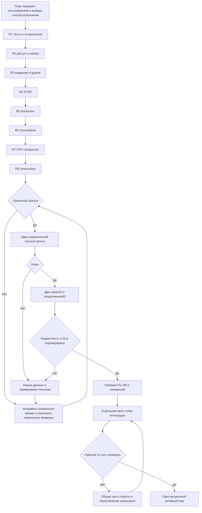

# Rust performance remediation — Implementation Plan

> **For agentic workers:** REQUIRED SUB-SKILL: Use superpowers:subagent-driven-development or superpowers:executing-plans to implement this plan task-by-task. Steps use checkbox (`- [ ]`) syntax for tracking.

**Goal:** устранить подтверждённые R1–R8, доказать корректность и сложность, затем измерить полный мир и довести отдельным согласованным этапом штатный путь «правка → видимый результат».

**Architecture:** сохраняем существующий движок, транзакции и экономические правила. Индексы строятся однократно на неизменяемое представление, guards сохраняют содержательные проверки внешних изменений; локальные синхронные операции получают отдельную доказуемую границу владения. SourceStore читает ограниченными пакетами, население сравнивается по ссылкам.

**Tech Stack:** Rust workspace, cargo release/locked/offline, rusqlite, serde, Windows PowerShell 7, существующий Job Object monitor; Node UI пока отдельный путь.

**Spec:** `../specs/2026-10-14-rust-performance-remediation-design.md` — принята пользователем в этом чате 2026-10-14. Её старую строку статуса не считать отказом от принятия. Этот план ещё НЕ принят.

## Global Constraints

- Полный мир; workers=1; median ≤3 с, p95 ≤5 с; две серии по 10 последовательных недель из одного снимка. p95 — 19-е отсортированное значение из 20. Продолжение до 52 недель. Private committed ≤12 ГиБ (12288 МиБ) на всём пути, включая загрузку/сохранение.
- Сборка, загрузка, сохранение, холодный и повторный путь до UI учитываются отдельно; численного SLA UI нет. Подготовка, guards, применение и обязательная финализация входят в неделю.
- Сохраняются все девять контрактов §3 спецификации: формулы, настройки (включая пустые приоритеты), количества, бюджет, зарплаты, FTE, занятость, валюты, права, резервы, аренда, долги, частичные исходы, порядок, округления, атомарность, replay, stale/absent-key/phantom, неизвестные поля, автономное восстановление.
- Битовая совместимость JS не требуется. Ошибочное игровое правило — отдельный описанный пример и решение, не молчаливое изменение ради скорости. Не вводить Kahan/перестановку сумм автоматически.
- Extra уже Arc. Не вводить второй полный изменяемый WorldState, всеобщую SoA-перепись, новую миграционную систему или параллелизм для маскировки сложности.
- Единственный выбор базы/кампании — исходный проект `data/kingmaker/runtime.json`; значения dbPath/campaignId читаются при запуске. Диагностические снимки не становятся рабочими кампаниями.
- После принятия плана исполнять согласованные шаги без повторных разрешений. Новое API/UI-поведение требует отдельной спецификации/плана согласно §7 принятой спецификации.

## Проверенная база и границы

Rust root: `D:/ЛИЧный хлам/🎲 ДнД для поляны/Карты тейванкаля/Фулл карта/kingmaker-rust` (далее R). Исходный проект: соседний `Проект карты Тейванкаля` (далее P). Все пути без P относятся к R; команды cargo выполняются из R.

Прочитаны пользовательские глобальные инструкции и P/AGENTS.md. В R и его предках AGENTS.md не обнаружен; вложенных AGENTS.md в R также не найдено. R не является Git-репозиторием: не обещать коммиты, не выполнять git init. Вместо коммитов — хеши исходников, проверяемые патчи и отчёт каждого этапа; чужие изменения сохранять.

Прочитаны review.md, probes.jsonl, настоящий review harness, profile-summary.json, итог progress.md и нужные контракты старых спецификаций. Старый alice-profile-first завершён как измерительный этап. Его повтор не является задачей этого плана.

14 октября: P/runtime.json выбирает memory/Node, workers=1. configured-server.cjs → server.cjs → runtime-gateway.cjs. P/data/kingmaker/instance.json сообщает PID50680, URL http://127.0.0.1:56897; PID отсутствует, GET /api/health получил connection refused. Работающий UI сейчас НЕ подтверждён. Rust routes.rs:114–128 по исходнику возвращает 503 SERVER_WEEK_EXECUTION_NOT_IMPLEMENTED; новый HTTP-запрос execute не отправлялся. Не запускать полный мир ради планирования.

Прежний результат: timeout1800 с, 0 недель, peak7,44 ГиБ. Arrivals self1036,792 с не приписывается целиком одному циклу. Storage self27,412 с остаётся нелокализованным. R5/R8 полного времени не имеют. Синтетические времена со счётчиком аллокаций не прогноз полного мира.

Gemini 3.8 Flash High был вызван через Antigravity для ограниченного поиска файлов/тестов. Headless command permission отклонён, полезных проверенных выводов нет; обход разрешений/смена аутентификации не выполнялись. План сверён локально.

## Review Focus

1. Числовой ExternalId 7 и строковый "7", дефицит у конкурентов с обратным порядком ID: разные ключи, прежняя очередь и округления — задачи 1/2/5.
2. Удаление и повторная вставка ключа, reorder, savepoint rollback: позиционный кеш не возвращает другую запись — задача 2.
3. Прямое изменение поля без revision; rollback и вложенный apply: stale-проверка не доверяет внешним версиям — задача 3.
4. STOP во время сериализации/сохранения и ошибка после commit: нет частичной недели, старый checkpoint валиден; committed RAM не объявляется откатанной — задачи 4/9.
5. Последняя/огромная строка SourceStore, ошибка в середине пакета, продолжение без исходной базы: нет потери авторских полей или ложного EOF — задачи 6/9.

## Общий протокол каждого исправления

- Сначала сохранить смысловые fixtures и GREEN существующих требований; добавить RED именно дефекта сложности/поведения. Уже верный контракт не обязан искусственно становиться RED.
- Счётчики посещений/поисков считают реальную работу, а не только число вызовов внешней функции; setup измерять отдельно. Существующие смысловые assertions не ослаблять.
- Новые regression-тесты задач 1–8 имеют префикс `remediation_`. `cargo test -p <crate> --locked --offline remediation_ -- --test-threads=1` обязан запускать ненулевое число тестов; отдельно перечисленные существующие integration suites запускать целиком.
- После GREEN — release N/2N/4N (1000/2000/4000, при необходимости 8000), 1 прогрев +5 измерений, сырые JSONL, median и отношения. Без полного мира; таймаут отдельной пробы 60 с, прекращение при квадратичном счётчике. Не вводить хрупкий миллисекундный порог CI.
- Новый harness `work/performance-remediation-2026-10-14/harness/{Cargo.toml,src/main.rs}` использует реальные модули/публичные входы, отдельно включает allocation meter. Старый review harness сохраняется: его assertion N(N+1)/2 описывает дефект и после исправления закономерно устареет.
- Артефакты: `work/performance-remediation-2026-10-14/{progress.md,checks.jsonl,probes-before.jsonl,probes-after.jsonl,input-identity.json,code-identity.json,memory-budget.json,guard-boundaries.md}`. На каждую задачу — diff, RED/GREEN, изменения поведения, пределы доказательства. Не заявлять успех по одному хешу мира.

## Память и срок жизни

Предлагаемый совокупный бюджет одновременно живущих добавленных структур: 1536 МиБ, включая 768 МиБ индексов/позиционных ключей/guards, 512 МиБ дельт и временных проверок, 64 МиБ существующего SourceStore cache, 64 МиБ совокупного prefetch всех его итераторов и 128 МиБ дополнительного scratch сохранения. Это admission budget, не доказательство общего RSS/private: основной мир, существующая история и runtime учитываются отдельно внешним монитором. При измеренной потребности сверх подбюджета остановить допуск и пересмотреть размещение, не выбрасывать игровые данные.

Индексы живут в фазе/владельце представления, не переживают его мутации. SourceStore immutable; его кеш живёт до закрытия store, evict не меняет результат. Никаких кешей будущих игровых исходов. Общий предел 12288 МиБ важнее суммы оценок. Один большой валидный payload не отвергать искусственным лимитом пакета: читать отдельно и учитывать в фактическом пике; при превышении общего допуска оптимизировать streaming до полного прогона.

## Task 1: R1 — линейный shipping audit

**Files:** Modify `crates/kingmaker-sim/src/shipping_invariants.rs`; tests `crates/kingmaker-sim/tests/internal/shipping_invariants.rs`, `shipment_arrivals_test.rs`, `shipment_arrival_rights_test.rs`; новый harness выше.
**Interfaces:** сохранить `verify_arrivals(before: &dyn WorldRead, after: &dyn WorldRead, operations: &[EconomicOperation]) -> OpResult<InvariantReport>`.

- [ ] Добавить `remediation_arrivals_linear_work`: S=1000/2000/4000, C=0 и C=2S; assert stock-row visits + change visits ≤8*(S+C+1). Counting WorldRead учитывает обходы настоящего verifier; отдельно keyed probes ≤2*S. RED показывает квадратичный участок.
- [ ] Добавить fixtures: пропажа stock; изменение owner/goods/unit/прав; необъяснённое количество; repeated stock_changes с чувствительным к порядку float; новый законный stock; частичное прибытие. Assert конкретных количеств, валютных проводок, резервов и отказа без публикации. Numeric/string ID различаются.
- [ ] Построить один индекс after по ExternalId (для Slice также линейное построение, не повторный RowView::get); один проход stock_changes в исходном порядке. Сумму изменений начинать с 0 как старый sum, затем один раз добавить к исходному quantity; проверку полей не сокращать. Дубликаты не терять при collect в HashMap.
- [ ] Запустить новые RED→GREEN, затем `cargo test -p kingmaker-sim --locked --offline --test shipment_arrivals_test --test shipment_arrival_rights_test --test shipping_authority_test`. Release-проба реального verifier; отдельный span `audit.arrivals.stock_rights`, без событий на строку. Сохранить этапный diff.

## Task 2: R2 — настоящий позиционный доступ с определённым сроком жизни

**Files:** Modify `crates/kingmaker-core/src/row_store.rs`, `crates/kingmaker-sim/src/world_transaction.rs`; Create `crates/kingmaker-core/tests/row_access_complexity_test.rs`; extend `crates/kingmaker-sim/tests/world_transaction_test.rs`, `local_hiring_test.rs`, `migration_cycle_test.rs`, `income_capital_test.rs`.
**Interfaces:** добавить обязательные `RowRead::len(&self)->usize` и `RowRead::at(&self,index:usize)->Option<&T>`; RowView и ReadSequence делегируют им. Все реализации RowRead, включая тестовые CountRows, обновить через compiler errors и `rg 'RowRead.*for|ReadSequence|\.at\(' crates`.

Выбрана разрешённая спецификацией ветка быстрого positional API, чтобы не менять очереди и десятки публичных форматов индексов потребителей. RowTable/BorrowedRows читают собственный Vec за O(1). Overlay и PreviewRows лениво строят Vec<K> видимого порядка один раз, затем обращаются по ключу. Это позиции только данного неизменённого представления; перенос позиций через мутацию запрещён. После write/edit/replace/reorder/apply/rollback/discard_forecast_accounts кеш сбрасывается; length поддерживается/кешируется вместе с членством. Возвращаемые ссылки привязаны к self, не к временной RefCell-guard.

- [ ] RED `remediation_indexed_access_linear`: N позиционных чтений +N len дают visits ≤3*N+1, N lookups ≤N; out-of-range→None. Повторный неизменённый проход не перестраивает индекс.
- [ ] `remediation_overlay_positions_after_mutation`: insert/delete/replace/reorder/delete-reinsert, вложенный apply и rollback; assert exact visible key sequence, len, строки по каждой позиции, нет resurrection. Отдельно выборка через len/at обязана регистрировать необходимые guards.
- [ ] Реализовать интерфейсы/инвалидизацию. Проверить каждый потребитель .at и ReadSequence::get: local_hiring, migration_cycle, income_capital, construction, construction_cancellation, cohort_scope, income_attribution, investments, investment_staff, profession_scope, shipment_actions. Если позиция переживает мутацию, заменить именно такой handle на ключ соответствующей таблицы; сохранить исходный порядок обхода, а не порядок HashMap.
- [ ] Запустить core suite и перечисленные четыре sim suites плюс `profession_cycle_test`, `construction_cycle_test`, `cohort_scope_test`; зафиксировать на реальных найме/миграции/capital счётчик посещений N/2N/4N и порядок конкурентов при дефиците. Индексная память входит в 768 МиБ.

## Task 3: R3 — локальная граница владения и внешние guards

**Files:** Modify `crates/kingmaker-sim/src/{read_guard,world_transaction,shipment_arrivals,shipment_actions,construction_cycle,construction_cancellation,construction_payroll,income_cycle,investments,local_food_reserves,physical_supply,raw_procurement,native_week}.rs`; tests `read_guard_test.rs`, `world_transaction_test.rs`, `native_week_test.rs`, `performance_contract_test.rs`; `guard-boundaries.md`.
**Interfaces:** существующие публичные prepare/apply сохраняют signatures и внешнюю проверку содержимого. Добавить private `LocalPrepareToken { owner: u64, mutation_epoch: u64 }`; методы `WorldTransaction::local_prepare_token(&self)->LocalPrepareToken` и `validate_local_prepare(&self, token: &LocalPrepareToken)->OpResult<()>`. Токен не сериализуется, не экспортируется пользователю и не является campaign revision.

- [ ] До редактирования составить таблицу каждого world_fingerprint callsite и читателей, включая чтения до создания child transaction. Для каждой строки указать external detached или synchronous internal, owner, read scope, invalidation и тест. Снимок текущего grep должен покрывать все 11 перечисленных модулей, включая native_week.
- [ ] RED счётчика `remediation_internal_phase_no_global_fingerprint`: внутренний prepare→apply не вызывает world_fingerprint; на неизменяемую базу одна selection fingerprint на таблицу/owner, repeated accesses не сериализуют её заново. Полная внешняя prepare/apply проверка допускается и явно измеряется; её нельзя скрыть за таймером.
- [ ] Закрепить `remediation_local_token_all_mutations`: любой put/remove/replace/set/edit/reorder/apply_phase/apply_delta/rollback/allocate_id/discard_forecast_accounts, source/history change (если есть путь), а также poison не разрешают принять устаревший локальный результат. Epoch монотонный, rollback не возвращает epoch назад; другой owner отвергается. Не делать trust fast path до прохождения всей матрицы.
- [ ] Сохранить внешние RED/GREEN regressions direct field edit без revision, absent→present, phantom insert/delete/reorder, singleton/settings change, source/history identity change, nested failure, conflicting replay. Assert world/IDs/payments/receipts не изменены при отказе.
- [ ] Разделить внутренний prepare и публичную оболочку: внутренний получает непрозрачный локальный proof вместо глобального fingerprint; полный расчёт и аудит сохраняются. В синхронном execute_in capture token до prepare и validate непосредственно перед apply. Внешний prepare не может создать этот proof. Нельзя трактовать `reads=None` как доверенный режим: сейчас это replay; использовать отдельный enum internal/external/replay.
- [ ] Повторные content guards к неизменяемой базе кешировать только в её владельце: key/content, absent и selection с порядком. При слиянии child guards переносить зависимости к parent, а не терять их. Для уже изменённого overlay инвалидировать только затронутые memo; произвольный dyn WorldRead не получает доверия по адресу. Если неполная карта записей — оставить content validation, отметить R3 незавершённым.
- [ ] Выполнить `cargo test -p kingmaker-sim --locked --offline --test read_guard_test --test world_transaction_test --test native_week_test --test performance_contract_test --test operation_session_test --test ordering_test`. Малые фазы: count/bytes global и selection guards, same-base repeats, изменение одной записи; никакой новой сериализации истории на каждом локальном apply. Сохранить diff и таблицу доказательства.

## Task 4: R4 — STOP без файлового запроса на мелкий serde write

**Files:** Modify `crates/kingmaker-sim/src/{run_control,read_guard}.rs`, `crates/kingmaker-io/src/checkpoint.rs` при необходимости порционных checks; tests внутри run_control/read_guard (private API), `crates/kingmaker-cli/tests/runner_test.rs`.
**Interfaces:** сохранить RunControl public API. Новый внутренний budget helper обслуживает атомарную отмену и учёт байтов; `fingerprint` возвращает тот же SHA256.

- [ ] RED `remediation_stop_poll_budget`: с управляемыми часами файловых stat ≤ceil(elapsed/100ms)+2, независимо от числа serde write; `remediation_fingerprint_control_equal` assert одинакового fingerprint. Не считать пользовательский probe автоматически файловым: throttling принадлежит from_stop_file.
- [ ] Writer копит байты локальным числом, обращается к budget check каждые 64 КиБ либо 4096 мелких writes (что наступит раньше); общий work не ведёт HashMap на каждый write. Часы проверяются на этих границах, файловый probe не чаще 100 мс, forced checks на начале/публикации. Остальные длинные CPU-циклы имеют check не реже 4096 элементов; атомарный cancelled флаг — дешёвый путь.
- [ ] Инъекция STOP до запуска, в длинном hash/CPU loop, в середине checkpoint. На нормальной ОС assert detection ≤1 с; отдельно измерить время безопасного завершения. Блокирующее IO: проверка между порциями ≤1 МиБ, одна большая запись отдельно отмечается; универсальный filesystem timeout не обещать.
- [ ] GREEN новых тестов и runner_test; тест failed checkpoint сохраняет старую восстанавливаемую версию, STOP до commit не публикует часть недели. Release-проба hash с/без file control и latency, отдельно число реальных stat.

## Task 5: R5 — индексы production audit

**Files:** Modify `crates/kingmaker-sim/src/production_invariants.rs`; tests `production_invariants_test.rs`, `production_review_test.rs`, `production_feasibility_test.rs`, `service_payroll_test.rs`, `storage_production_test.rs`.
**Interfaces:** сохранить существующий verifier; внутренние индексы заимствуют POP/payroll/operations, не копируют записи; агрегаты обновляются в исходном порядке.

- [ ] RED `remediation_production_linear_audit`: A=P=R=O=E=N, visits ≤16*(A+P+R+O+E+1), N/2N/4N; учитывать реально прочитанные элементы вложенных поисков.
- [ ] Добавить конкретные cases missing POP, duplicate payroll/operation IDs (не last-wins), лишний/ложный выпуск, несовпадающие операции, slaves/artisans/FTE, бюджет ниже payroll, частичная зарплата. Assert expected paid+debt, employed FTE, stock delta и отсутствие отрицательных средств по каждой валюте.
- [ ] Однократные keyed POP, payroll и operations indexes; агрегаты выпуска по используемому составному ключу. Не менять порядок allocation/reduction, нормы труда или authored formulas.
- [ ] GREEN перечисленных suites и `production_differential_test`; release visits/time/allocations. Проверить пустой список приоритетов и конкурентный дефицит; никакой оценки прежнего полного времени производства.

## Task 6: R6 — пакетный SourceStore

**Files:** Modify `crates/kingmaker-io/src/source_store.rs`; tests `crates/kingmaker-io/tests/{source_store_test,checkpoint_test,review_regression_test}.rs`.
**Interfaces:** `SourceRead::scan` и dictionary/shared iterators сохраняют Item/Result и порядок. Private batch state содержит continuation key, VecDeque результатов и done/error; ошибки не превращаются в EOF.

- [ ] RED `remediation_source_batch_queries`: N=0,1,1023,1024,1025,4096; small rows assert SQL queries ≤ceil(N/1024)+1 на scan (setup и table_names отдельно). Такие же tests для refs namespace/id; seq gaps не теряют строки.
- [ ] Пакет ≤1024 строк и ≤4 МиБ оценённого live payload/metadata; SELECT ORDER BY с continuation и LIMIT1024, stop reading cursor при byte cap, release mutex между пакетами. Общий prefetch budget всех iterators64 МиБ, учёт через один store owner. Oversized row выдаётся отдельно, не silently dropped. Реальный SQL counter учитывает refill, а не next().
- [ ] Ошибка после нескольких строк: ранее прочитанные допустимые результаты в порядке, затем Err и termination; checkpoint не публикуется. Тест concurrent scans, early drop, eviction, large row, nonempty final partial batch, неизвестные поля и dictionary/shared references.
- [ ] GREEN IO suites. Release N/2N/4N: query count, logical bytes, elapsed, batch peak; SQL bounds при byte-limited строках по фактическому числу пакетов, не ложная формула ceil(N/1024). Checkpoint восстановить другим процессом без доступа к авторской базе/source cache; последующий replay не повторяет расход.

## Task 7: R7 — сравнение POP без полных копий

**Files:** Create `crates/kingmaker-sim/src/pop_invariant_projection.rs`; Modify `crates/kingmaker-sim/src/lib.rs`, `{shipping,income,construction,investment}_invariants.rs`; Create `crates/kingmaker-sim/tests/pop_projection_test.rs` с private module inclusion по существующему образцу internal tests.
**Interfaces:** private `fn same_people_except_accounts(before: RowView<'_, ExternalId, PopRecord>, after: RowView<'_, ExternalId, PopRecord>) -> bool` ; тип ключа ExternalId подтверждён в crates/kingmaker-core/src/world_fields.rs:9. Сравнивать zip borrowed записей и длину; исключения только account_id/account_status ; одинаковые исключения сверены во всех четырёх текущих closures.

- [ ] Зафиксировать полную структуру PopRecord с exhaustive destructuring без `..` в projection: добавление поля должно потребовать осознанного решения компилятора. Тест меняет каждое запрещённое поле, включая Extra, и отвергает изменение; два разрешённых поля принимаются. Порядок/длина/identity не теряются.
- [ ] RED allocation test на 1000/2000/4000 POP: delta alloc/pop <64 bytes для собственно projection, temporary peak <64 КиБ, setup и guards отдельно. Это не предел общего verifier, который создаёт другие индексы.
- [ ] Заменить только клонирующие people closures заимствованной projection. Не делать JSON serialize/clone вместо Vec<PopRecord>.
- [ ] GREEN projection и shipping/income/construction/investments suites; release allocation probe всех четырёх audits, отдельно неизвестное поле1 КиБ/POP. Не называть это удалением глубокой копии Extra или доказательством причины прежнего пика7,44 ГиБ.

## Task 8: R8 — линейная сверка строительства

**Files:** Modify `crates/kingmaker-sim/src/construction_invariants.rs`; tests `construction_cycle_test.rs`, `construction_cancel_test.rs`, `construction_rights_test.rs`, `construction_payroll_test.rs`.
**Interfaces:** существующий verifier; одно borrowed keyed представление проектов, duplicate detection до lookup.

- [ ] RED `remediation_construction_linear_projects`: N/2N/4N, visits ≤4*N+1, lookups ≤N. Cases removed/duplicate project, changed owner/assignments/terms, partial progress, cancellation/refunds, replay.
- [ ] Заменить repeated find индексом, сохранив все проверки полей и исходный порядок. Не менять авторами заданные уровни зданий.
- [ ] GREEN четырёх suites плюс `construction_authority_test`; release-пробы counts/time. Проверить деньги/труд/права при отрицательном и частичном исходах, ID и receipts при повторе.

## Task 9: локальный допуск и ограниченный полный мир

**Files:** new harness; Modify при необходимости `crates/kingmaker-core/src/diagnostics.rs`, `crates/kingmaker-sim/src/{warehouse_capacity,shipment_arrivals,shipping_invariants}.rs` только для coarse spans; existing `scripts/measure-native-performance.ps1`, `scripts/summarize-native-profile.py`, `crates/kingmaker-cli/src/runner.rs`; new `work/performance-remediation-2026-10-14/run-series.ps1` и `scripts/tests/remediation-series.tests.ps1`.

- [ ] Перед измерениями `cargo check --workspace --locked --offline`; `cargo test --workspace --locked --offline`; `cargo build -p kingmaker-cli --release --locked --offline`. Записать build duration, SHA256 источников/EXE, fixture/rules/runtime/hardware/workers. При ошибках нет полного допуска.
- [ ] Harness command: `cargo run --manifest-path work/performance-remediation-2026-10-14/harness/Cargo.toml --release --locked --offline`. Новый standalone lock создать один раз до paired probes. В harness выбрать только shipping/storage и затронутые production/construction phases на ограниченной fixture через существующие API, не выполнять ненужные недели. Таймаут60 с на case; ограничить память тем же monitor.
- [ ] Storage coarse spans разделяют построение индекса, расчёт вместимости и проверки; arrivals — prepare/audit stock checks/guards/apply. Проверить отсутствие двойного счёта inclusive/self. Остаток времени оставить явно unallocated, если измерения его не объясняют. Counter allocation off и on — отдельные результаты.
- [ ] Локальный допуск: все R1–R8 GREEN, complexity bounds, STOP≤1с CPU, no global guards на внутренних фазах, bounded batches/allocations; новый guard/cache budget не нарушен. Ухудшение соседних малых фаз >15% median повторить один раз для проверки шума и локализовать до полного мира; это diagnostic gate, не обещание ускорения.
- [ ] run-series.ps1 читает актуальный runtime, фиксирует snapshot/input identity и генерирует JSON argument arrays, новые output directories без overwrite. Запрещает параллельные full-world runs. Тест scripts/tests/remediation-series.tests.ps1 на fake child проверяет limits, unique dirs, 1→10+10→52 gate, STOP/timeout и no-repeat одинакового code+input+hypothesis.
- [ ] Первый ограниченный полный прогон: arguments `--runtime <P/runtime.json> --run-weeks 1 --output <new profile-run> --profile`; monitor `pwsh -NoProfile -File scripts/measure-native-performance.ps1 -Executable target/release/kingmaker-cli.exe -ArgumentFile <saved arguments.json> -OutputDirectory <new monitor-dir> -PrivateLimitMiB 12288 -TimeoutSeconds 1800`. Только диагностическая ветка исходного снимка; активную кампанию не править.
- [ ] Если timeout/STOP/OOM: сохранить process.json и завершённые scopes, не доверять оставшемуся run.json running. Следующий полный запуск только после изменения или записанной проверяемой гипотезы; не повторять старый 30-минутный прогон автоматически.
- [ ] После завершённой диагностической недели: две независимые серии A/B по10 недель от одного frozen input, workers1, обычный режим без подробного профиля. Каждая серия monitor12288 МиБ/1800с; сохранять20 значений, median, p95=sorted[18], также статистики каждой серии. Неделя включает prepare/checks/apply/обязательную finalization. Не вычитать audit и не переносить его в setup.
- [ ] Продолжить серию A ещё42 недели из её checkpoint через `--resume <A checkpoint> --run-weeks 42 --output <new continuation-dir>`; контролировать memory/history per week, включая save/load. Отдельно `--verify-continuation <checkpoint> --output <new verification-dir>` и восстановление/replay в новом процессе. Одинаковые результаты при warm/cold application caches; OS disk cache помечать uncontrolled, не сбрасывать его.
- [ ] Summary отдельно: достигнуты ли R1–R8, weekly SLA,52-week continuity, UI goal. Если SLA не достигнут — назвать измеренный следующий bottleneck; не закрывать цель. Обновить spec diagram только при согласованном изменении процедуры, а не косметически ради PASS.

## Task 10: обязательный интеграционный этап и граница публикации

**Files read-only сейчас:** P/scripts/kingmaker/{configured-server,server,runtime-config,runtime-gateway,memory-world-runtime}.cjs, P/viewer/kingmaker/client.js, P/data/kingmaker/runtime.json; R/crates/kingmaker-server/src/{routes,state}.rs, tests/server_api_test.rs.
**Create после фиксации разрыва:** `docs/superpowers/specs/2026-10-14-rust-ui-execution-integration-design.md` и после её принятия `docs/superpowers/plans/2026-10-14-rust-ui-execution-integration.md`. Текущий план разрешает диагностику/подготовку этих документов, но не произвольную переделку API/UI.

- [ ] Перепроверить процесс/health и маршрут launcher→owner→execute→commit→checkpoint→SSE/poll→refetch. Не считать старый instance.json доказательством работающего процесса. Проверку 503 автоматизировать на маленьком server_api fixture; не отправлять игровую неделю в активный Node ради проверки.
- [ ] Обязательная отдельная спецификация: единственный владелец мира; действительный Rust execute; revisions/generation; errors/STOP/replay; источник авторских изменений и invalidation; publication/checkpoint failure semantics; UI видит новую дату и изменённые вычисленные данные. Предложить сохранение загруженного мира, если позволяет общий budget, без нового hot reload по умолчанию.
- [ ] После принятия интеграционных spec/plan реализовать и проверить: изменить базовый параметр в тестовых авторских данных → штатно перечитать → правильные зависимые места/найм/оплата/результат на старте и следующем ходе. Не назначать работников вручную и не подгонять save. Тест malformed change оставляет последний валидный мир, повтор команды не списывает деньги снова.
- [ ] Измерить отдельно build, load, invalidation, week, save, publish, UI refresh для холодного и повторного запуска. Только реальный browser-visible результат подтверждает путь, CLI benchmark его не заменяет.
- [ ] После всех проверок согласованных изменений применить к единственному активному миру через runtime.json и штатный launcher; проверить revision/generation/health/UI. Не переключать на read-only/503 endpoint. Диагностическую копию не объявлять рабочим миром. Если интеграция ещё не согласована/готова — R1–R8 можно завершить отдельно, общая цель и публикация остаются открытыми.

## Порядок допуска и самопроверка процедуры

Экономический commit следует Mermaid из §6 принятой спецификации: full/partial → invariants+guards → atomic commit; error/STOP до commit → discard; replay → прежняя квитанция, conflicting replay → отказ. Failed save после commit не означает rollback RAM; старый checkpoint остаётся последним восстановимым. У всех развилок есть выход; проверка схемы не подменяет реальные engine tests.

## Самопроверка плана и передача

Проверено: R1→1, R2→2, R3→3, R4→4, R5→5, R6→6, R7→7, R8→8; §3 контракты→Global/Review Focus/регрессии; §6→схема и задачи4/9; §7→10; §8→9; §9→эта передача. Пути product/test сверены по текущему дереву, новые файлы помечены. Тип projection сверён с world_fields.rs:9; внешние signatures сохраняются. RED/GREEN и новые замеры в этом чате не выполнялись: сделано планирование, не реализация.

Рекомендация исполнения: **Native / executing-plans** — Codex последовательно реализует и интегрирует, Gemini выполняет узкие поиски/черновики/независимые проверки при доступности; итоговый независимый reviewer после всех шагов. Сильная зависимость overlay/guards/потребителей делает передачу каждого шага новому исполнителю дороже. Альтернатива **Subagent-driven** — отдельный исполнитель и reviewer на каждую задачу, затем общее ревью; больше контекстных расходов. При недоступности Gemini работа продолжается локально, без обхода account/permission ограничений.

Статус: план подготовлен к проверке и выбору исполнения. Продуктовые правки, полный запуск и переключение активного мира не выполнены.

