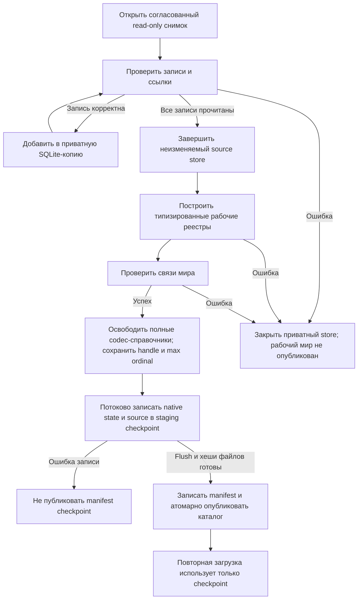

# Rust Week Performance Implementation Plan

> Уточнение пользователя от 14 октября 2026: приоритет — быстрый цикл «правка → результат»; 8–12 ГиБ допустимы. Для дальнейших полных прогонов верхний предел 12 ГиБ (12288 МиБ) заменяет прежние 4 ГиБ ниже. Исторические результаты и тестовые примеры не переписываются. Актуальное продолжение: `2026-10-14-alice-methods-adaptation-design.md` и план `2026-10-14-alice-profile-first.md` в соответствующих каталогах docs/superpowers.
> **For agentic workers:** REQUIRED SUB-SKILL: Use superpowers:subagent-driven-development (recommended) or superpowers:executing-plans to implement this plan task-by-task. Steps use checkbox (`- [ ]`) syntax for tracking.

**Goal:** Полный недельный расчёт с сохранением игровых правил: медиана ≤3 с, p95 ≤5 с, private committed memory ≤4 ГиБ, продолжение до 52 недель.

**Architecture:** Общие неизменяемые авторские данные и история; индексы вместо глобальных повторных обходов; одна транзакция недели с изменениями строк и вложенными точками отката. Существующие механики переводятся на чтение транзакционного представления последовательно, без полной материализации мира на каждой фазе. Проверки смысла, атомарность и повторяемость сохраняются.

**Tech Stack:** Текущий Rust/Cargo workspace, std, существующие serde/rusqlite/sha2; Windows PowerShell для внешнего наблюдения процесса. Новые зависимости не требуются по умолчанию.

**Spec:** `docs/superpowers/specs/2026-10-14-rust-week-performance-design.md` (согласована).

Статус плана: согласован и выполняется inline. Этапы 1–6 реализованы; этап 7 проходит общую проверку, этап 8 начат с исследования загрузки. Подробные RED/GREEN, исключения и решения: `work/rust-week-performance-2026-10-14/progress.md`. Приёмка полного мира (этапы 9–10) ещё не выполнена. Все пути ниже относительно `kingmaker-rust`.

## Global Constraints

- Игровые настройки, пустые приоритеты, количественные правила, авторские формулы, бюджетное расходование, права и порядок распределения дефицита сохраняются. Деньги по валютам и численность проверяются точно; количественные допуски не расширяются ради совпадения.
- Медиана ≤3 с и p95 ≤5 с: две серии по 10 недель из одного исходного снимка, workers=1, release. p95 — 19-е из 20 отсортированных измерений. Загрузка и сохранение измеряются отдельно.
- Пик private committed memory ≤4 ГиБ, включая загрузку/сохранение и продолжение до 52 недель. Working set и суммарные выделения — отдельные метрики.
- При удвоении сбалансированного размера фаз рост выделений после вычитания постоянного старта ≤2,5 раза. Проверяются склады, партии, заказы и история, а не только число покупателей.
- Не удалять историю, неизвестные исходные поля, обязательные квитанции или проверки устаревшего prepare. Не создавать бесплатные деньги, товары, труд или фиктивных владельцев.
- Единственный runtime: `../Проект карты Тейванкаля/data/kingmaker/runtime.json`. Проверочные недели не продвигают активную кампанию. После приёмки используется одна актуальная рабочая сборка.
- До продуктовых правок каждого этапа зафиксировать соответствующий RED; проходящие старые тесты сохранить. Старые JS проверки технического JSON заменять только с записанным обоснованием и проверкой того же игрового контракта.
- Нет Git-репозитория. Перед изменением сохранять только затрагиваемые исходники и manifest SHA256 в `work/rust-week-performance-2026-10-14/before/`; журнал `progress.md` содержит шаг, RED/GREEN, решения и команды. Не создавать фиктивные commits или новый Git-репозиторий. Не копировать гигабайтные checkpoints ради такой страховки.
- Gemini 3.8 Flash High через Antigravity — помощник для ограниченного исследования, черновиков и независимой проверки. Codex проверяет выводы и применяет изменения. При недоступности инструментов Gemini передавать ограниченные фрагменты текста; при недоступности самой модели продолжать локально.
- Дальнейшее усложнение, дополнительная горячая точка или изменение интерфейса фиксируются в журнале с причиной и ценой ошибки; критерии приёмки не понижаются автоматически.

## Review Focus

1. Неудачная аренда после предварительного освобождения места: следующая партия не получает вымышленную вместимость — Task 2.
2. Новый участник выборки или ранее отсутствовавший долг между prepare/apply: устаревший результат отвергается — Tasks 5–6.
3. Сбой после частичной записи журнала или утрата исходного кеша: checkpoint самодостаточен, неопубликованные события не засчитываются — Task 8.
4. Вложенная проба создаёт ID, людей, резерв и долг перед ошибкой: полный откат и отсутствие грязного чтения — Tasks 5–7.
5. Размер payload и длина ID растут при постоянном числе событий: bounded cache не скрывает неограниченный индекс или повторную копию истории — Tasks 4, 8–9.

## File Structure and Dependencies

Существующие файлы не разделяются ради косметики. Новые модули имеют отдельные роли:

| Файлы | Ответственность |
|---|---|
| `scripts/measure-native-performance.ps1`, `scripts/tests/measure-native-performance.tests.ps1` | Запуск и контроль только измеряемого процесса, private bytes/working set, пороги и результаты |
| `crates/kingmaker-sim/tests/performance_contract_test.rs`, `tests/common/allocation_meter.rs` | Малые сценарии фактических фаз, объём выделений и пик живых объектов |
| `crates/kingmaker-sim/src/storage.rs`, `food_conversion.rs` | Одна складская выборка на фазу, инкрементальные остатки |
| `crates/kingmaker-sim/src/market_index.rs`, `land_paths.rs` | Индексы спроса и ограниченный кеш направленных путей |
| `crates/kingmaker-core/src/row_store.rs`, `world_read.rs` | Типизированное чтение реестров, стабильные ключи, общие неизменяемые данные |
| `crates/kingmaker-core/src/history.rs`, `crates/kingmaker-io/src/history_store.rs` | Единая история и квитанции, чтение через bounded cache, дисковые сегменты |
| `crates/kingmaker-sim/src/world_transaction.rs`, `read_guard.rs` | Изменения строк, вложенный откат, проверяемая публикация |
| `crates/kingmaker-io/src/source_store.rs` | Неизменяемые исходные envelopes без обязательной полной загрузки JSON-деревьев |
| `crates/kingmaker-io/src/checkpoint.rs`, `sqlite_loader.rs` | Потоковый вход/выход и независимый checkpoint |
| `crates/kingmaker-cli/src/runner.rs`, `crates/kingmaker-sim/src/native_week.rs` | Управление неделей, отмена и измерения |

Новые модули экспортируются из соответствующих `lib.rs`; тестовые модули регистрируются рядом с существующими. Изменение Cargo.toml допускается для тестового binary/feature, если оно нужно измерителю; без отдельного benchmark framework.

Задачи связаны общим контрактом недели; это одна последовательная переработка. Законченная локальная оптимизация проверяется отдельно, но не заменяет итоговую приёмку.

### Task 1: Воспроизводимые измерения без повторного зависания машины

**Files:** создать измеритель и его проверки из таблицы; создать `performance_contract_test.rs`; использовать `work/memory-review-2026-10-14` как диагностическое свидетельство, не как тест всего рынка.

**Interfaces:** PowerShell `-Executable <path> -ArgumentFile <json-array-file> -OutputDirectory <new-dir> -PrivateLimitMiB 4096 -TimeoutSeconds <int>`. Выход `process.json` содержит exit_code, outcome, peak_private_bytes, peak_working_set_bytes и sampling_interval_ms; измеряет дочерний PID, созданный самим скриптом. JSON аргументы передаются как список, а не склеенная shell-команда.

- [ ] Написать проверки измерителя на малом helper-процессе: нормальное завершение; превышение памяти; timeout; чужой одноимённый процесс не завершается. Assertions: `outcome == "memory_limit"`, `peak_private_bytes > limit`, `foreign_process_alive == true`.
- [ ] Запустить `pwsh -NoProfile -File scripts/tests/measure-native-performance.tests.ps1`. Expected: RED из-за отсутствующего измерителя; затем реализовать измеритель и получить GREEN. Использовать наблюдение каждые 100 мс и Windows Job Object process-memory cap через штатный Win32 API; отказ ОС из-за лимита — провал прогона, а не успешный результат. Внешнее наблюдение не включать в замер аллокаций симуляции.
- [ ] Добавить regression fixtures заключительного рынка с реальным surplus и неизвестными полями, общей вместимостью и несколькими партиями. Зафиксировать функциональные assertions до оптимизации. Счётчик аллокаций измеряет весь действительный вызов фазы, а не только изолированную имитацию StorageBatch.
- [ ] Сохранить RED масштабирования на 128/256/512 объектах: `assert!(net_alloc_256 * 2 <= net_alloc_128 * 5)` и аналогично 512/256. Нулевой сценарий даёт вычитаемый startup; если net_alloc ≤0, измерение ошибочно. Этот тест остаётся RED до Task 2; остальные проверки Task 1 GREEN.
- [ ] Сохранить результаты, версии инструментов и hashes исходников в журнал. Тяжёлый полный baseline повторно не запускать; старый сбой остаётся исходным свидетельством.

### Task 2: Инкрементальные склады в surplus

**Files:** изменить `storage.rs`, `food_conversion.rs`; адаптировать вызовы StorageBatch в `production.rs`, `production_feasibility.rs`, `market_clearing.rs`, `labor_forecast.rs`, `shipment_actions.rs`, `shipment_arrivals.rs`, `shipment_dispatch.rs`; тесты `storage_production_test.rs`, `performance_contract_test.rs`, `tests/internal/food_conversion_native.rs`.

**Interfaces:** `StorageBatch<'w>::new(s: &OperationSession<'w>) -> OpResult<StorageBatch<'w>>`; `facilities` содержит ссылки на определения базового мира, а не глубокие копии. Добавить `checkpoint_facility(&self, id: &ExternalId) -> OpResult<FacilityCheckpoint>` и `restore_facility(&mut self, checkpoint: FacilityCheckpoint)`; checkpoint включает изменяемый остаток и признак invalid, но не копию определений. Существующие `reserve_storage`, `consume_storage`, `release_storage`, `availability`, `adjust` сохраняют смысл.

- [ ] Написать RED: две конверсии одного склада делят реальную вместимость; rejected reserve после `adjust` не освобождает сырьё для следующего запроса; оплаченная частичная аренда возвращает только неиспользованную часть; неизвестная единица остаётся отказом. Assertions: совпадают quantities/fees/debts с ранее закреплёнными ожиданиями; нет отрицательного остатка и двойного возврата.
- [ ] Запустить `cargo test -p kingmaker-sim --test performance_contract_test --test storage_production_test --locked`. Expected: зафиксирован масштабный RED Task 1 и отдельный RED новых требований к API; старые игровые проверки проходят.
- [ ] Перенести построение batch на границу surplus; обновлять остатки после успешных действий, восстанавливать локальную поправку после отказа. Не хранить копию всех запасов только ради обхода: зафиксировать список подходящих ID и читать текущую запись перед действием.
- [ ] Повторить команду и `cargo test -p kingmaker-sim --test warehouse_capacity_test --test market_differential_test --locked`. Expected: всё GREEN, рост выделений ≤2,5; исходные правила частичного исполнения/прав сохранены.
- [ ] Сохранить hash набора изменённых файлов и RED/GREEN в журнал.

### Task 3: Индексы заказов и переиспользуемые пути

**Files:** создать `market_index.rs`, `land_paths.rs`; изменить `food_conversion.rs`, `market_inputs.rs`, `market_policy.rs`; создать `market_path_scaling_test.rs`.

**Interfaces:** `OrderIndex<'a>::new(orders: &'a [MarketOrder], scope: &MarketScope) -> Self`; `raw_orders(&self, location: &MarketLocation, goods: &ExternalId) -> &[usize]`, `food_orders(&self, currency: &ExternalId, goods: &ExternalId) -> &[usize]` возвращают индексы в исходном порядке. `LandPathIndex::new(data: &MarketData, cache_byte_limit: usize) -> OpResult<Self>`; `path(&mut self, from: ProvinceId, to: ProvinceId) -> OpResult<Option<Arc<[ProvinceId]>>>`. Лимит кеша 16 МиБ на фазу; FIFO eviction; определения графа не копируют произвольные extra. Старый `find_land_path` — обёртка для самостоятельного вызова, внутренние циклы используют индекс.

- [ ] Написать RED: одинаковая пара не пересобирает граф; A→B не подразумевает B→A; острова и водные связи не становятся сухопутными; порядок маршрута и дефицитных покупателей прежний. Assertions: `path(A,B)==expected`, `path(B,A)==None`, экономические balances/stocks совпадают с fixture; кеш не превышает лимит после тысяч пар.
- [ ] Запустить `cargo test -p kingmaker-sim --test market_path_scaling_test --locked`; Expected: RED на новых API/повторных построениях.
- [ ] Внедрить индекс, прекратить BFS после нахождения нужного пути, переиспользовать результат внутри фазы. При проверке сырьевого спроса использовать текущие деньги и остатки, а не замороженный при построении индекса бюджет. Кеш пути не кеширует оплату, вместимость и доступный транспорт.
- [ ] Запустить новый тест, `market_differential_test`, `market_input_orders_test`, `migration_path_test`, `physical_supply_test`. Expected: GREEN и стабильные игровые результаты.

### Task 4: Общее чтение данных и единая история

**Files:** создать `core/src/row_store.rs`, `world_read.rs`, `history.rs`, `io/src/history_store.rs`; изменить `core/src/state.rs`, `operations.rs` и контейнеры `production.rs`, `market.rs`, `budget.rs`, `labor.rs`, `mobility.rs`, `transport.rs`, `income.rs`, `construction.rs`, `week.rs`; создать `core/tests/shared_state_test.rs`, `io/tests/history_store_test.rs`.

**Interfaces:** `RowRead<K,T> { fn get(&self, key: &K) -> Option<&T>; fn iter(&self) -> Box<dyn Iterator<Item=(&K,&T)> + '_>; }`; `RowTable<K,T>` — опубликованное индексированное хранение с одним ключом записи и разделяемыми неизменяемыми строками. `WorldRead` предоставляет `campaign() -> &CampaignHeader`, типизированные RowRead для активных реестров и заимствованные авторские каталоги. Методы реестров называются по прежним полям: `accounts`, `pops`, `stockpiles`, `factories`, `artisans` и остальные из `WorldState`. Ключи: AccountAddress для счетов, ProvinceId для провинций, ExternalId для сущностей/событий; singleton-настройки имеют фиксированное имя поля. Все поля WorldState перечислить в `work/rust-week-performance-2026-10-14/state-field-inventory.md` с категорией author/state/history/derived и стратегией изменения; непокрытое поле блокирует Task 5.

На этом шаге новые контейнеры и traits вводятся рядом с заимствующим адаптером существующего WorldState. Не переключать все публичные Vec одномоментно и не ломать компиляцию неперенесённых потребителей: переключение выполняется совместно с Tasks 6–8. Зависимость io dev-tests от sim учтена — компилируется весь workspace после каждой смены публичного типа.

`HistoryKey { namespace: String, id: ExternalId }`, `HistoryRecord { key: HistoryKey, value: Value }`, `HistoryError`; `HistoryRead::get(&self, key: &HistoryKey) -> Result<Option<Arc<HistoryRecord>>, HistoryError>`; `scan(&self) -> Box<dyn Iterator<Item=Result<Arc<HistoryRecord>,HistoryError>> + '_>`. `HistoryStore::open(path: &Path, cache_byte_limit: usize) -> Result<Self, HistoryError>` реализован в IO с уже имеющимся SQLite, стабильным typed key и дисковым индексом. Кеш payload+ключей ограничен 64 МиБ, не загружает все ключи в RAM. Core знает только trait, не rusqlite. Малые fixtures используют эквивалентное хранение в памяти.

- [ ] Написать RED: заимствованное чтение не клонирует крупные extra; числовой 1 и строковый "1" различаются; повторный event не заменяет несовпадающее содержимое; квитанции разрешаются по ссылкам. Assertions: `Arc::ptr_eq` для одной неизменяемой записи; `get(number)!=get(string)`; конфликт вызывает ошибку.
- [ ] Написать RED роста истории: при фиксированном working set увеличение числа старых записей и размера payload не создаёт дополнительную RAM-копию всей истории. `assert!(cache_bytes <= 64*1024*1024)`; чтение вытесненной записи возвращает прежнее содержимое.
- [ ] Запустить `cargo test -p kingmaker-core --test shared_state_test -p kingmaker-io --test history_store_test --locked`; Expected: RED, затем реализовать интерфейсы и получить GREEN. Добавить ручную Serialize/Deserialize или DTO-переход на границе IO, без преобразования всего мира в Value.
- [ ] Реализовать представление квитанций через ключи/доказательства и HistoryRead; переключение существующих квитанций провести с их фазами в Tasks 6–7. До переключения всех фаз возможен читающий адаптер старых Vec, но он не делает полного `.collect()` и удаляется с продуктивного пути к Task 7.

### Task 5: Транзакция записей, точки отката и read guards

**Files:** создать `sim/src/world_transaction.rs`, `read_guard.rs`, `tests/world_transaction_test.rs`, `tests/read_guard_test.rs`; использовать типы Task 4.

**Interfaces:** `WorldTransaction<'w>::new(base: &'w dyn WorldRead) -> Self`, `savepoint(&mut self) -> Savepoint`, `rollback_to(&mut self, mark: Savepoint) -> OpResult<()>`, `finish(self) -> OpResult<PreparedWorldDelta>`; WorldTransaction реализует WorldRead. Изменения типизированы по реестрам: `put_account(AccountAddress, AccountBalance)`, `put_stock(ExternalId, StockpileRecord)`, и соответствующие put/remove остальных изменяемых реестров из inventory. `apply_world_delta(world: &mut WorldState, delta: PreparedWorldDelta) -> OpResult<()>`; поля delta и Savepoint закрыты от изготовления извне.

`PreparedWorldDelta` владеет новыми строками и guards, но не заимствует базу. `PreparedWorldDelta::view<'a>(&'a self, base: &'a dyn WorldRead) -> PreparedWorldView<'a>` даёт read-only WorldRead для проверки и метрик до публикации. Временное представление отпускается до mutable apply; нельзя держать immutable borrow мира внутри подготовленного результата и одновременно требовать `&mut` того же мира.

ReadGuard хранит прочитанные значения/потоковые hashes без глубоких копий, отсутствующие ключи и состав значимых выборок. Для хеширования применяется существующий sha2; hash не подменяет проверку полномочий. Прямые mutable поля активного состояния закрываются за API, версии ускоряют проверки только после этого. Начальная интеграция при сомнении проверяет содержимое; не полагается исключительно на revision.

- [ ] Написать RED: read-your-writes; вложенный откат удаления/создания/обновления; восстановление IDs, долгов, резервов, счетов, событий и кешей; stale value, absent key и phantom insertion. Assertions: после rollback экономическое состояние и следующий ID равны начальному; после посторонней вставки `apply_world_delta(...).is_err()` и мир остаётся посторонне изменённым, а не откатывается к снимку.
- [ ] Запустить `cargo test -p kingmaker-sim --test world_transaction_test --test read_guard_test --locked`; Expected: RED, затем GREEN после реализации.
- [ ] Проверить подготовку commit: все проверяемые ошибки возникают до замены опубликованных корней таблиц; не использовать fallible apply по одной строке с возможным частичным commit. Необходимая память выделяется до точки публикации. `finish` не материализует полный глубокий WorldState.
- [ ] Добавить scaling assertion: одна изменённая строка с неизменной длиной ключа не копирует payload остальных 10 000 строк; измеряется объём аллокаций delta отдельно от начальной загрузки.

### Task 6: Перевести сессии, склады, производство и рынок на транзакцию

**Files:** изменить `operation_session.rs`, `market_operations.rs`, `production*.rs`, `storage.rs`, `food_conversion.rs`, `market*.rs`, `needs.rs`, `budget*.rs`, `service_payroll.rs`, `labor*.rs`, `local_hiring.rs`; тесты существующих фаз плюс `tests/session_history_scaling_test.rs`.

**Interfaces:** `OperationSession::new(base: &dyn WorldRead) -> OpResult<Self>`; `finish(self) -> OpResult<PreparedChanges>` возвращает изменения без заимствования исходного view, затем `WorldTransaction::apply_phase(&mut self, changes: PreparedChanges) -> OpResult<()>` применяет их атомарно. Это два отдельных вызова: сессия должна отпустить immutable borrow до mutable изменения транзакции. Внутренние фазовые входы получают `&mut WorldTransaction` и request, возвращают прежний тип receipt. Самостоятельные публичные execute/prepare/apply создают корневую транзакцию и используют `PreparedWorldDelta`; недельный вызов корень не создаёт. HistoryRead Task 4 заменяет `known: HashMap<ExternalId, Value>` полной истории.

- [ ] Зафиксировать RED на размере history: создание сессии при удвоении числа старых событий не копирует их payload; весь нынешний `MarketReadSet::capture` не появляется как дублирующий снимок внутри недели. Добавить poison/failed-phase regression.
- [ ] Выполнить перенос по семействам: операции/склады → производство → рынок/потребности → бюджеты/труд. После каждого семейства запускать его существующие тесты; не менять количественные assertions. Borrow-checker исправлять адаптацией чтения и владельцев, а не возвратом full-world clone.
- [ ] Проверка: `cargo test -p kingmaker-sim --locked`. Expected: все старые проверки GREEN плюс новые guards/history/scaling; временные адаптеры читают актуальные overlays.
- [ ] Сопоставить inventory со всеми мутациями перенесённых фаз; запись в прежний Vec в обход транзакции считается незавершённым переносом.

### Task 7: Перевести вложенные фазы и собрать одну транзакцию недели

**Files:** изменить `income_cycle.rs`, `artisan_working_capital.rs`, `investments.rs`, `construction_cycle.rs`, `construction_payroll.rs`, `construction_cancellation.rs`, `mobility_cycle.rs`, `cohort_cycle.rs`, `profession_cycle.rs`, `migration_cycle.rs`, `shipment_arrivals.rs`, `shipment_actions.rs`, `physical_supply.rs`, `raw_procurement.rs`, `local_food_reserves.rs`, `native_week.rs`, `week_invariants.rs`, `week_metrics.rs`; соответствующие вызываемые helpers переводятся вместе с владельцем фазы.

**Interfaces:** сохраняются наблюдаемые prepare/apply/replay контракты native_week. `PreparedNativeWeek` содержит PreparedWorldDelta и NativeWeekReceipt, а не два WorldState. `preview<'a>(&'a self, base: &'a dyn WorldRead) -> Option<(PreparedWorldView<'a>, &'a NativeWeekReceipt)>` возвращает read-only представление Task 5 для метрик; runner адаптируется к дополнительному аргументу. Добавить `RunControl::check(&self) -> OpResult<()>`; существующие callbacks прогресса адаптируются к нему. Чек отмены до фазы и не реже чем через 256 обработанных записей/рёбер долгого цикла; после отмены не исполняются новые операции.

- [ ] Написать RED `whole_week_has_one_overlay_and_no_deep_world_snapshots`, `cancel_inside_surplus_keeps_published_world`, `nested_artisan_failure_restores_all_registry_kinds`. Assertions: снимок игровых данных, receipts, next-ID и история после ошибки равны исходным; отмена наблюдается до окончания всего входного массива.
- [ ] Заменить вложенные клоны точками отката. Перевести capture_income_opening на минимальные необходимые исходные показатели. В метриках читать только нужные агрегаты и новые операции, не копировать весь старый мир/журнал.
- [ ] Запустить `cargo test -p kingmaker-sim --test native_week_test --test native_week_history_test --test world_transaction_test --test performance_contract_test --locked`, затем весь sim. Expected: GREEN; повтор периода и устаревший prepared не публикуются; перенос ПОПа и строительство обновляют индексы.
- [ ] Проверить поиск `.clone()` по WorldState и `.to_value(world)` в продуктивном недельном пути; оставшийся вызов должен иметь измеренное ограниченное назначение и запись в журнале, иначе удалить. Полное копирование мира в тесте для проверки отката допустимо.

### Task 8: Ограниченная загрузка и самостоятельные checkpoints

**Files:** создать `io/src/source_store.rs`; изменить `sqlite_loader.rs`, все `*_projection.rs`, `checkpoint.rs`, `codec.rs`, `economic_comparison.rs`; изменить `core/src/state.rs`, `history.rs`; тесты `io/tests/checkpoint_test.rs`, `history_store_test.rs`, `source_store_test.rs`, `cli/tests/runner_test.rs`.

**Interfaces:** `SourceRead::record(&self, table: &str, key: &str) -> Result<Option<Arc<StoredRecord>>, SourceError>` и потоковый `scan(table)`; raw source хранится неизменяемо с ограниченным кешем 64 МиБ. `SqliteLoader::load_from_path` и `load_checkpoint` сохраняют тип возвращаемого WorldState, но он содержит разделяемые store handles. `save_checkpoint(world, path, identity)` сохраняет текущие typed rows и необходимые независимые source/history stores в staging directory. Manifest schema=2; читатель schema=1 поддерживает конкретный согласованный входной снимок потоково, не становится framework миграций.

- [ ] Написать RED: checkpoint загружается после удаления только созданных тестом исходной БД и кеша; сохраняет неизвестные поля/typed IDs; продолжение после перезапуска эквивалентно непрерывному; неопубликованный history segment не признаётся commit; порча или пропуск обязательного сегмента явно отвергаются.
- [ ] Запустить `cargo test -p kingmaker-io --test checkpoint_test --test source_store_test --test history_store_test --locked`; Expected: RED, затем GREEN.
- [ ] Сделать projection потоковым: использовать текущую запись, извлекать нужные типизированные поля, разделять повторяющиеся справочники, не держать второе полное декодированное дерево. Ссылки shared/dictionary резолвятся с сохранением типов. Существующие author fields остаются доступны через backing store.
- [ ] Сохранять manifest только после flush/закрытия/проверки файлов. При переносе SQLite stores использовать штатный backup или корректный закрытый snapshot; не копировать открытую БД без WAL. Публиковать директорию атомарным rename. Старый checkpoint при ошибке остаётся валидным.
- [ ] Запустить `cargo test -p kingmaker-io -p kingmaker-cli --locked`. Expected: GREEN включая две недели новым процессом; нет обязательной зависимости от пути исходной базы или временного каталога.

### Task 9: Полный мир, профиль и устранение оставшихся ограничений

**Files:** изменить runner и измеритель Task 1; добавить `scripts/summarize-native-performance.ps1`, `scripts/tests/summarize-native-performance.tests.ps1`; результаты в `reports/rust-week-performance-2026-10-14/`.

**Interfaces:** summarizer читает process.json и текущие недельные timings, выдаёт `acceptance.json`: complete_samples, median_ms, p95_ms, peak_private_bytes, load_ms, save_ms, invariant_failures, continuation_passed, accepted. `accepted` true только при полном наборе измерений, отсутствии нарушений и всех лимитах; незавершённая серия — false. Для 20 значений median=(sorted[9]+sorted[10])/2, p95=sorted[18].

- [ ] Написать RED summarizer: 19 недель не принимаются; отказ по памяти не считается нулевым временем; 20 значений с p95>5000 отвергаются; exact boundary 4096 МиБ принимается только при остальных успешных условиях. Assertions: `accepted == false` для неполных/ошибочных серий.
- [ ] Выполнить `pwsh -NoProfile -File scripts/tests/summarize-native-performance.tests.ps1`; Expected: RED, затем GREEN. Запустить все тесты debug и release, собрать `cargo build --release --workspace --locked` до полного мира.
- [ ] Сначала проверить загрузку и один полный ход под лимитом. Аргументы CLI: `--runtime ../Проект карты Тейванкаля/data/kingmaker/runtime.json --run-weeks 1 --output <new-run>`; передавать как JSON-массив в измеритель, чтобы пробелы/кириллица не сломали команду. Использовать фактический release EXE из Cargo target-directory, ещё не `bin/`.
- [ ] Если предел или время не достигнуты: снять профиль только контролируемого процесса; определить доминирующую фазу/аллокации; добавить RED сценарий соответствующего масштаба; исправить причину, повторить затронутые тесты и этот этап. Не ускорять пропуском фаз, проверок или расходов.
- [ ] Две независимые серии по 10 недель из зафиксированного одинакового initial; затем продолжить первую серию ещё на 42 недели новым процессом через `--resume <first-final> --run-weeks 42 --output <new-continuation>`. Проверить согласованность 52 недель с текущими инвариантами. На контрольной неделе сравнить непрерывное и перезапущенное продолжение, включая события, долги и резервы.
- [ ] Expected: 20/20 замеров, медиана≤3000 мс, p95≤5000 мс, peak≤4294967296 байт за все этапы и год, zero invariant failures, successful continuation. Записать фазовые времена, размеры истории и private bytes по неделям, условия машины и hashes. Ни один пункт не заменяется результатами миниатюр.

### Task 10: Итоговая проверка и актуальный рабочий запуск

**Files:** актуализировать `README.md`, `reports/rust-week-performance-2026-10-14/report.md`, diagrams затронутых процедур; проверить адаптированные потребители `crates/kingmaker-server/src/state.rs`, `routes.rs`, `main.rs`; опубликовать прошедшие проверки `bin/kingmaker-cli.exe` и `bin/kingmaker-server.exe`; launcher/runtime изменяются только при необходимости фактического нового формата, без смены выбранной кампании. Серверные обращения к контейнерам исправляются при смене типов в Tasks 6–8; этот этап проверяет интеграцию, не откладывает compile errors до конца.

**Interfaces:** журнал содержит полный перечень решений и снятых технических assertions с заменяющими экономическими тестами; report ссылается на эту спецификацию, план и acceptance.json. Запуск использует ровно проверенный SHA256 executable.

- [ ] Провести финальное независимое ревью по диффу относительно сохранённых исходников и Review Focus. По умолчанию выполнить inline-работу Codex с помощью Gemini; финальное ревью организовать по executing-plans и пользовательским правилам. Недоступность отдельного проверяющего явно записать, не выдавать самопроверку за независимую.
- [ ] Для каждого существенного замечания: RED→исправление→GREEN и затронутый набор; изменение горячего пути требует повторить релевантные полные измерения. Все замечания и решения записать в отчёт.
- [ ] Финальные команды: `cargo test --workspace --locked`, `cargo test --workspace --release --locked`, `cargo build --release --workspace --locked`. Expected: GREEN; сборка для публикации совпадает с измеренной по исходникам и настройкам. Не запускать прежние тестовые бинарники как доказательство новой сборки.
- [ ] Сохранить прежние bin и hashes в диагностический before; опубликовать новые файлы и проверить launcher и чтение выбранной кампании. Если работающий процесс удерживает EXE, сначала установить его точную принадлежность и сохранить завершённое состояние, затем корректно перезапустить; чужие процессы не останавливать.
- [ ] Передать краткий отчёт: реальные времена/память, полнота 52 недель, ограничения, spec/plan paths, роль Gemini. Если acceptance.json не accepted, не объявлять цель достигнутой и не выдавать локальную оптимизацию за законченный перенос.

## Plan Self-Review and Handoff

Проверка покрытия: контракты/измерения — Tasks 1–3; общие данные и сохранная история — Task 4; атомарность и устаревшее чтение — Tasks 5–7; полный вход/выход — Task 8; все численные критерии — Task 9; рабочая сборка — Task 10. Все пять Review Focus имеют regression cases. Core содержит абстракции хранения, IO — реализацию, sim — транзакции; циклической зависимости core→io нет. Временные адаптеры не разрешают глубокие копии на финальном пути.

Самопроверка исправила потенциальный конфликт immutable/mutable borrow при завершении сессии и preview; переключение контейнеров теперь явно согласовано с переносом потребителей. Gemini дал компактный разбор порядка задач и риска `.collect()`/tombstones; его предложения о побитовом baseline, старом 52-недельном прогоне и сохранении незавершённых фаз отклонены как противоречащие согласованной цели. Удалённая запись не должна снова появляться при объединённом обходе базы и overlay; это assertion Task 5.

Рекомендуемый способ исполнения: **inline в текущем чате**, Codex применяет изменения и выполняет интеграцию, Gemini помогает ограниченными исследованиями/черновиками/ревью. Причина: задачи последовательно меняют общий интерфейс состояния; раздача реализации независимым агентам увеличит риск несовместимых решений. Альтернатива — subagent-driven с отдельным исполнителем и проверяющим каждого этапа, с дополнительными затратами на контекст.

Следующий шаг после проверки пользователем этого плана и выбора способа исполнения — executing-plans для inline либо subagent-driven-development для выбранной альтернативы. Код продукта до этого шага не изменяется.

### Уточнение исполнения Task 8: исходные данные и справочники

Исходные envelopes, dictionary и shared сохраняются в одной приватной неизменяемой SQLite-копии. Во время первичного projection codec использует общие справочники в памяти; после построения рабочих реестров они освобождаются, а источник читается через дисковый интерфейс. Максимальный ordinal справочника остаётся в метаданных и участвует в выдаче новых внутренних ID. Общий кеш источника 64 МиБ делится между raw records и decoded references. Авторские расширения рабочих записей используют разделяемые значения с copy-on-write; содержимое формул, пустых настроек, количеств и JSON-типов сохраняется.

Это уточнение не означает завершение архивирования истории: подключение immutable history, schema=2 и полный 52-недельный замер остаются отдельными обязательными проверками.
