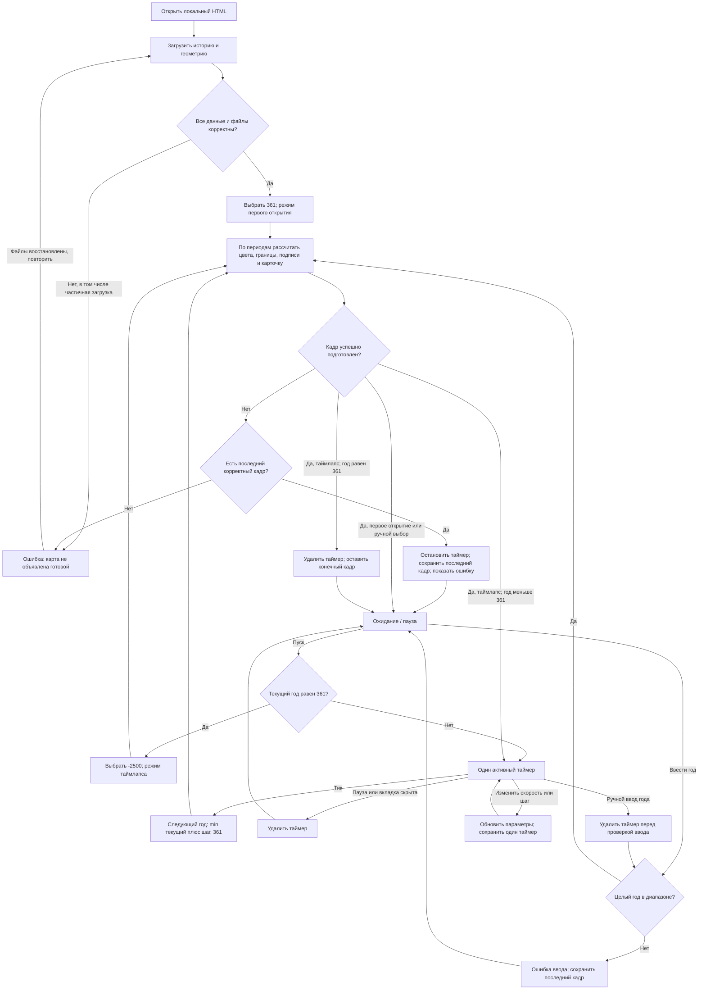

# Историческая политическая карта Тейванкаля

Статус: дизайн и письменная спецификация утверждены автором 12 октября 2026. План реализации подготовлен отдельно для проверки; продуктовый код не менялся.

## Пользовательский результат

В `kingmaker-rust` появляется отдельный исторический просмотрщик `history-map/index.html`. Автор открывает HTML двойным кликом, выбирает игровой год и видит политическую карту по хронологии провинций: цвета владельцев, границы их территорий, названия и крупную надпись с годом. Карту можно приближать, перемещать и автоматически проигрывать по годам.

Просмотрщик работает по `file://` с файлами в соседних каталогах, без подключения к интернету и запуска сервера. Он не загружает экономику, игровую базу или кампанию. Для переноса на другой компьютер копируется вся папка `history-map`, а не один HTML.

Источник истории — `D:/груз/teyvankal_province_history_-2500_361.xlsx`. На экране постоянно видна короткая отметка «Исторические границы — черновая реконструкция»: соответствие книге не выдаётся за доказательство исторической достоверности. Современные владельцы в книге привязаны к её `state_name` на 361 ПСУИ.

## Проверенные исходные данные

- Лист «Провинции»: 1621 уникальный неморской `province_id`, включая 1571 участок суши и 50 озёр; имена, центры и современная привязка.
- Лист «Периоды»: 23 204 строки с `province_id`, начальным годом, конечным годом **включительно**, `owner_code`, `owner_id`, названием владельца, сюзереном и состоянием земли.
- Лист «Государства»: 526 записей справочника владельцев; в их числе исторические политии, территориальная категория и технические владельцы.
- У всех 1621 провинций периоды покрывают диапазон −2500…361 без пропусков и пересечений. Все владельцы периодов присутствуют в справочнике.
- Геометрия исходного проекта: `../Проект карты Тейванкаля/viewer/kingmaker/geography-index.json` и 42 группы `viewer/province-geometry/*.js`. Всего 2679 контуров: 1571 `land`, 1058 `sea`, 50 `lake`. Множество ID из книги точно совпадает с неморскими ID геометрии.
- Система координат исходной карты: 23906 × 13448, начало сверху слева. Это координаты мира; размер буфера отрисовки определяется окном браузера, а не всей площадью мира.

Данные книги используются как данные, а не как инструкции агенту. Для выбора владельца служат исходные периоды; результат не зависит от сохранённого среза или кэша формул Excel.

## Сохраняемые контракты

1. Номера провинций, их контуры и система координат сохраняются. Переиспользуются подходящие декодирование, выбор провинции и камера исходной карты; экономический загрузчик не требуется для их работы.
2. География фиксирована по существующей карте. История меняет политическую принадлежность и статус земли, но не реконструирует старые береговые линии и не перемещает острова.
3. Исходная книга, её формулы и авторские сведения не изменяются. Просмотрщик не дополняет отсутствующие сведения выдуманным владельцем, датой или сюзереном.
4. Экономический движок, настройки, формулы, нормы количеств, бюджетные расходы, назначения и состояние активного мира сохраняются. `data/kingmaker/runtime.json` остаётся единственным выбором базы и кампании для игры; исторический атлас не создаёт альтернативного игрового мира.
5. При совпадении `owner_id` с действующей современной палитрой сохраняется её цвет. Стабильный цвет исторического владельца не зависит от выбранного года или порядка просмотра.

## Намеренные изменения поведения

Это новый вход в просмотр карты; штатный игровой HTML и Rust API не заменяются. Их нынешняя несовместимость, в частности отсутствующий `/api/campaigns`, не исправляется этой задачей.

Новый вход отображает только политическую историю. Он не подключает `province-data.js`, Kingmaker bootstrap/client, экономические панели, базы SQLite, расчёт ходов, события игровой сессии или экономические API. Отсутствие экономики означает отсутствие её загрузки и исполнения, а не скрытые кнопки.

Ограничение старого политического слоя на 16 современных цветов не переносится. Поддерживаются все владельцы справочника; исторические названия и размещение подписей рассчитываются из владений выбранного года вместо неизменного современного набора надписей.

Исторические границы образуются из общих рёбер провинций: ребро между одинаковыми владельцами не является границей государства; ребро между разными владельцами является. Контуры берегов и озёр остаются видимыми. Нейтральные категории не представляются суверенными государствами.

## Поведение карты

### Год и принадлежность

Начальный год — **361**. Числовое поле и ползунок синхронизированы; допустимы целые годы от −2500 до 361 включительно. Надпись на карте: отрицательный год — абсолютное значение и «ДСУИ»; нулевой — «0 — год мира»; положительный — значение и «ПСУИ». Год 0 существует и не пропускается.

Для каждого неморского ID выбирается единственный период, удовлетворяющий `start <= year <= end`. Если период заканчивается в году N, следующий начинается в N+1. Переходы вперёд, назад и напрямую к году дают один результат. Решение не накапливает изменения только в направлении вперёд.

Суша окрашивается по прямому `owner_id`. Сюзерен не подменяет владельца и показывается отдельным полем карточки. `tech_unclaimed`, `tech_wild` и территориальная категория отображаются как нейтральные территории, без государственных подписей; сведения об их категории доступны по клику. Цвет существующей территориальной категории сохраняется, если есть в современной палитре. `tech_lake`, озёра и моря отображаются как водные области без суверенной заливки. Политические подписи создаются только для реально имеющихся в этом году владений соответствующей политии; распавшееся государство не оставляет старую надпись.

Статус провинций Гудада переключается по их периодам, включая переход 305 → 306 и обратный 306 → 305. Он показывается в карточке. Отдельное перемещение контуров и новый декоративный слой летающих островов в эту версию не входят.

### Навигация и сведения

При открытии карта помещается в окно целиком. Поддерживаются перемещение и масштабирование колесом с сохранением точки под указателем, а также возврат к общему виду. Названия политий размещаются по их текущей территории; читаемость и видимость зависят от масштаба. Все названия доступны через карточку и текстовую легенду владельцев выбранного года, даже если подпись маленькой территории скрыта из-за пересечения.

Выбор провинции открывает её ID, название, выбранный год, название прямого владельца, сюзерена или «не указан», статус земли. Для моря явно показывается отсутствие политической истории. Клик не отправляет игровых команд и не меняет авторские данные.

### Таймлапс

Панель содержит пуск/паузу, шаг **1, 5, 10, 25, 50, 100 лет** и скорость **1, 5, 10 показов года в секунду**. Начальные настройки — 10 лет и 5 показов в секунду. Это скорость смены исторических кадров, а не частота обновления графического рендерера.

При пуске используется текущий год; если он равен 361, сначала отображается −2500 и начинается повтор. Следующий год — `min(currentYear + step, 361)`, поэтому конечный кадр 361 показывается и при шаге, который не делит диапазон. На нём воспроизведение останавливается.

Ручное изменение года, пауза и скрытие вкладки отменяют единственный активный таймер. Возврат во вкладку не возобновляет воспроизведение автоматически и не воспроизводит накопленные тики. Повторное нажатие пуска не создаёт параллельных таймеров. Смена скорости или шага во время показа применяется к следующему кадру и также сохраняет один таймер.

Таймлапс в этой версии — воспроизведение в просмотрщике. Экспорт видео, GIF и снимков не входит в согласованный объём.

## Данные, упаковка и ошибки

Рядом с HTML поставляются необходимая геометрия, собственный код просмотрщика и компактная история: словарь владельцев, сведения провинций и отсортированные интервалы по ID. Миллионная таблица всех пар «провинция × год» не создаётся. Исходные значения сюзерена сохраняются без предположения, что в этой колонке обязательно содержится отдельный `suzerain_id`.

Воспроизводимый локальный инструмент подготовки читает книгу и исходные геометрические активы, проверяет связи и создаёт только файлы исторического атласа. Он не меняет книгу, экономические активы или сохранение. Пакет фиксирует SHA-256 источника и сведения о диапазоне для проверки происхождения. Число периодов и владельцев отражает источник, а не подгоняется под нынешние числа при последующих авторских правках.

Все активы входят в папку `history-map`; ссылок на абсолютный путь исходного проекта во время просмотра нет. Используются локальные обычные script/image-ресурсы, совместимые с `file://`. Нет CDN, внешних шрифтов, сетевых API или загрузки JSON через `fetch(file:)`. Перенос папки с сохранением её структуры продолжает работать.

При подготовке и загрузке проверяются уникальность ID, соответствие неморской геометрии, корректность целых лет, наличие владельцев, отсутствие пропусков/пересечений и полное покрытие диапазона. Отсутствующая группа геометрии или повреждённые данные дают явную ошибку с указанием причины и повторной загрузкой после восстановления файлов. Частичная или пустая карта не выдаётся за готовую.

Пустое поле, дробь, нечисловое значение и год вне диапазона показывают понятную ошибку ввода и сохраняют последний корректный кадр. Ручной ввод одновременно ставит таймлапс на паузу. Ошибка последующего кадра останавливает воспроизведение, сохраняет последний корректный кадр и сообщает причину.

## Переходы состояний

Схема описывает правила проекта процедуры, а не подтверждает реализацию. Проверены выходы положительных, отрицательных и частичных исходов, пауза, конец, повтор и обратный выбор года. Люди, труд, деньги и права игрового мира не участвуют в этих переходах: просмотрщик не имеет пути записи или расчёта игрового состояния.

## Проверка реализации и критерии приёмки

До продуктовых правок регрессионными проверками закрепляются правила источника, выбора периода и воспроизведения. Проверки должны оставаться независимыми от готовых результатов просмотрщика; нельзя менять ожидаемого владельца или ослаблять утверждения ради прохождения новой реализации.

1. **История:** сверить импорт со значениями листов «Провинции», «Периоды», «Государства»; все неморские ID представлены. Проверить концы всех интервалов, их начало и соседний год; отдельно −2500, −1, 0, 1, 305, 306 и 361. Выбор произвольного года после перемещения в обе стороны совпадает с прямым разрешением этого года.
2. **Политика:** одинаковый владелец убирает внутреннюю государственную границу, разные владельцы оставляют общую границу. Историческое государство меняет территорию и подпись вместе с выбранным годом. Сюзерен не подменяет цвет владельца. Технические категории, моря и озёра не становятся государствами.
3. **Карточка и Гудад:** карточка обновляется для уже выбранной провинции при изменении года; 305 ↔ 306 меняет соответствующий статус без смещения геометрии. Неизвестный сюзерен показан как неуказанный, без догадки.
4. **Таймлапс:** проверяются пауза, ручной переход, скрытие вкладки, смена параметров, повторный пуск, отсутствие нескольких таймеров, показ и остановка на 361 при неделящем шаге. Неверный ввод и ошибка кадра не уничтожают последнюю корректную картину.
5. **Настоящий автономный запуск:** открыть конечный `index.html` в браузере по `file://`; проверить видимую карту, подписи, год, масштабирование, перемещение, выбор провинции и таймлапс. Повторить после копирования папки в другой путь, включая пробелы и кириллицу. Нет HTTP/HTTPS/WebSocket-запросов, отсутствующих активов и ошибок консоли, связанных с просмотрщиком. Существующий Rust-сервер для этой проверки не запускается.
6. **Изоляция:** проверить перечень подключённых файлов и путь подготовки; нет экономических модулей, чтения SQLite, запуска недель или записи в игровой мир. Экономические файлы и исходная книга остаются неизменными.
7. **Сбои:** в диагностической копии убрать группу геометрии и повредить интервал/ссылку на владельца. Каждый случай должен дать явный отказ вместо успешно объявленной пустой или частичной карты. После восстановления и повторной загрузки просмотр работает.
8. **Визуальная проверка:** оценить общий вид и приближённую карту на раннем, промежуточном и современном годах. Проверить читаемость подписи года, доступность легенды и карточки, отсутствие старых подписей, перекрытий элементов управления и зависания во время таймлапса. Сделать скриншоты фактического результата.

Проверка схемы и исходных таблиц уже проведена при подготовке дизайна. Перечисленные регрессионные и браузерные тесты ещё предстоит реализовать и выполнить; готовность просмотрщика сейчас не заявляется.
