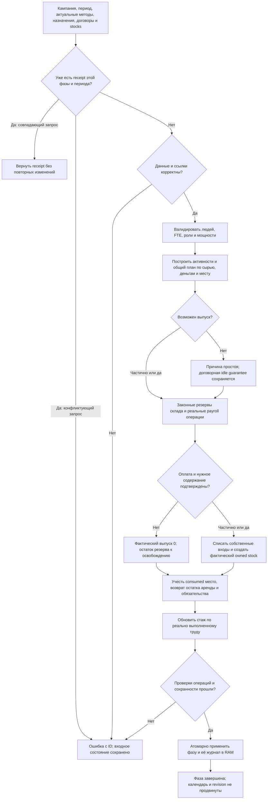

# Rust: реальный производственный цикл

Статус: одобрено автором 12 октября 2026 для подготовки плана реализации; product-код второго этапа не изменён. Первый этап завершён по `reports/rust-recovery-2026-10-12/report.md`. Запрос автора: продолжить исправление и нативный перенос экономики.

## Результат и граница этапа

Нативный производственный цикл автоматически строит план из актуальных ДП, заводов, кустарей, назначений труда, договоров, методов, запасов и складов; оплачивает предусмотренный труд и фактически списывает сырьё/создаёт выпуск. Показатель выпуска соответствует настоящим принадлежащим производителю запасам. Нельзя включить выпуск, передав вручную произвольное количество работников или цель производства вместо игрового состояния.

Этап охватывает R4 первоначального Rust-аудита и обязательные зависимости производства: валидатор назначений, договорную производственную ЗП/налоги/обязательства, конечные складские резервы и аренду, бухгалтерское применение производственных операций. Рынок/покупка сырья, потребление, пищевые конверсии, автоматический найм/смена профессий, доход от продаж и распределение прибыли, общий бюджет, перевозки и строительство переносятся следующими этапами. Производство использует уже имеющееся сырьё и актуальные назначения труда; отсутствие ещё не реализованных upstream-фаз не заменяется заполнением стартовых данных.

Полная неделя остаётся заблокированной. Реализованный изолированный производственный цикл не объявляется автономной работающей экономикой. Read-only просмотр разрешён; полные недели рабочего мира, изменение active SQLite/runtime и ручная подгонка мира исключены.

## Основание и выбор подхода

Обязательный источник — актуальная цепочка `foundation-turn.cjs` → `activity-plans.cjs` → `foundation-production.cjs`, а также `rgo.cjs`, `factories.cjs`, `artisans.cjs`, `production-catalog.cjs`, `labor.cjs`, `storage.cjs`, `ledger.cjs`, `building-effects.cjs`. Старый `production.cjs`, его прежние `productionPlan` и неподключённая Rust-заглушка не становятся новой экономической нормой.

Рассмотрены три способа: перенос связанного производственного цикла; локальная правка списания inputs в старой Rust-функции; перенос всей оставшейся недели за один этап. Выбран первый: он проверяет действующие зависимости выпуска и сохраняет обозримую границу. Локальная правка не обеспечивает оплату, права, склад и реальные методы; перенос всей недели одновременно объединяет независимые бюджетные, транспортные и демографические системы без проверяемых границ.

Существующие пять crates сохраняются. Нативный код исполняет правила; JS используется только как тестовый oracle на маленьких одинаковых мирах. Runtime остаётся единственным выбором базы и кампании. Старые альфа-сохранения не мигрируются, авторские ресурсы и числа не переписываются.

## Обязательные контракты

### Данные, методы и труд

- Дополнить текущие typed-проекции реальным каталогом, ДП, назначениями, договорами, технологиями, завершёнными расширениями/эффектами, складскими правами, резервами и денежными обязательствами. Сохранить неизвестные поля исходных envelopes. Текущее состояние производственного цикла и исходная immutable-копия не должны выдаваться за один и тот же набор после применения операций.
- Изменённый базовый параметр на следующем чтении/расчёте влияет на результат автоматически. Нет runtime-подмены ресурса, назначения профессии или уровня здания.
- ДП производят только свой утверждённый базовый ресурс и требуют только предусмотренный труд. Проверки метода, land access, capacity, расширений и технологии повторяют текущие правила. Производство металла не превращается в завод из-за старой тестовой фикстуры.
- Завод использует утверждённые входы, производительность и оборудование. Сохраняются прямой труд craftsmen, поддержка clerks, бонус стажа и завершённые инфраструктурные эффекты, включая ограничения/статусы источников параметров. Рост уровня не умножает произвольно людей и выпуск вторично.
- Кустарь использует собственный artisan-метод и труд, независимо от наличия завода. Технология и pending retooling ограничивают выпуск по текущим правилам; фабричная зарплата кустарю не придумывается.
- Workers, time fraction, FTE, классы и провинции проверяются по текущему валидатору. Сопутствующие назначения на стройке не исключаются из проверки общей рабочей силы. Известные коэффициенты и авторские пределы сохраняются; неизвестный коэффициент не заменяется единицей.

### Возможность производства и реальная ЗП

- План строится из текущего состояния, учитывает свободные собственные входы, удержания, место на складе, оплату труда и аренды. Пищевой резерв не расходуется как промышленное сырьё.
- Общий ресурс одинаково ограничивает конкурирующие активности по алгоритму `planFeasibleActivities`: сохраняются сортировка activity ID, порядок ограничивающих ресурсов и одновременное пропорциональное уменьшение, без преимущества обхода одной фабрики первой.
- Сохраняются ставки договоров, wage policy, guaranteed idle pay, налоговая политика/expectedPayroll, purpose-счета, unpaid obligations и приоритет прежних обязательств. Нехватка наличных уменьшает actual paid FTE и фактический выпуск; невыплаченная договорная часть не исчезает.
- Плановая ЗП не доказывает оплату: actual production проверяет реально применённые payroll receipts текущего периода, их event IDs и уникальные employment IDs. Содержание рабского труда подтверждается фактическими maintenance receipts. Если upstream-подтверждения нет, труд не становится выполненным.
- Нулевая договорная сумма обрабатывается именно по `planFoundationPayroll`: допустимый committed receipt с gross=0 не отвергается только из-за отсутствия перечисления денег. Режимы занятости не смешиваются.
- Денежные вычисления используют правила `decimalRatio`, `roundRatio`, `ratePay`, `multiplyMoney`, `allocateBudget`, включая tie-break ID и распределение остатка. Плавающие деньги не вводятся. Для точных промежуточных рациональных вычислений допускается стандартная библиотека BigInt из Rust ecosystem; самодельная арифметика не нужна. Сохранённый Money(i64) и явный отказ при непредставимом результате остаются контрактом первого этапа.

### Склады, выпуск и права

- Склады конечны: учитываются текущие stocks и held reservations, единицы товара/площади и `space_per_unit`. Для чужого склада нужны действительные lease terms; стоимость, валюта, purpose и отмена берутся из договора.
- Выход заранее получает реальный оплаченный/законный резерв; неизвестная вместимость или доступ не создают условное бесплатное место. Алгоритм малого остатка места из действующего JS сохраняется.
- Фактическое количество уменьшается долей подтверждённого труда. Сырьё списывается по рецепту из собственных свободных запасов той же провинции; чужой владелец и held construction goods исключены. Порядок расходования — сортировка `opening_stock_id` из JS, а не придуманное FIFO по времени.
- Выход создаётся/пополняется только по ключу owner/province/goods/facility с существующим JS правилом produced-ID и настоящей валютой учёта. Если подходящего запаса нет, создаётся реальный owned stock; один отчёт о выпуске недостаточен. Единицы и происхождение товара сохраняются.
- Использованное место не освобождается второй раз. При частичном/нулевом выпуске освобождается только остаток резерва; `refund_unused` возвращает только должную оплаченную долю из денег владельца склада, а непогашенная часть становится предусмотренным обязательством. Полное использование заканчивает резерв как consumed. Повтор не возвращает аренду ещё раз.
- Производство обновляет стаж завода по `updateFactoryTenure` на основании реально отработанных часов; этот эффект включён в этап.

### Операции, ошибки и повтор

- Производственные изменения применяются через нативные операции с конкретными event IDs, входными/выходными stock deltas и объясняющими финансовыми записями, а не неучтённое изменение суммы по провинции.
- Фаза готовит изменения в отдельном рабочем наборе затронутых строк и публикует их после проверки. Ошибка сырья, прав, денег, переполнения или последней операции оставляет дофазовое состояние и историю прежними. Полный мир для этого не экспортируется и не клонируется каждый раз.
- Успешный повтор одного периода не повторяет ЗП, выпуск, списание сырья, арендный возврат или прирост стажа. Как в ledger первого этапа, тот же event ID с другим содержимым — ошибка, а не разрешение подменить операцию.
- Простой, нехватка средств и неопределённый параметр представлены конкретными blocked reasons с entity/activity IDs. Ошибка декодирования/контракта отличается от нормального нулевого выпуска. Отсутствующий валидатор остаётся `NotMeasured`.
- Создание личного/казённого счёта разрешается только явным законным credit операции зарплаты/налога, как в действующем JS ledger, с каноническим account ID и правильным владельцем/валютой/purpose. `transfer_once` не теряет запрет на неизвестный адресат. Создание счета не является эмиссией денег.

## Преднамеренные изменения относительно нынешнего Rust

Заглушка выпуска без сырья/прав заменяется вычислением и применением полного описанного производственного цикла. Её прежний свободный интерфейс не остаётся способом обойти проверки: вызовы переводятся на новый проверяемый entry point; при неполном контексте возвращается ошибка. Положительные тесты переписываются на реальные методы/условия с сохранением числовых требований, а не ослабляются до проверки одной записи отчёта.

Ledger получает явно разрешённые payroll/debt/rent/production операции в дополнение к строгому примитиву перевода. Создание счета новым законным credit, атомарность всей производственной фазы и отказ при конфликтующем повторе обозначены явно; успешные результаты обычных JS сценариев должны совпасть. Полный недельный entry point не разблокируется и дата/revision не продвигаются.

Не вводятся новые цены, зарплаты, налоги, мощности, лимиты, субсидии, бесплатные товары, государственный гарантированный сбыт или изменённые правила голода. Неперенесённые upstream-политики передаются только действительными результатами предыдущих фаз; пока они не исполнены, полный ход недоступен.

## Приёмка

До product-правок закрепить RED: три воспроизведения R4 и дополнительные реальные сценарии. На одинаковых малых состояниях сравнить Rust с настоящими JS `planFeasibleActivities`/`planFoundationPayroll`/`planFoundationProduction` и storage/ledger: не только totals, но владельцев, amounts, валюты, units, FTE, резервы, зарплату/налоги/долги, стаж, event IDs и replay.

Обязательные случаи: ДП с верным/неверным ресурсом; законная частичная оплата; сырьё отсутствует/достаточно/чужое/удержано; совместное ограничение нескольких фабрик; зависимость clerks/tenure/equipment/infrastructure; отдельный кустарь; двойная занятость; нет подтверждения payroll/maintenance; невыплаченная idle guarantee; создание нового выходного stock; конечный/чужой/неизвестный склад; частичная/нулевая отмена аренды и нехватка денег возврата; ставка/налог/лимит 0; округление и monetary overflow; ошибка после предварительных успешных операций; replay и конфликт event ID. Сталь проверяется по текущему рецепту 1,1 железа + 0,4 угля на единицу, а не по старому условному рецепту аудита.

Проверить изменение базового метода, авторских уровней/эффектов и назначения труда без ручной пересборки dependent state. Отдельно проверить, что полный недельный API всё ещё отказывает без изменения мира. Малый повтор того же состояния даёт тот же производственный результат.

Полный мир: только read-only проверка загрузки новых проекций/поддержки значений, без исполнения даже одной производственной фазы на активном мире. Тестовая SQLite отдельно. После независимого ревью и проверки обновить реальные EXE/документацию, сохранить compact результаты и fingerprints. Новое время полной недели не публикуется.

Самопроверка проекта процедуры: входы и выходы всех развилок связны; нулевой, частичный и полный выпуск сохраняют правила труда/аренды; отрицательная ветка не публикует частичное состояние; повтор не удваивает товары, деньги, стаж или возвраты. Это пока проверка спецификации, не доказательство реализованного движка.

## Проверенные сведения и независимый вклад

Gemini сопоставил предоставленные Rust/JS производственные исходники: оплаченный труд, owned inputs, held reservations, output operations и необходимость differential tests подтверждены напрямую. Его обозначение расходования как FIFO исправлено на действительную сортировку ID; предложение отложить стаж не принято. Для ставки, обязательств, резервирования и инфраструктуры дополнительно прочитаны реальные вызываемые JS-функции. Модель не получила доступ к посторонним данным или ключам.
