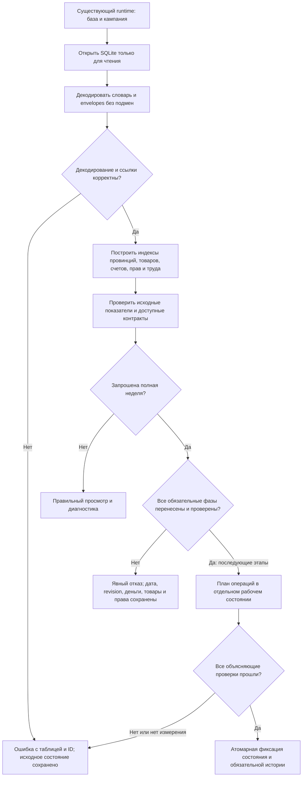

# Исправление Rust-переноса Кингмейкера

Статус: первый этап и план одобрены автором 12 октября 2026, выполнены и проверены. Результат: `reports/rust-recovery-2026-10-12/report.md`. Полный перенос экономики остаётся незавершённым.

## Цель и согласованные ограничения

Запрос автора: исправить нарушения из `reports/review-2026-10-12/report.md`, чтобы Rust правильно работал с единственным актуальным миром и действующими правилами Кингмейкера. Пользовательский результат: правильные ресурсы, провинции, ПОПы, деньги, права и экономические операции; измерение времени только того хода, который действительно выполняет необходимые системы.

Баланс, авторские параметры, ресурсы, рецепты, рабочая сила, правила собственности, бюджеты, перевозки и четыре последних экономических исправления сохраняются. Базу не подгонять под Rust. Динамическое поведение исправляется в движке. Выбор базы и кампании остаётся в существующем `../Проект карты Тейванкаля/data/kingmaker/runtime.json`; отдельной рабочей кампании или системы миграции старых альфа-сохранений не создаётся. Полные недели мира и годовая серия на этом этапе не запускаются.

Источники правил: действующий JS-движок, особенно `state-codec.cjs`, `store.cjs`, `ledger.cjs`, `foundation-turn.cjs`, `week-kernel.cjs`; утверждённая спецификация `../Проект карты Тейванкаля/docs/superpowers/specs/2026-10-12-economic-recovery-design.md`. Прежние проходящие технические тесты не являются доказательством экономической корректности.

## Подход и границы первого этапа

Рекомендуемый путь — исправить нативный Rust последовательно, начиная с загрузки и учёта. Замена расчёта вызовами JS дала бы уже существующую экономику, но не нативный ход и не ожидаемое ускорение. Одновременно дописать все системы поверх испорченных связей нельзя проверить достоверно.

**Первый этап включает R1, R2, R7, R8, ошибки даты/несуществующей кампании из R10 и защиту от выдачи неполного хода за полноценный.** Далее отдельно идут исполняемые производство/рынок/логистика/бюджет, труд и строительство, полный API и сохранение. Эти дальнейшие этапы остаются частью цели; завершение первого не называется завершением всего переноса.

На первом этапе загрузчик и финансовые операции становятся корректными; просмотр и диагностика доступны по фактической поддержке. Запуск полной недели в неполностью перенесённом Rust временно возвращает явный отказ с перечнем отсутствующих обязательных фаз, не меняя состояние. Это намеренное изменение прежнего ошибочного поведения, когда успешно менялись дата и revision при пропущенной экономике. Не добавляется скрытый переход на JS.

## Контракты загрузки и модели

1. Читать `km_dictionary`, envelope `value`, `extensions`, `bigint_fields` и необходимые `km_shared` по существующему codec-v2. Сохранять различие числовых и строковых внешних ID. Не считать ordinal словаря внешним ID и не обрезать значения приведением к `u16`.
2. Для провинций строить однозначную связь с настоящим номером карты. Ссылки на ту же провинцию числом и десятичной строкой сопоставляются только по этому явному правилу области провинций; другие пространства ID автоматически не объединяются. Номер холдинга никогда не определяет место запаса.
3. Товар разрешается из настоящего `goods_id` через словарь/каталог. Поддерживать все товары мира отдельными идентичностями, не только перечисленные в старом enum. Не искать название товара в непрозрачном ID запаса и не заменять неизвестное зерном.
4. Счёт имеет собственный ID, владельца, валюту, назначение и точную целую сумму. Индекс поиска — `(owner_id, currency_id, purpose)` по правилам существующего движка. Валюта, владелец, счёт и получатель резерва — разные роли. Связи ПОПов/предприятий/казны следуют настоящим финансовым правилам, включая оплату содержания другим владельцем там, где она предусмотрена. Не создавать личные счета или деньги ради обнуления диагностического счётчика.
5. Запасы сохраняют ID, владельца, товар, единицы, количество, провинцию, склад, удержания, назначение и получателя еды. Модель сохраняет зависимости на складские права, договоры, труд и рецепты. Неперенесённые поля и таблицы сохраняются без утраты, даже когда ещё не используются нативной фазой. Это не обещание их исполнения на первом этапе.
6. Строить настоящие диапазоны/индексы ПОПов по провинциям; не оставлять `(0,0)` у населённых мест. Исправить адресацию государства, типов ПОПов, культуры, религии, метода и валюты.
7. Читать фактические дату, revision, campaign ID и подписи из сохранения. Отсутствующий мир, битый envelope, неизвестный dictionary ID, невозможная ссылка или неподдерживаемое представление денег дают ошибку с таблицей и ID. Не подставлять revision 20, 306-01-01, нулевые деньги или пустой мир. Допустимое отсутствие игрового значения остаётся отличимым от ошибки декодирования.
8. Загрузка не пишет в исходную SQLite или runtime. Повторное чтение одного состояния даёт тот же логический результат. Проверка полного мира потоковая/индексная, без ненужного полного digest или экспорта всей базы.

## Финансовые операции и проверки

- Перевод проверяет существование обоих счетов, валюту, назначение и полномочия, неотрицательную сумму, средства и переполнение до изменения. Успешный самоперевод не меняет баланс; отрицательный перевод и неизвестный адресат отвергаются. Нулевая сумма не создаёт счёт. Невозможная операция атомарно оставляет все суммы и историю прежними.
- Деньги сравниваются отдельно по валютам, с объясняющими операциями. Авторская эмиссия авантюристов не объявляется нарушением: до переноса её валидатора такие операции не исполняются нативно. Не требовать неизменности денег, товара или населения там, где правила предусматривают источник/списание.
- Проверять количества людей, рабочую силу, занятость, ссылки и имущественные права, а не число строк ПОПов. Товары сверять по реальному выпуску, потреблению, переносу, конверсии и грузам. Если операции или нужная проверка пока не поддержаны, возвращать явное «нет измерения/не реализовано», а не `true` или ноль.
- Не фиксировать неделю и не возвращать `executed=true` после нарушения. Повторное исполнение одного идентификатора финансовой операции не списывает деньги заново; ошибки и частичные входные данные не оставляют частично применённый перевод.

Для перевода проверяются позитивный исход, недостаток средств, неизвестный адресат, самоперевод, отрицательная/нулевая сумма, неправильная валюта, переполнение и повторный ID. Для загрузки — точное чтение, отсутствие кампании, битая ссылка и повторная загрузка. Отказ не создаёт и не уничтожает людей, труд, товары, деньги или права.

## Проверки и критерии завершения первого этапа

- Закрепить известные ошибки отрицательными регрессионными тестами **до изменения движка**. Уже имеющиеся `reports/review-2026-10-12/probes` — исходные воспроизводящие примеры, не набор, который можно облегчить удалением требований.
- Малые реальные codec-v2 фикстуры: numeric/string IDs, неупорядоченный словарь, провинция 1000, соль/глина/лекарства вместо Grain, непрозрачный ID запаса, отдельные деньги владельца и предприятия, содержание ПОПа спонсором, еда с конкретным beneficiary, неизвестный товар/ID, перенесённые поля и дата 307-04-12.
- На полной базе только чтение: исходные товары/количества/провинции/права и суммы валют сохранены; все ссылки корректны по предусмотренным правилам. Первоначальные 40 752 подмены товара и 16 269 подмен провинции исчезают. Отсутствующие по правилам счета не заменяются вымышленными.
- Проверить финансовые операции и объясняющие проверки; отсутствие измерения не выдаётся за успех.
- Проверить отказ полной недели до завершения всех её фаз: состояние идентично до/после, в том числе дата и revision. Бенчмарк неполного пути не называется временем игровой недели. API не выполняет активный мир по чужому campaign ID.
- Выполнить независимое ревью, сборку и затронутые тесты. Обновить отчёт и фактически запускаемые EXE/launcher так, чтобы источник и запуск соответствовали; активную игровую базу не менять первым этапом.

Критерий **всего переноса**, ещё не достигаемый первым этапом: нативные операции всех действующих фаз совпадают с JS на одинаковых маленьких мирах, сохранение в новый процесс сохраняет состояние и обязательную историю, viewer обслуживает полный действующий API, затем можно измерять полный мир.

## Самопроверка и независимый вклад

Спецификация разделяет правильную загрузку, исполнение механик и подтверждение полноценной недели; их результаты не подменяют друг друга. Ресурсы и баланс не меняются. Схема содержит выходы отказа и успеха, включая сохранение исходного состояния. Git в каталоге отсутствует: спецификация сохранена локально без выдуманного коммита.

Gemini предложил начать с загрузки без потерь, составного индекса счетов и сравнения с JS. Сведения проверены по `state-codec.cjs`, `ledger.cjs`, структуре SQLite и фактическому конвейеру. Предложения Gemini о порче товаров, ассимиляции и других неустановленных механиках не приняты: переносится только реально существующее правило. До утверждения этого документа product-код не изменён.
