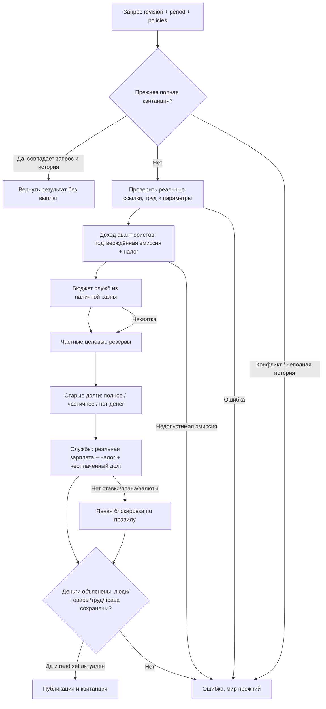

# Rust: денежное открытие недели

Статус: утверждено Codex 2026-10-13 по прямому разрешению автора самостоятельно утверждать следующие спецификации и планы. Выполнение здесь; полный мир ещё не прогоняется.

## Наблюдаемый результат

Rust выполняет отдельный атомарный денежный цикл открытия: фиксированный доход авантюристов → бюджет служб → частные резервы зарплат и содержания → погашение старых обязательств → зарплаты существующих служебных мест. Все суммы, получатели, налоги, назначения и долги подтверждаются реальными данными. Повтор запроса возвращает прежнюю квитанцию без повторной выплаты. Ошибка не публикует частичный результат. Это необходимый этап полного хода, а не разрешение считать неполный цикл игровой неделей.

## Обязательные исходные правила

Источник: JS `foundation-turn.cjs:53-64`, `state-budget.cjs:7-39`, `foundation-budget.cjs:3-4`, `adventurer-income.cjs:14-35`, `ledger.cjs:33-59`, `foundation-labor.cjs:29-34`, `labor.cjs:2-23`.

- Службы education/medicine/administration/army финансируются 0–100%, по умолчанию 100%; ползунок изменяет запрос, не исходный контракт. Нулевая текущая зарплата не отменяет старый долг. Только существующее фактическое место получает зарплату; классовой бесплатной выплаты нет.
- Государственный резерв — две недели актуальных запросов плюс старые обязательства по секторам, минус уже имеющиеся целевые деньги. Источник — только `treasury:<state>` / `operating_capital`, раздельно по валютам. Пропорциональное распределение с точными целыми остатками. Нельзя тратить деньги другого сектора или будущий прогноз.
- Частные резервы — две недели трудовых договоров и содержания рабов, только при утверждённом foundationBudgetPolicy/source/reserve_weeks=2. Сначала operating_capital; затем излишек employer_operating_capital сверх двух недель зарплат на остальные резервы. Переводы не считаются доходом ПОПов.
- Авантюрист получает утверждённую стартовую рациональную ставку × текущий размер ПОПа. Это разрешённая временная эмиссия, отдельно от бюджета; налог идёт казне, остаток личному счёту. Отсутствующая ставка, иная валюта/класс/получатель, произвольная эмиссия — ошибка, не ноль. Никакой повторной калибровки цен и ставок.
- Зарплаты службы используют реальные employment/contract/jobs/institution, FTE и целевой счёт, authored rates, wages, бюджетный коэффициент, taxes либо expectedPayroll.tax_rate. При частичной оплате actual_fte пропорциональна оплате; unpaid становится обязательством с исходными правами и налогом. При gross=0 actual_fte=0, как в JS служебной зарплате. Производственная зарплата сохраняет отдельный существующий контракт поведения.
- Исключаются production assignments и direct_output_labor, чтобы исключить двойную выплату. Проверяются общая рабочая сила, группы времени и вместимость места; рабы получают содержание, не зарплату. strict/initial_plan остаётся заблокированным.
- Старые обязательства погашаются реальными целевыми деньгами, включая ранее реализованные правила rent debt. Сохраняются права, остаток и раздельные налоги.
- ID остаются типизированными; числовой ID не превращается в строковой ID. Авторские дополнительные поля сохраняются. Денежные округления и порядок остаточного распределения существующие.

## Архитектура

Добавить BudgetData: employment, jobs, adventurerIncomeRates, foundationBudgetPolicy и native receipts, прочитанные существующим lossless codec. Контракты, ПОПы, учреждения, обязательства, политики и счета использовать существующие. Планы настоящих фаз рассчитываются из OperationSession с изменёнными остатками; операции каждого вида принимаются только после внутренней авторизации точного рассчитанного DTO. Публичный arbitrary transfer остаётся прежним контрактом; новая эмиссия не доступна ему.

PreparedBudget содержит закрытый PreparedChanges и полный компактный read set всех читаемых исходных денежных/трудовых параметров. Перед публикацией проверяются revision, campaign, read set и полная история. Расчёт без мутации исходного мира; публикация одним apply. Квитанция содержит операции/запросы, фактические зарплаты и разрешённую эмиссию по валютам, с проверками изменения счетов и отсутствия изменения людей/товаров/занятости. Технические новые personal account bindings допустимы после проверки адреса.

## Проверка и границы

Регрессии перед реализацией: JS oracle на малых вручную описанных мирах, 0/50/100%, конечный бюджет, изоляция секторов/валют, старый долг при 0%, недостаточная зарплата, строгий план, рабы, пересечение производственных назначений, повтор и конфликт истории, подготовка с изменением read set, ошибочная/поддельная эмиссия, переполнение денег. Проверка линейного доступа к таблицам без полного мира на каждую операцию.

Сознательное изменение только доступности нативного изолированного денежного открытия и его диагностики; баланс и порядок JS фаз не меняются. Неразрешённые числовые коллизии event ID можно предотвращать типизированным составным ID с документированным отклонением технической истории, не экономического состояния.

Ещё не включаются найм/переезды, транспорт/запасы, дивиденды, выбор кустарных рецептов, стройка, commit недели и checkpoint. Следующие самостоятельные этапы: труд; доходы/инвестиции/стройка; перевозки/резервы/госзакупка; полный порядок, сохранение и автоматический диагностический прогон 10 недель. Полная неделя разблокируется только после этих фаз. Запуск на отдельной копии текущей базы в RAM; при первом значимом баге серия останавливается и сохраняет пример, после исправления начинается новая достоверная серия.

## Уточнение после ревью, утверждено самостоятельно
Обязательная реальная ссылка employment/contract → job и совпадение явно заданной профессии теперь проверяются до выплат. Старый JS мог пропускать потерянное место или неверный класс; Rust отказывает атомарно и сообщает дефект данных. Это намеренное усиление валидации, не изменение правил зарплат или ручное создание работы. Учреждения и общие пулы полностью проверяет следующий трудовой этап. Ошибочные строки не подменяются отсутствием значения.
Уточнение: profile_kind=capacity_pool обозначает общую вместимость и её основную профессию; собственный конкретный контракт может законно определять вспомогательный класс. При наличии точной профессии договора проверяется она; остальные job/contract ограничения и ссылки сохраняются. Никакой замены классов в данных.
