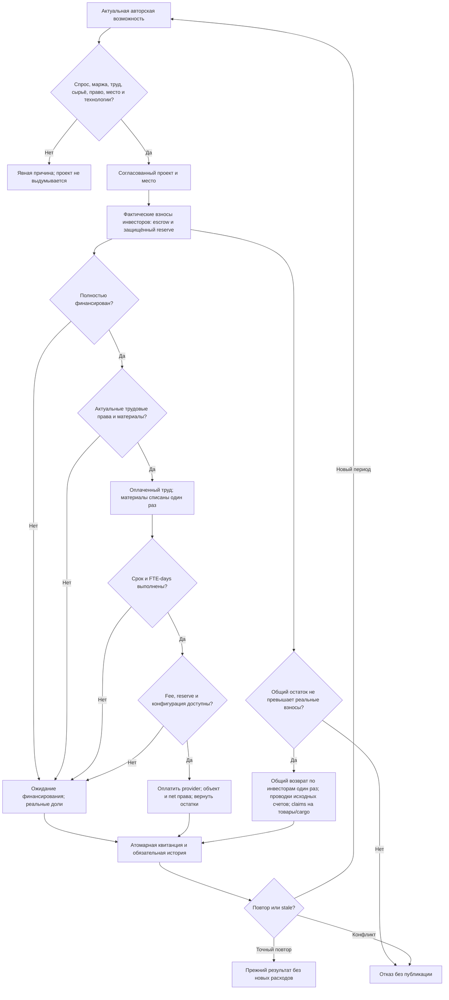

# Native investment and construction

Архитектурный этап, самостоятельно утверждён по разрешению пользователя продолжать следующие этапы и утверждать спецификации/планы. Наблюдаемый результат: капиталисты могут совместно оплатить реальный проект; стройка потребляет принадлежащие проекту материалы и оплаченный труд, завершает объект только после выполнения срока, труда и платежей. Деньги каждого инвестора, расходы, остатки и права доступны в обязательной истории. Полная неделя и десятинедельная диагностика остаются отдельным обязательным завершением цели.

## Основа и выбранный подход

Сохраняем текущие правила JS: investments.cjs, foundation-investment-policy.cjs, investment-assessment.cjs, construction.cjs, foundation-labor.cjs, building-rules.cjs, factories.cjs и factory-expansions.cjs. Источник: ../Проект карты Тейванкаля/scripts/kingmaker. Native WorldState и OperationSession остаются единственной финансовой и имущественной правдой. Существующие construction_projects, completed_construction, completed_expansions, capitalist_entities и project_investments переиспользуются; недостающие авторские каталоги и возможности проецируются без подмены данных.

Выбран перенос существующих процедур с закрытыми подготовкой/применением и квитанциями. JS runtime-bridge оставил бы две реализации состояния; ручная подготовка проектов скрыла бы отсутствие автоматических решений. Оба варианта отклонены. Новых правил баланса, бесплатных материалов, принудительных инвестиций и совместимости старых alpha-save нет.

## Инвестиции и права

Автоматическая фаза после бюджетного финансирования, до производственных выплат, как foundation-turn.cjs. Только исходные/одобренные возможности с source, для approved также approval_ref. Assessment вычисляет спрос, положительную маржу, доступный труд и реальные доступные локальные входы; не доверяет готовым оптимистичным числам возможности. Соблюдаются технологии инвестора, валюта, готовность метода и конструкции, уникальный тип завода в провинции, восемь заводских мест региона и применимые лимиты построек.

Уточнение по фактическому investment-assessment.cjs: динамический пересчёт применяется к assessment_policy=native_weekly_v1. Явно фиксированные авторские возможности с другой/отсутствующей policy сохраняются, как в действующем источнике; их параметры не переписываем под удобный результат. Проверки отдельно подтверждают оба режима. Это сохранение авторского контракта, не новая подмена runtime.

Сумма взноса = min(неоплаченный бюджет проекта, реальные деньги после резерва инвестора, его contribution_limit). Точные целые деньги. Условия содержат источник, целочисленную version>=1, cash_contribution, pro_rata_unspent, согласованную валюту, положительный бюджет >= стоимости. Operating reserve >=0 и <= бюджет−стоимость. Из каждого взноса защищённая часть равна roundRatio((funded+amount)*reserve,budget)−roundRatio(funded*reserve,budget); она идёт в factory_startup_reserve, остальное в construction_escrow. Один shared account не расходуется дважды. Взнос не является доходом.

Project ID, инициатор, метод, провинция, условия и event identity проверяются при повторе. Вклад каждого инвестора, исходный owner/purpose и принятая версия сохраняются. Доли рациональны, выводятся из фактических взносов, а после возврата — из net contributions. Нельзя выдать права по обещанным деньгам. Подмена валюты требует реального обмена и отвергается.

Активирование planned assignments и staff_transfers происходит только после полного финансирования, с проверкой актуального источника и полной занятости. При невозможности — причина ожидания и отсутствие частичного переноса людей. Автоматическая динамика выполняется движком, без пересборки стартового мира.

## Строительство и оплаченный труд

Готовность construction/source, duration_days>0, labor_required_fte_days>0, includes_wages/excludes_wages, provider, валюта, стоимость и положительные материалы обязательны. Неизвестные параметры дают явное ожидание; нулём не подменяются. Before payroll проверяются материалы, нужный остаток труда, местные farmers/laborers и действующие контракты проекта. Запрошенный труд ограничен оставшимися FTE-days; фактически оплаченные FTE определяют прогресс. Заработок и налог используют общие действующие правила зарплаты; строительство не получает вторую служебную зарплату.

Материалы списываются один раз, по реальным stock owners/province/goods. Нет оплаченного труда — awaiting_labor; нет материалов — ожидание без выпуска. Elapsed days и labor_fte_days сохраняются по исходной процедуре. При достижении срока и труда final fee = cost − paid_wages для includes_wages, иначе cost; отрицательная fee запрещена. Fee оплачивается реальному provider. Защищённый reserve переводится в капитал нового предприятия только при завершении. Остатки возвращаются исходным инвесторам по pro_rata_unspent с точным округлением. Суммы возвратов не могут превышать действительные вклады.

Новый завод получает фактический method, site/facility, оборудование, 40000 people_slots, level1 и инвесторские доли. При динамической системе найма он появляется awaiting_staff; последующий обычный найм определяет занятость, отсутствующих работников не назначаем. Исходная конфигурация склада/оборудования должна быть готова и принадлежать будущему предприятию. Factory expansion сохраняет старые имущественные права/капитал, требует согласия владельцев, ограничена level20, увеличивает slots на40000 и оборудование/склад пропорционально уровням. ДП expansions и остальные постройки следуют собственным правилам и авторским effects; восемь заводов не применяются ко всем зданиям.

Отмена — закрытый API с идентичностью project/event/reason, запретом повторной отмены завершённого объекта. Возвраты только неистраченных проектных денег; оставшиеся товары и cargo оформляются имущественными claims, не исчезают и не превращаются в деньги. Не реализованные игровые команды в автономном сценарии не исполняются сами собой.

Выявленная бухгалтерская защита: сумма возвращаемых остатков всех проектных счетов не может превышать реальные взносы. Исходный JS проверял каждый счёт отдельно; Rust дополнительно отклоняет общий необъяснимый избыток. Это отказ на противоречивом состоянии без списаний, не изменение бюджета, цен или долей. Regression task5-excess-red.txt → task5-excess-green.txt.

Исправления по независимому ревью: общий возврат распределяется между инвесторами один раз, затем точные права на этот возврат проводятся через исходные проектные счета. Это устраняет повторное выигрывание округления одним инвестором и возврат сверх его взноса. У всех завершённых объектов, включая учреждения и расширения ДП, записываются фактические возвраты и права по чистому оставшемуся капиталу. Конфигурация нового завода сохраняет авторские технические поля, но не перезаписывает вычисленные доли, капитал, происхождение и стартовый уровень 1. Исправляются ошибки учёта, суммы бюджета/цен/рецепты не меняются.

## Атомарность и доказательства

Публичная операция с type=capitalist_investment/construction_* не разрешает списание. Закрытые prepare/apply/execute investment, construction и cancellation APIs вычисляют обязательные операции из native данных. Один private phase state и полный readset предотвращают частичную публикацию при поздней ошибке. Canonical boundary и receipt обязательны даже для пустой фазы; exact replay не платит, не списывает материалы и не увеличивает срок дважды. Удалённая/подменённая обязательная история — отказ. Registry/provenance сохраняется при native serde. Реальный full-world checkpoint проверяется позже в составе цели.

Самопроверка: частичное финансирование не выдаёт завершённый объект; частичная зарплата даёт только оплаченный труд; failure после предварительных расчётов не списывает деньги; отмена сохраняет товары и права; повтор не ускоряет срок. Проверки обязательно активируют отдельную мини-стройку, даже если естественный мир не строит. Отсутствие строительства само по себе не баг: фиксируем несработавшие условия.

Измерения: started/funding/stalled/completed/cancelled, investor contributions, escrow/protected reserve, wages/fee/materials/refunds, elapsed/labor days, reasons and created assets. Объясняются деньги по валютам, товары по операциям, люди/труд и имущественные права. Неподдерживаемые результаты учреждений и отсутствие игровых решений обозначаются явно.
