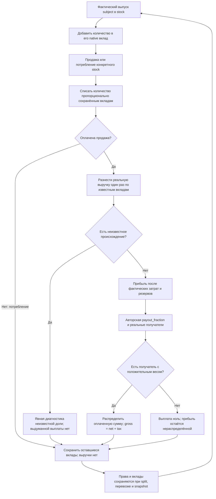
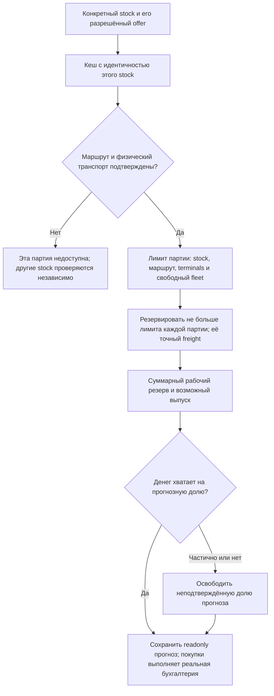
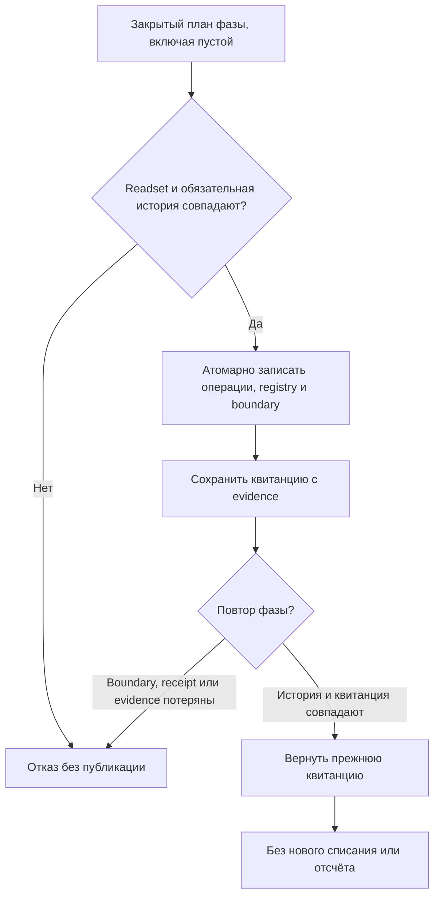
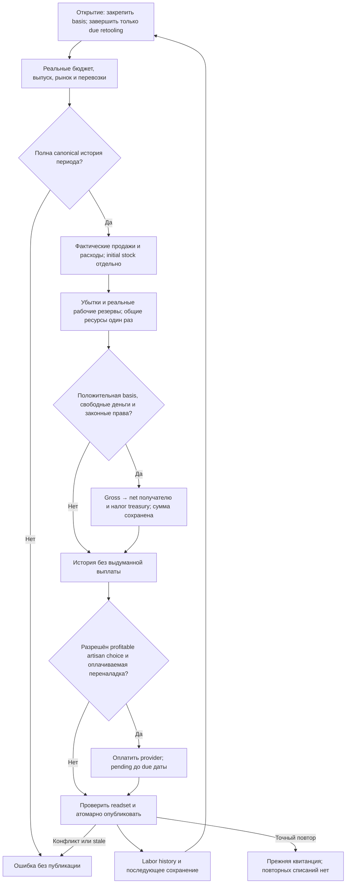
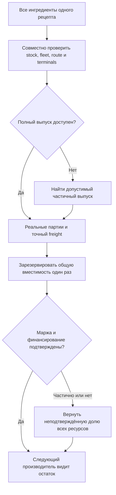

# Native income, ownership and artisan decisions

Самостоятельно утверждено 2026-10-13 по разрешению пользователя. Следующий этап общей цели: 10 полных Rust-недель с фактической диагностикой, сохранением и продолжением. Этот этап переносит реальные доходы предприятий и владельцев, защиту оборотных денег и выбор кустарного производства. Строительство, исполнение грузовых перевозок и сборка полной недели продолжаются следующими этапами; технические проверки здесь не доказывают здоровую экономику.

Наблюдаемый результат: оплаченная продажа произведённого товара даёт объяснимую прибыль и выплаты действительным получателям, а исходный товар и вложенный капитал не превращаются в прибыль. Убыток переносится, необходимые деньги остаются предприятию. Кустарь может оплатить переналадку и сменить метод в предусмотренный срок. Государственная доля и налоги поступают в реальный бюджет. Нет искусственного дохода, новых долей или изменения ставок.

## Источники и выбранный способ

Авторитетные правила — текущие JS `foundation-income.cjs`, `producer-profit-rights.cjs`, `foundation-artisan-policy.cjs`, `artisan-working-capital.cjs`, `artisans.cjs`, `foundation-budget.cjs`, `foundation-turn.cjs`. Gemini подготовил карту income/investment правил; порядок проверен непосредственно по `foundation-turn.cjs`: construction → closing market → food reserves/supply/state procurement → artisan income → producer income → artisan choices → labor history. Инвестиции не выплачивают доход. Имеющийся Rust `artisan_capital.rs` считает сумму защиты, но не реализует этот цикл.

Выбран перенос источников в закрытые native планировщики с общей бухгалтерией. Вызовы Node допустимы только как малые тестовые oracle. Обёртка JS для каждой недели не выполняет цель Rust-переноса; переписывание баланса вместо сохранения формул также не принимается. Не требуется отдельная система совместимости старых alpha-сохранений.

## Точные сохраняемые контракты

1. Деньги — целые minor units; исходные `invoice`, `multiplyMoney`, `ratePay`, распределение целой суммы с остатком последнему получателю сохраняются. Проверяется переполнение до публикации. Числовые и строковые actor/event IDs различаются. Неизвестная цена или право — ошибка/причина отказа исходного правила, не нулевая оценка.
2. Используется закреплённая native основа открытия периода для stock metadata плюс фактические текущие строки; это не повторное чтение старого `SourceSnapshot`. Доход выводится из проверенных canonical операций обязательных фаз данного периода. Public API не принимает неподтверждённый список оплат/продаж. Законная история других периодов сохраняется.
3. Доход ДП/заводов признаётся только по продаже `inventory_origin=produced`, включая оплаченные arrivals. Продажа начального товара записывается отдельно. Расходы — фактически выплаченная ЗП, потреблённое сырьё по авторской текущей цене, аренда, maintenance и предусмотренные freight/recovery. Точный алгоритм распределения цены между проданными stocks сохраняется.
4. Для производителя `net = revenue - cost`, `basis = max(0, net - prior_loss)`, `loss_carry = max(0, prior_loss - net)`. Дивиденд ограничивается basis и реальным свободным `employer_operating_capital` после резерва. Резерв: две недели действующей ЗП/норм budgetRequirements, недостающий sponsored maintenance, утверждённый 25-дневный input buffer только при соответствующем authored source/value, плюс действующие долги. Отсутствие автора параметра не заменяется выдуманным значением.

   Если стоимость потреблённого сырья не измерена, net остаётся null/«нет измерения», выплаты не выполняются, прежний loss carry сохраняется до достоверного расчёта. Нельзя стирать прошлый убыток из-за пропущенной стоимости. Неизвестные права/источник не превращаются в выполненную выплату: distributed отражает только реальные запланированные перечисления.
5. Права берутся из production/factory beneficiaries, а для созданного предприятия — из действительных project shares и инвесторов. Рациональные доли должны суммироваться в единицу. Общий holding не получает дублированный cash pool. При factory override RGO/factory права взвешиваются положительной фактической секторной прибылью, как в `mixedProducerRights`; общие расходы и резервы остаются общими. Существующие доли 60% аристократам, 25% капиталистам, 15% государству сохраняются там, где они заданы данными; движок не переписывает права.
6. Кустарный доход сохраняет `income_policy.source`, payout fraction, cash reserve, loss carry, undistributed profit, персонально внесённый principal и историю. Выплата ограничена прибылью после прошлых убытков и свободными деньгами после максимума authored/working-capital reserve. Группа резервов объединяется по owner/currency; сырьё, входящий груз и транспорт не обещаются двум предприятиям одновременно. Без назначений законный property income допускается только при существующих рабочих капитале и owner POP; иначе используются реальные artisan assignments с исходными весами FTE×1,000,000.
7. Из gross реально перечисляются net и налог в treasury; действуют текущие inherited policies и явные overrides без стирания остальных ставок. Запрещены выплаты чужому ПОПу, несовместимой валюте или по потерянному праву. Налоги и dividends не являются эмиссией. Деньги между назначениями счёта перемещаются один раз и остаются объяснимыми.
8. Quotes кустарей — текущие цены, неудовлетворённая часть реальных заказов и доступное разрешённое сырьё по региональному рынку. Технологии, status ready, положительная маржа, реальная покупательная способность и оплачиваемые условия provider обязательны. Сохраняются исходные 64 шага поиска допустимого выпуска и порядок выбора при равной марже. Stocks `food_reserve` недоступны производству/выбору. Нет автоматической смены при `automatic_choice != true`.
9. Переналадка списывает реальный cost и оплачивает provider, не выпускает бесплатный товар. Новый метод вводится только при due ready_date/remaining_days на открытии; во время pending сохраняются исходные ограничения работы. Выбор на закрытии рассчитывает срок от следующей даты (+7), как источник. Completion/replay не списывают cost повторно. Не меняются authored duration, provider, технологии или формулы товара.
10. Working-capital forecast сохраняет исходные собственные/удержанные stocks, входящие грузы в ближайшие 7 дней, маршруты/границы/допуски, capacity и freight. Это прогноз, а не покупка или доставка. Не считать межрегиональный груз мгновенным. Не вводить резерв по фиктивному бесконечному транспорту. Нужные transport/navigation данные проецируются losslessly в единый native реестр, который затем использует этап исполнения перевозок.

## Атомарность, продолжение и диагностика

Task5: исходный `planArtisanIncome` воспроизвёл двойное признание продаж по одному owner: одна оплаченная продажа100 дала revenue100 и выплату100 каждому из двух предприятий (итого200). Это баг, не экономическое правило. Доход и общие расходы должны относиться к конкретному предприятию/его товару один раз. Для различных товаров/провинций используются фактические stock/recipe/subject связи; для общего запаса одинакового товара сохраняется рассчитанная движком история вкладов производителей и пропорционального расходования этого запаса. Новое производство добавляет собственный вклад, продажа/потребление уменьшает его; полный/частичный перенос stock должен сохранять эту информацию вместе с правами. Это вычисляемое native состояние для последующих ходов и сохранения, не ручная подгонка стартовых данных. Неизвестное происхождение старого общего produced stock не распределяется по выдуманным долям капитала: сохраняется явный неизвестный остаток и диагностика; выплаты нельзя оправдать неизвестным доходом. Авторские payout_fraction, cash reserve и права получателей сохраняются. Сумма признанных продаж по предприятиям не превышает фактически оплаченной продажи. Подтверждение: `work/rust-income-2026-10-13/reproduce-artisan-owner.cjs`, `artisan-owner-source-repro.json`; это малый исходный эксперимент, не вывод о полном мире.

Task5: отдельно воспроизведён исходный дефект выплаты без получателя. При отсутствии назначений и законного property recipient исходный JS возвращает operations=[], но записывает taxable_distribution_minor=600 и уменьшает undistributed_profit на600. Native сохраняет фактический результат: выплата0, прибыль600 остаётся в undistributed_profit. Авторские права, payout_fraction и резерв не изменяются; фиктивная выплата не считается исполненной. Проверка: no_recipient_keeps_profit_and_does_not_record_an_unpaid_distribution.

Task3 также воспроизвёл пробел native production replay: прежняя квитанция принималась после удаления/подмены её обязательных операций либо при дублировании квитанции. В production receipt сохраняются event IDs и SHA256 каждого canonical operation body; полная исходная операция остаётся в обязательной истории. Повтор и последующее признание дохода сверяют эту компактную независимую запись, точные payroll и отсутствие дубликатов. Это hashing новых операций, а не полный digest мира и не замена обязательной истории. Старые alpha-save миграции не добавляются; неполная native история отвергается. Законные последующие изменения текущих stocks/accounts не отменяют точный повтор уже выполненной фазы.

В Task2 воспроизведены два дефекта исходного JS-прогноза; они не становятся правилом новой версии. Кеш маршрута обязан учитывать конкретный stock/offer: отсутствие разрешения на первый склад не отменяет разрешение другого склада с тем же товаром. При резервировании прогноза каждая партия ограничена ранее рассчитанным lot.quantity (включая route/terminal/fleet limits), а freight считается по фактическим партиям. Пример:12 единиц через партии2 и10 стоят1200 за товар +4+100 за перевозку, а не1224 при незаконном использовании первого маршрута сверх вместимости2. Формулы цен, сроки, деньги, реальная продажа и авторская вместимость не изменены; исправлен учёт доступности. Минимальные исходные JS-воспроизведения и native RED→GREEN находятся в income_capital_test.rs; обычные случаи продолжают совпадать с JS.

Закрытые APIs: capture opening basis, prepare/apply/execute income closing, opening retool completion и closing artisan choices. Prepared readset включает все прочитанные финансовые, имущественные, stock, policy, price, order, forecast и phase-history зависимости; устаревшая позиция/право/цена отвергаются до записи. Только внутренний планировщик авторизует новые виды операций. Точное повторение возвращает прежнюю квитанцию; конфликт/отсутствие обязательной истории/потерянный child или investor — отказ без изменения состояния. Пустые и отрицательные сценарии сохраняют деньги, товары, людей и права. Полная неделя пока остаётся закрыта защитным guard.

Task6: даже пустая фаза сохраняет обязательную canonical boundary без денежных и товарных проводок. Boundary закрепляет campaign, period, stage и digest опубликованных registry changes; повтор сверяет её и отдельную квитанцию. Потеря квитанции не разрешает второй отсчёт переналадки. Общий OperationSession атомарно сохраняет известные количества производителей при фактическом выпуске, потреблении, покупке и переходе имущественных прав; неизвестное происхождение не подменяется догадкой. Доказательство фактической перевозки остаётся обязательным в следующем Supply этапе.

История доходов и решений сериализуется как обязательное native состояние с исходными неизвестными полями. Отдельно сохраняются gross/tax/net, initial-stock revenue, consumed-input cost, reserves, loss carry, shares/source, started/pending/completed retooling и причины отсутствия выплат. Не поддерживаемый показатель явно `не реализовано`/`нет измерения`. Native mini roundtrip не называется сохранением полного мира.

Самопроверка схемы: no-profit и missing-rights не создают выплат; частичный бюджет не делает долг скрытым; pending не завершён досрочно; restart сохраняет срок и обязательную историю; один shared owner/input/fleet используется один раз. Метрики здоровья экономики остаются за будущим полным прогоном.

Final review: воспроизведены два Important дефекта native прогноза. Недельные route/source-terminal/destination-terminal limits должны учитываться совместно для всех партий и предприятий, как реальный supply.cjs; отказ/недофинансирование освобождает соответствующую долю прогнозной вместимости. Все ингредиенты одного рецепта используют общий fleet одновременно: grain1+coal1 при fleet12 позволяют выпуск6, а не ошибочный отказ для выпуска10. При input prices100 и freight2 резерв равен1224. Максимальный совместно доступный выпуск рассчитывается до признания маржи/денежного резерва. Условия, мощности, цены и срок не изменяются; исправляется двойное обещание транспорта и ложный отказ.

Проверки: конкретные source oracle с initial vs produced sale, убытком/восстановлением, двумя валютами/секторами, долями и остатком, tax/state share, shared reserves, pending cargo/capacity, property vs labor artisan income, частичной оплатой, funded/unfunded choices, датой/повтором переналадки. Отдельные негативные тесты подмены операций, ставок, прав, prices, stale readset, orphan history и переполнения. Затем одно итоговое независимое ревью и один исправительный проход, release и актуальные EXE. Полный мир только на диагностической RAM-копии без продвижения недели, если нужен probe этого этапа.
