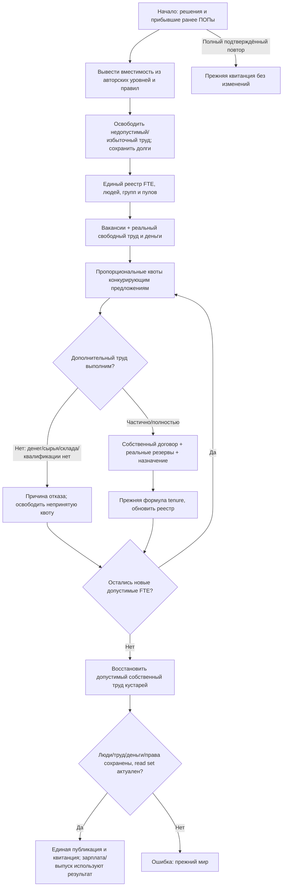

# Rust: вместимость, единый труд и местный найм

Статус: самостоятельно утверждено 2026-10-13 по прямому разрешению автора. Следующий этап после денежного открытия; часть цели десяти достоверных Rust-недель. Реализация здесь, с одним итоговым независимым ревью. Прежняя авторская спецификация `../Проект карты Тейванкаля/docs/superpowers/specs/2026-10-11-pop-employment-mobility-design.md` остаётся источником правил вместе с текущим JS.

## Результат

В начале хода свободный подходящий ПОП занимает доступное реальное место в своей провинции без ручного назначения. Изменение уровня учреждения/вместимости предприятия автоматически обновляет слоты, освобождает избыток работников и открывает вакансии. Принятый труд учитывают зарплата и выпуск этого же хода. Нулевая казна, недоступные технологии, склад, сырьё, квалификация или деньги дают конкретную причину отказа, а не подарочные деньги/работу/выпуск.

## Варианты и решение

1. Портировать местный труд как самостоятельную нативную фазу с существующими денежными/производственными расчётами — выбранный вариант, отдельно проверяется на старых/новых назначениях.
2. Подключить JS для трудового открытия — требует второй копии большого мира и не достигает полного Rust-цикла; не выбран.
3. Сразу объединить найм, смену профессий, титулы, разделение ПОПов и пассажирский транспорт — слишком разные границы атомарности; следующий отдельный этап перемещений использует результат настоящего найма.

## Источник и сохраняемые правила

`institution-capacity.cjs:3-41`, `employment-roster.cjs`, `pop-mobility.cjs:46-76`, `labor-market.cjs`, `production-hiring.cjs`, `current-world-labor.cjs:16-25`, `state-services.cjs:6-23`.

- Места школы/больницы/администрации/армии — уровень × 2000 по authored institutionRules, распределение staffing_roles и capacity_weight с детерминированными остатками. Уровень не выводится из текущего населения; старт не пересобирается.
- RGO используют существующий native rgo_capacity/expansions; завод — people_slots, не число предприятий и не произвольный уровень. Общие пулы и отдельные места проверяются одновременно. Ограничения количества заводов не меняются.
- Единый реестр объединяет назначения RGO/заводов/кустарей/активной стройки и оставшиеся службы. employment-зеркало не считается вторым работником. Все employment/job/contract/POP ссылки уникальны и согласованы. workers целые, time в [0,1], FTE объяснён, worker_group time ≤1; труд не превышает workforce. Закрытые/демонтированные места, неверная профессия/доступ к земле и два неоплаченных хода освобождают назначение, сохраняя денежные долги. Активные строители защищены по source status.
- При уменьшении вместимости освобождается избыточный труд в исходном детерминированном порядке; заводской tenure уменьшается по прежней функции при уходе, растёт по newcomers при найме. Зеркала POP employed/unemployed и jobs slots_filled обновляются из реестра, не вручную.
- Предложение RGO требует approved resource, land_access, ready rgo method. Завод operating/awaiting_staff, real equipment/source, технологии и допустимое staffing. Служба — реальное здание из state profiles, разрешённый operational_status и роль. В пути труд недоступен.
- Уже занятые работники резервируют две недели зарплат плюс старый долг из конкретного owner/currency/purpose; недостаток целевого резерва уменьшает доступные общие operating_capital/казну. Один денежный остаток нельзя использовать для двух вакансий. Найм добавляет ровно подтверждённую сумму двумя денежными источниками; не списывает зарплату задним числом.
- Существующая собственная ставка и контракт сохраняются. Новый RGO contract: собственная базовая food/clothing корзина → месячная ставка с primary 100/extraction110, округление месячных minor, затем точное 7/30. Новый завод 115%, обычная служба105%, soldier120%, officer135% от собственной корзины/workforce. Никакой ставки случайного другого ПОПа; неизвестный профиль/цена/коэффициент вида — диагностируемый отказ.
- Конкуренция вакансий и ПОПов: исходные source quotas, Hamilton remainder/tie ordering, финансирование целевого пула и общего источника, integer affordability search. Не заменить quota алгоритм последовательным захватом рабочих первым заводом. После неудавшихся предложений ещё свободные места распределяются дополнительными проходами до отсутствия принятого FTE; каждый успешный проход уменьшает конечную свободную силу.
- Factory/artisan forecast резервирует только предполагаемое дополнительное производство: принадлежащее сырьё после holds/прежнего труда, общий конечный склад, аренда, tech/tenure/equipment, clerk/direct ratio. Forecast не выпускает товары, не потребляет их и не получает выручку. Проверка сырья в полном производстве повторяется. Нельзя объявить приём клерка, который не повышает выпуск, или дважды использовать общий склад/сырьё.
- Кустарный найм восстанавливает собственный труд существующих artisan assignments, только в родной провинции, по реальной вместимости, рецепту, сырью и forecast. Чужой наёмный завод/его зарплата не подменяет доход кустаря.
- Все typed IDs сохраняются; province canonicalization прежняя. Для новых технических event IDs коллизии предотвращаются existing typed identity. Обычные строковые IDs сохраняют source identity/order.

## Данные и атомарность

Добавить LabourData с institutionRules, profiles, catalog species, popMobility и полными дополнительными полями ПОПов. Существующие BudgetData employment/jobs/contracts и ProductionData/MarketData используются единственными авторитетными строками, без второго изменяемого реестра. PopRecord получает lossless Extra для dynamic/native fields, которые сейчас только в SourceSnapshot: species_id/coefficient, mobility_status, population/literacy counts, unemployment/wealth/satisfaction/parent/status; дополнительные поля не превращаются в нули. Проекция не переименовывает классы/ресурсы.

Закрытый PreparedLocalLabor рассчитывает полные новые трудовые строки и внутренне авторизованные денежные переводы на отдельном phase workspace/row overlays. Apply предварительно проверяет campaign/revision, прочитанные счета, stock/hold/storage/recipes/needs/prices/policies, исходные трудовые строки и историю. Ошибка/неполная история не публикует часть назначений. Квитанция хранит фактические hires/releases и конкретные blocked causes; повтор не повторяет найм/перевод и не изменяет tenure. История прошлого неоплаченного труда читается; обновление истории в конце полной недели будет отдельной entry point следующего этапа.

## Приёмка и отсутствующие механики

TDD/реальный JS oracle: локальный farmer; частичный найм; два работодателя/общий денежный источник; рост/снижение уровня; pool+job caps; unchanged authored wages; new own rate; нулевой бюджет; нехватка сырья/склада/аренды/tech; clerks; кустари; ended employment и dormant/in-transit; две неоплаченные недели; protected construction; replay/conflict/read-set mutation; производство использует новых работников в том же period. Все инварианты объясняются операциями, goods/population не меняются при местном найме. Малые fixture comparisons не считаются измерением здоровья мира.

Смена профессии (10%, после одной полной недели), разделение активов/прав, миграция (5%, после двух/трёх недель,7 дней/ребро) — следующий отдельный этап с согласованными правилами, не молча пропущенные части готовой недели. Образование/лечение, смерть от голода и морская миграция по прежним решениям не реализованы; их не подменять нулём в отчётах.

## Выявленная исходная проблема и динамическое исправление
Read-only воспроизведение: work/rust-budget-2026-10-13/source-job-repro.json. В провинции100 jobs_100 связан с rgo:100/rgo:salt, а свой договор clerks связан с prod_100/recipe_industrial_chemicals. Общий capacity_pool может законно иметь основную профессию craftsmen и отдельный договор clerks; это не разрешает существование удалённого химического производства. Единая фаза выпуска/найма должна проверять реальную производственную/служебную площадку и связность job/contract/employment. Старое назначение на удалённую или перемещённую площадку освобождается автоматически до бюджета с причиной stale_workplace_reference, сохранением личных средств/долгов; новые места распределяются обычным наймом. Это намеренное исправление динамического дефекта прежнего JS, который мог платить по одному наличию старого договора, а не ручная смена стартовых профессий/ресурса/запасов.
