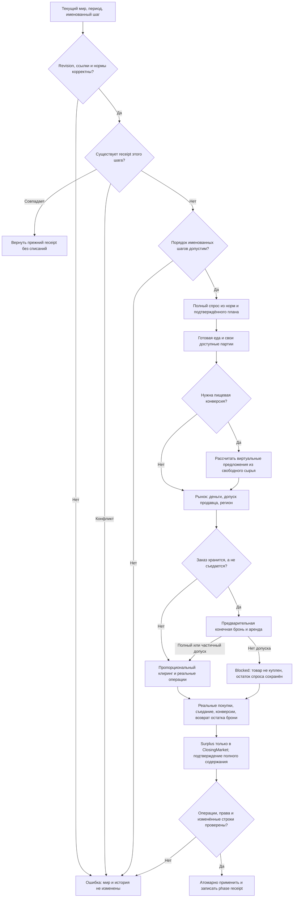

# Rust: реальные потребности, оплаченный рынок и пищевые конверсии

Статус: одобрено автором 13 октября 2026 для подготовки плана реализации. Предыдущий производственный этап завершён; подтверждения находятся в `reports/rust-production-2026-10-12/report.md`. Эта спецификация описывает следующий этап переноса, а не уже работающую Rust-неделю.

## Наблюдаемый результат

Rust рассчитывает потребительские заказы по настоящим нормам мира, исполняет доступные оплаченные покупки, списывает действительно съеденные товары и сохраняет владельцев, остатки денег и складские права. Купленное производственное сырьё оказывается на настоящем складе покупателя. Показатель удовлетворения потребностей выводится из фактических операций, а не из распределения условного общего предложения.

Сохраняются утверждённые решения автора: мгновенная торговля внутри региона; реальные сроки межрегиональной доставки; зерно → мука и скот → мясо по текущим пищевым правилам; отсутствие денег означает непокрытый спрос; защищённое сырьё кустарей; конечные склады. Экономические нормы, цены, ставки, начальные данные и бюджетные расходы не балансируются заново.

Полная неделя остаётся заблокированной. Не запускаются недели рабочего мира, полный производственный цикл рабочего мира, годовые прогоны, экспорт или запись текущей SQLite. Проверки выполняются на небольших изолированных RAM/SQLite-fixtures и настоящем JS как эталоне. Сам по себе успех таких проверок не доказывает здоровье экономики мира.

## Выбор границы

Рекомендуемый вариант — три атомарных шага на существующих `WorldState`, `OperationSession`, точной денежной арифметике и складских правилах:

1. **Maintenance**: полный известный базовый спрос содержания рабов, его фактические покупки и итоговое подтверждение содержания.
2. **EarlyFood**: доступная оплаченная еда обычным ПОПам до производства, только при действующем `instant_food`.
3. **ClosingMarket**: после реального производства — остаток еды, производственные/строительные закупки, обычный рынок и складская конверсия излишков.

Одних рассчитанных потребностей недостаточно: без оплаты, прав и списания они повторили бы проблему прототипа. Перенос сразу всей недели потребовал бы одновременно найма, бюджета, перевозок, доходов владельцев и строительства; эти подсистемы остаются следующими этапами. Три шага позволяют сохранить реальный порядок JS без имитации отсутствующих фаз.

Вход каждого исполняемого шага: текущий мир, campaign/revision, непустой period, именованный шаг и действующие профиль/приоритеты. Потребительские количества строятся движком из мира. В ClosingMarket используется подтверждённый производственный план этого же периода; произвольная пользовательская цель выпуска не заменяет план. Шаги не меняют календарь или revision и не выдают себя за сохранённый ход.

## Источники правил

Пути относительно рабочего JS-проекта `../Проект карты Тейванкаля`:

| Источник | Контракт |
|---|---|
| `scripts/population/needs-resolver.js:54`, `:90`, `:144`, `:181`, `:211`, `:223` | Нормы, богатство, грамотность, замещения, неизвестные потребности |
| `scripts/kingmaker/market.cjs:19`, `:61`, `:74` | Бюджеты, клиринг, собственные запасы, продовольственные альтернативы, построение заказов |
| `scripts/kingmaker/foundation-market.cjs:8`, `:18` | Производственные/строительные заказы, складские брони и допуск продавца |
| `scripts/kingmaker/regional-market.cjs:4` | Типизированные регионы и физическое расположение запасов |
| `scripts/kingmaker/food-conversion.cjs:8`, `:10`, `:21`, `:26`, `:54`, `:71` | Коэффициенты, остаток потребности, early/late/surplus, проверка рецептов |
| `scripts/kingmaker/artisan-working-capital.cjs:13` | Защита входных запасов кустарей |
| `scripts/kingmaker/building-rules.cjs:2` | Допуск закупок существующего строительного проекта |
| `scripts/kingmaker/foundation-network.cjs:4`, `:6` | Соседи и сухопутный путь для оценки спроса при surplus |
| `scripts/kingmaker/foundation-turn.cjs:65`, `:71`, `:77`, `:89` | Порядок содержания, ранней еды, позднего рынка и последующих фаз |

При реализации фиксируются хэши использованных JS-файлов и версия Node/ICU. Если исходники параллельно изменились, расхождение разбирается до продолжения; спецификация не даёт права незаметно выбрать другую редакцию правил.

## Потребности и их данные

- Загружаются реальные `needs`, профили, `profileRefs`, нормы, resolver, соглашения содержания, цены, параметры рынка, территориальная привязка, предложения продажи и необходимые поля проектов/учреждений. Сохраняются provenance, неизвестные поля, null/undefined и различие строковых/числовых ID по действующему codec. Общая история операций остаётся единой; отдельная конкурирующая бухгалтерия рынка не появляется.
- Исходником количества служит актуальный `profileRef`, как в JS; провинция, плательщик и класс берутся из текущего ПОПа. Изменение этих данных, нормы, цены, региона, назначения склада или метода производителя должно влиять на следующий расчёт без пересборки стартового мира. Устаревшие ссылки выявляются; отсутствие будущей механики изменения профессий не компенсируется ручной подгонкой профиля.
- Недельные нормы читаются из `quantity_per_person_week`. Для weekly-resolver обязательны `period=week` и `period_days=7`; отсутствие нормы вызывает ошибку, месячная норма не делится автоматически на четыре. Явные ветви исходного resolver сохраняются, миграции старых сохранений не добавляются.
- Еда: подушевая норма × численность, с текущим вычетом продовольственной части военного пайка и `food_norm_multiplier`. Множитель конечен и неотрицателен. Сохраняются доли альтернатив и восстановление непокрытой пищи при сорванном/частичном военном снабжении, без второго полного обеда.
- Для материальных норм сохраняются `H`, `mean_raw`, правило распределения, веса богатства, множитель грамотности `0,5 + literacy`, ограничение роскоши и выбранные замещения одежды/мебели. Нулевой или отсутствующий параметр обрабатывается именно по соответствующей ветви resolver; универсальных новых коэффициентов нет. Сохраняются порядок вещественных операций и нормализация до 12 знаков исходного JS.
- `military_supply`, оружие и боеприпасы требуют реально указанного active force; отсутствующее штатное устройство не заменяется всей численностью военных ПОПов. Этот этап не назначает военнослужащих на места.
- Обычный ПОП покупает со своего `personal_savings`; раб — только базовые потребности за плательщика соглашения с `sponsored_maintenance_reserve`. Отсутствующее соглашение не создаёт кошелёк рабу или бесплатную еду. Финансирование этого purpose-счёта переносится вместе с бюджетными/upstream-правилами позднее.
- Housing, heat, education и другие строки, не имеющие исполняемой количественной нормы в исходнике, сохраняют `null`, `not_evaluated`/`not_applicable` и объяснение. Их обеспеченность не становится нулём или 100%. Отсутствие всего раздела needs диагностируется как «нет измерения», а не как мир без потребностей.

## Оплата, предложение и клиринг

- Нужна действительная положительная цена в валюте заказа. Собственная партия используется без перечисления денег, при сохранении требований текущего JS к котировке и доступу. Остаток заказа может быть куплен у других продавцов; каждый проход имеет исходный суффикс `:phaseN` в event ID.
- Один кошелёк `owner/currency/purpose` распределяется между заказами общего приоритета. Используются действующие `invoice`, `decimalRatio`, `roundRatio`, `allocateBudget`, правила остатка и сортировки. Minor units целочисленные; переполнение Money(i64) — явная ошибка до публикации.
- Приоритеты берутся из действующей политики/подтверждённого производственного плана, а не прибиваются заново. Внутри группы сохраняется одновременный пропорциональный клиринг до 32 итераций и epsilons JS. Перестановка покупателей не превращается в преимущество первому. Сортировка `localeCompare` использует уже принятый ru-UA, денежные tie-break — действующее правило UTF-16.
- Цена, валюта партии и существующие валютные счета продавца определяют допустимость расчёта. FX не придумывается. Зачисление производится на утверждённый seller-purpose, личные сбережения либо operating-purpose соответствующего производителя по исходному алгоритму. Продажа может создать законный недостающий адрес счёта, но не произвольного владельца или эмиссию.
- Маскируются held goods и защищённые входы кустарей. Личные запасы ПОПа, производственные входы и материалы активной стройки продаются другим только по действующему допуску/подтверждённому предложению. Пищевой резерв доступен владельцу для нужного бенефициара, не всему населению провинции. Допуск и фактический объём предложения учитываются отдельно.
- Проданный товар списывается из конкретной партии. `consume=true` означает реальное потребление; `consume=false` создаёт/пополняет запас покупателя с исходным purchased-ID, единицей, валютой и настоящим destination facility.
- Для несъедаемой покупки сначала получается конечная складская бронь, включая аренду. Частичная бронь уменьшает принятый заказ. После покупки погашается фактически занятая часть, оставшаяся освобождается с предусмотренным возвратом/обязательством. Еда, сразу съеденная, не нуждается в фиктивном складе.
- При `regional_market=true` предложения объединяются в пределах типизированного region_id. Провинции без региона остаются отдельными. Физическое местоположение продавца не переписывается. Разные регионы не получают мгновенный импорт; сохраняются причины `pending_transport`, `no_supply`, `no_buyable_supply`, `settlement_unavailable` и отсутствие котировки.

## Производственные закупки

Заказы на входы заводов и кустарей используют авторские рецепты и реальный потенциальный/трудовой выпуск плана. Текущий `ProductionPhaseReceipt.planned_outputs` хранит только уже ограниченный выпуск; этого недостаточно для спроса на недостающее сырьё. Этап добавляет к подтверждённому производственному receipt необходимые вычисленные поля активности (`method_id`, potential/labor/output), сохраняя существующие поля и результаты производства. План не заменяется текущим фактическим выпуском: иначе производство без сырья заказывало бы ноль сырья навсегда.

Сохраняются pending retooling, назначенные работники, свободные собственные входы, exclusion food-reserve, purpose/currency и input-facility mapping. Материалы funded/building/awaiting_labor проектов заказываются по текущим ready-правилам, лимитам и escrow; completed/cancelled/недопущенные проекты не создают спрос. Переносятся только нужные для закупок чтение и проверки лимитов; строительство и смена производственного метода не исполняются этим этапом.

## Еда, содержание и фактическая обеспеченность

- При действующем `instant_food` сначала покупается готовая еда, затем только реально купленный недостающий объём конвертируется из свободного сырья: **1,03 зерна на 1 муки; 5 скота на 1 мяса**. Это пищевые операции, не бесплатная заводская активность. Переименования исходного ресурса ДП нет.
- Виртуальное предложение служит расчёту. Реальное списание сырья, создание продукта, оплата и съедание применяются одной атомарной публикацией. Неиспользованный виртуальный остаток не материализуется. Сохраняются владелец, исходная провинция, валюта, единицы и provenance партии.
- `remainingFoodOrders` учитывает все реальные пищевые receipts, включая fallback и военное замещение; early/late/обычный рынок не съедают одну норму несколько раз. Объединяются альтернативы grain/flour, без дублирующего заказа на одну потребность.
- Surplus сохраняет текущие правила оплаченного конкурирующего спроса на сырьё, доступного пищевого спроса, складского net-space и аренды. Неоплаченный голод не блокирует использование зерна промышленностью. Для оценки `foodWanted` воспроизводится только необходимый поиск сухопутного пути из исходника, включая множитель длины пути; это не отправка груза и не реализация разрешений международной торговли.
- Итог содержания рабов вычисляется по **всем** известным базовым заказам, включая полностью неисполненные: minimum отношения фактического потребления к заказу по need_id, ограниченный единицей; без заказов — ноль, как в JS. Receipt содержит исходные суммы спроса, actual, period и event IDs. Проверка связи с производством отвергает подтверждение выше этого результата, чужие/старые события, повторный учёт одного события и пропущенную непокрытую потребность. Количественно неизвестные нужды отдельно отмечаются.
- Обеспеченность обычного ПОПа и unmet demand выводятся из этих же фактических покупок. Транзитный груз, заказ или план покупки не считается съеденной едой. Смертность от голода и новые потребности не добавляются.

## Атомарность, повтор и диагностика

Добавляются строго проверяемые `purchase` и `food_conversion` операции к существующей общей сессии. Произвольный вызов ledger не получает право бесплатно списывать чужие товары, создавать товар или назначать receipt содержания. Проверяются источник, доступ, рецепт, единицы, оплата, склад и неизменность затронутых данных перед публикацией.

Любая ошибка портит весь подготовленный шаг: счета, запасы, брони, история и receipts остаются прежними. Успешный шаг сохраняет именованный phase receipt. Полностью идентичный повтор возвращает прежний receipt без новых списаний/конверсий/аренды; несовпадающий запрос, конфликтный event или частично применённый шаг явно отвергается. Текущий механизм защиты `PreparedChanges` расширяется на прочитанные рыночные данные; проверка выполняется до первой мутации мира.

Receipt содержит запрос, frozen спрос, принятые и исполненные количества, покупки, платежи, продажи, потребление, конверсии, освобождения, причины отказов и audit. Товары агрегируются по исходным единицам; деньги — отдельно по валюте и purpose. Изменение товаров объясняется рецептами, потреблением и перемещением собственности; изменение денег — debits/credits/rent/refunds, без требуемой неизменности произведённых/съеденных товаров. Люди и назначения труда этим шагом не меняются.

Проверяются конкретные имущественные переходы операций и защита резервов. Полная юридическая проверка всех прав мира, доходы владельцев, общий бюджет, перевозки и годовое сохранение остаются «не реализовано»/«нет измерения». Порядок технических строк сохранения не выдаётся за экономический результат.

Для схемы G означает подготовку условий рынка, а не оплату до складской брони. Экономический отказ отдельного заказа — допустимый частичный исход K; структурная ошибка или нарушение сохранности — полный откат X. Повтор Y не проходит через конверсию или возврат аренды.

## Изменения контрактов и проверка

Преднамеренные изменения Rust: заменяются выдуманные нормы `size×0,1 grain` / `size×0,02 cloth` и последовательное распределение общего supply; исчезает автоматическое использование чужого провинциального запаса. Старые detached helper-API, не имеющие нужных норм/счетов/прав, не продолжают рассчитывать фиктивную экономику: их вызовы переводятся на авторитетный API либо возвращают явную ошибку с обновлением известных callers. Существующий полный week-API продолжает отказывать до переноса всех обязательных фаз.

Новые данные рынка и метаданные производственного receipt добавляются без удаления его текущих полей, денежных настроек и проверок. Нативный integrated maintenance получает полную проверку спроса; это явное усиление относительно прежней изолированной проверки только представленных событий. Вне перечисленного экономические правила не меняются. Найденное расхождение самого JS воспроизводится и сообщается отдельно; его исправление не прячется под перенос.

До реализации добавляются RED-регрессии и малый JS oracle. Основные случаи:

1. Реальные weekly-нормы, food multiplier, богатство/грамотность, роскошь, апгрейды, missing norm, неизвестные/неприменимые нужды.
2. Два ПОПа одной провинции: личные запасы/food-reserve одного не становятся общим бесплатным пайком; sponsored maintenance не кредитует кошелёк раба.
3. Общий buyer budget, приоритеты политики, пропорциональный дефицит, несколько продавцов, денежное округление и валюты.
4. Частичный собственный паёк плюс оплаченный остаток; alternatives/fallback; неудачный и частичный military_supply без двойной еды.
5. Один регион/другой регион/null region/числовой и строковый region ID; изменение привязки немедленно меняет доступ, не физическую партию продавца.
6. Частичный склад, аренда, возврат/долг, законный seller-purpose, скрытое личное сырьё, held goods, защищённые входы кустарей.
7. Нулевой выпуск из-за отсутствия сырья при положительном potential создаёт правильный input order; pending retooling и допуск стройки сохраняют свои источники спроса.
8. Grain/flour merge; реальные коэффициенты; ready перед conversion; неоплаченный голод; funded raw demand; surplus с реальной ёмкостью/путём; продукт без чужого склада.
9. Непокрытая вторая потребность содержания, чужой/старый/поддельный receipt, inflated fraction, повторное событие.
10. Атомарный отказ, тождественный повтор, конфликт/частичное применение, изменение исходной цены/нормы/прав/назначения склада между prepare и apply.
11. Изменение параметров ПОПа, профиля, рынка и производителя без ручного пересоздания мира; отсутствие повторного использования устаревших вычислений.
12. Сохранение людей/труда/денег/прав и объяснённых goods-deltas; регрессии предыдущего производства; read-only CLI/API и прежний отказ полной недели.

Сравнение с настоящим JS включает операции, экономические остатки и обязательные метаданные, исключая только явно техническую диагностику; количества сравниваются с исходными epsilons, деньги/ID — точно. После реализации — один независимый итоговый review, исправление существенных замечаний, актуальные EXE и отчёт с фактическими результатами. Замер недель и вывод о здоровой экономике не входят в приёмку этого этапа.

Уточнение реализации после итогового ревью: исполняемые planners/capabilities внутренние; внешний вход — prepare/apply/execute именованного шага с построенным движком спросом. Первый Maintenance/EarlyFood после производства или более позднего рыночного шага того же периода запрещён; идентичный повтор возвращается по receipt до проверки порядка. ClosingMarket использует явно переданные приоритеты либо purchase_priorities подтверждённого производства, сохраняя его override. Эти проверки закрепляют уже указанные требования оплаты, прав, последовательности и отсутствия повторного потребления.

