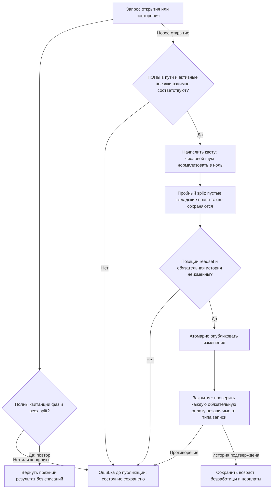
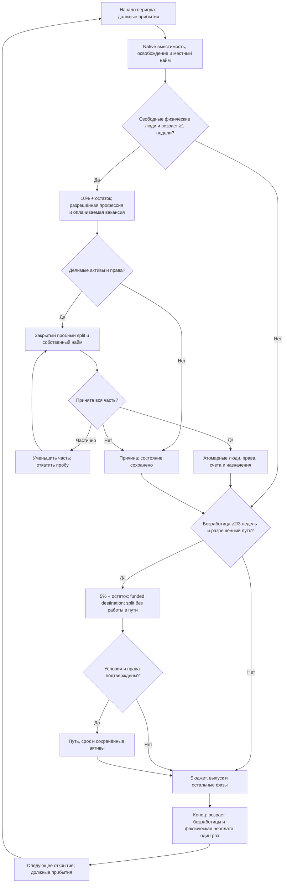

# Native profession, cohort and passenger mobility

Самостоятельно утверждено 2026-10-13 по прямому разрешению пользователя. Реализация — после закрытия местного труда; полная неделя остаётся заблокирована до остальных обязательных фаз. Цель этапа: без ручной правки стартовых назначений свободные люди действительно меняют профессию и получают местную работу либо едут к доступной работе; сохраняются люди, деньги, долги, товары и имущественные права.

## Сохраняемые правила

Источник: действующие `pop-mobility.cjs`, `pop-cohorts.cjs`, `pop-cohort-assets.cjs`, `profession-hiring-scope.cjs`, `pop-migration.cjs`. Новых ставок, населения, ресурсов, рабочих мест, субсидий и цены поездки нет. Один реестр native POP/счетов/договоров/складов; отсутствующие исходные права сначала проецируются losslessly, не считаются пустыми и не читаются заново из старого SourceSnapshot после native изменений.

1. В начале периода — состоявшиеся прибытия, затем вместимость/освобождение/местный и собственный кустарный найм. После этого профессия, затем отправления. Новый работник участвует в оплате/производстве того же периода. В конце периода обновляется история безработицы и неоплаты фактических назначений.
2. Профессия: минимум одна завершённая неделя без работы, 10% подходящей свободной рабочей силы + дробный остаток. Только явно разрешённое `funded_vacancy` с источником в справочнике профессий. Новый собственный договор и подтверждённый найм **всей** выбранной части в конкретную вакансию; частичный результат уменьшает пробную часть и проверяется заново, ошибка/отказ ничего не публикует.
3. Разделение: `floor(size × workers / workforce)` людей и точный перенос соответствующей рабочей силы; грамотных — целая пропорциональная доля; возрастная история безработных переносится от старейшей части. Только свободные физические работники, без двойного использования людей с неполным временем. ID дочерней группы — прежний SHA256 события, числовые/строковые ссылки не схлопываются. Наследуются только утверждённые характеристики ПОПа, чужая зарплата не копируется.
4. Личные сбережения/товары/долги делятся по прежним формулам. Производственное сырьё/произведённый товар собственного кустаря остаётся у родителя при частичном разделении; удержания нельзя потратить повторно. Проверяются резервы денег/товаров, незавершённые перевозки, инвесторы/бенефициары и неделимые условия аренды. При полном разделении перевязываются разрешённые ссылки и права; при частичном — предоставляется предусмотренный исходником складской доступ. Физическое место товара при смене профессии не меняется. Перевозки и долги не теряются.
5. Миграция: 5% подходящей силы + остаток; внутри страны после двух завершённых недель, за границу после трёх. Только соседние сухопутные провинции одной суши; направленная внешняя граница должна разрешать переход. 7 игровых дней на каждую границу, плата отсутствует по утверждённому правилу. Во время пути работы нет; вакансия назначения учитывает уже идущих людей. Прибытие переносит провинцию/государство/needs refs/территориальную численность, собственную валюту сохраняет. Предпочтение: внутренняя миграция, обеспеченность жизненных потребностей, длина пути, прежняя сортировка провинций.
6. Аристократы, капиталисты и рабы защищены от этого разделения; авантюристы не меняют профессию/не мигрируют через эту процедуру. Не реализуются образование/лечение, смертность от голода и морская миграция. Их отсутствие сохраняется явным, без подмены нулём.

## Наблюдаемые результаты и атомарность

Решения по шести воспроизведённым замечаниям итогового ревью (2026-10-13): отрицательный числовой шум дробной квоты нормализуется в ноль, ставка 10% не меняется; readset хранит позиции потребностей и территории; вся обязательная производственная оплата проверяется независимо от подменённого типа операции; полный split переносит также пустые складские строки и их метаданные, чтобы ссылки на места будущей доставки существовали; каждый ПОП в пути обязан иметь ровно одну активную поездку; повтор фазы требует сохранённых квитанций всех её split, включая дочерний ID и операции. Пустой склад не создаёт товара или денег. Последующее законное изменение состояния не требует возвращать ПОПа к параметрам старой квитанции. Это исправления сохранности, не изменение баланса; прежний JS пропуск пустого склада и отрицательный epsilon не переносятся как желаемое правило.

Ошибки или неполные/противоречивые ссылки возвращают конкретную причину/ID до изменения состояния. Повтор с полной совпадающей историей возвращает прежний результат; частичная история, изменившиеся прочитанные данные и попытка выполнить открытие после поздних фаз отклоняются. Все денежные/товарные/долговые операции закрыто авторизуются native планировщиком. Продолжение после сохранения сохраняет остатки, возраст безработицы, пути и обязательную историю.

Преднамеренные изменения относительно JS: строгая проверка типизированных ссылок/количеств и атомарного применения; отдельный отказ вместо тихого обнуления неизвестных норм/данных. Любой обнаруженный существенный исходный баг фиксируется отдельно с RED-регрессией, причиной и записанным решением; баланс не меняется ради теста.

Самопроверка: отказ не списывает активы; уменьшение пробы заканчивается при count=0; положительная проба не оставляет второе назначение/дублированные товары; отправление не работает в пути; прибытие не создаёт население. Архивные и неактивные строительные назначения не оплачиваются/не старят неоплату. Существующие обязательства остаются обязательствами даже после освобождения.

Валидация: небольшие реальные JS oracle примеры + отдельные регрессии доказанных багов; граничные округления, полный/частичный split и удержания, чужие/исчезнувшие ссылки, funded preview, разрешённый/запрещённый путь, повтор/прерванная история/readset, первый заработок ребёнка, отсутствие работы в пути и сериализация. Полный RAM probe не объявляется здоровой недельной экономикой.
