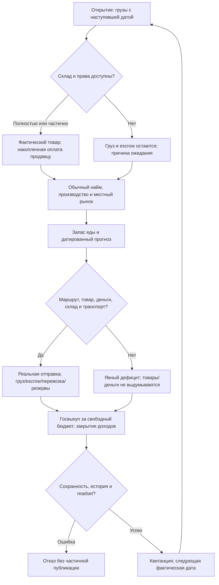
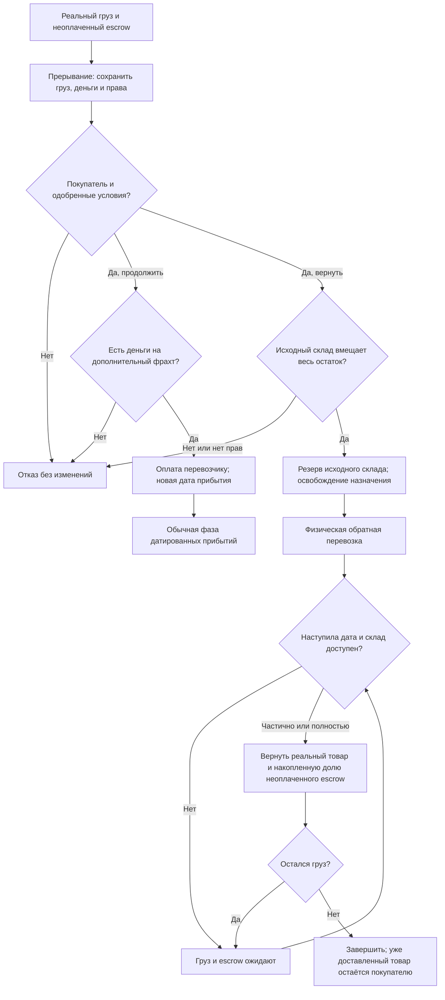
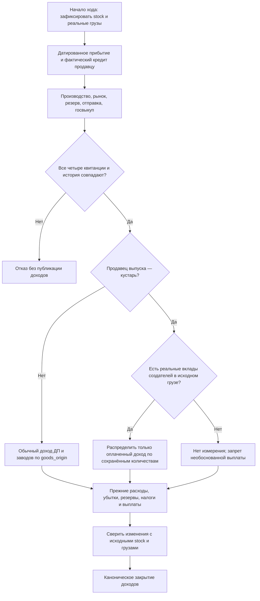
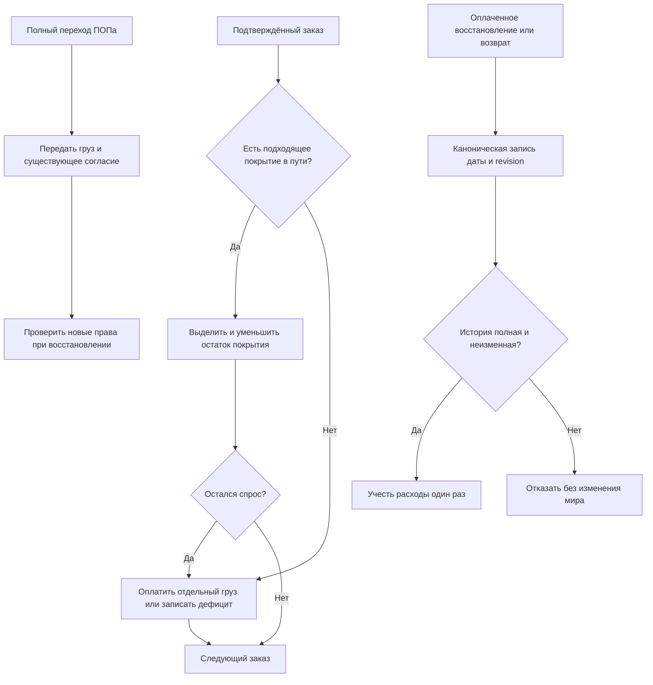

# Native dated supply, food reserves and state raw procurement

Следующий этап цели десяти Rust-недель. Самостоятельно утверждён по разрешению пользователя. Наблюдаемый результат: товары действительно отправляются между регионами за деньги, остаются в пути до игровой даты, приходят на законный склад и оплачиваются продавцу по фактическому прибытию. ПОПы заказывают еду на горизонт пути и следующей проверки; государство выкупает сырьё только за доступный бюджет. Полная неделя пока остаётся закрыта до сборки всех фаз и checkpoint.

## Авторитетные правила

Источники JS: supply.cjs, foundation-supply.cjs, food-supply-forecast.cjs, state-procurement.cjs; маршрутные условия foundation-network.cjs, региональность regional-market.cjs и складские права storage.cjs. Native уже реализует местный рынок, точные деньги, склады, бюджеты, производство, труд, доходы и строительство. Их контракты сохраняются. Не использовать старые упрощённые публичные helpers Rust как доказательство готового цикла.

Прибытия обрабатываются на открытии по текущей игровой дате, до найма и выпуска (foundation-turn.cjs43). После местного рынка: местные пищевые резервы → физическое снабжение → госзакупка → доходы (91–93). Отправленный сейчас груз не становится доступной едой до срока. Даты — действующий календарь 30 дней в месяце, 360 дней в году; travel_days/return_days не ускоряются. Внутри одного региона работает существующая мгновенная оплаченная доставка.

## Отправка, прибытие и права

Сохраняются ID и неизвестные авторские поля всех грузов, маршрутов, транспортных активов, терминалов, резервов и recovery plans. При отправке валидируются реальные предложения, продавец/товар/единицы/провинция, маршрут/границы/навигация, транспорт и склад назначения с арендным правом. Количество ограничено свободным товаром после обязательных резервов, складом, общей недельной пропускной способностью маршрута/обоих терминалов, занятым транспортом и реальными деньгами. Совместные ограничения учитываются один раз для всех заказов и ингредиентов.

Цена товара с точным authored rate помещается в trade_escrow груза, перевозка платится реальному перевозчику, аренда — по действующим правилам. Не создавать доход продавца до прибытия. Исходный товар списывается в груз; его происхождение и производственный вклад сохраняются. При частичном прибытии на склад покупателя продавцу платится разница между округлённой накопленной оплатой и уже выплаченным; повтор не платит снова. Нехватка склада сохраняет оставшийся груз, деньги, резерв и занятость транспорта, с явной причиной. Успешная доставка не освобождает транспорт раньше разрешённой даты возврата.

Прерывание, восстановление и физический возврат используют существующие явно одобренные условия и права участника. В автономном сценарии решения игрока не выдумываются. Не превращать застрявший груз в бесплатные деньги или товар. Возврат приходит физически на исходный склад и возвращает только предусмотренный неоплаченный escrow, со всеми остатками и частичными исходами.

Проверка прав прибытия: чужой склад требует сохранённого одобренного договора аренды для соответствующего владельца, валюты и исходного purpose. Существующий оплаченный резерв сохраняет договор даже без текущей записи access_contracts. JS-прибытие проверяло лишь held/owner резерва; Native дополнительно отказывает на противоречивом состоянии без договора. Возврат использует права/счёт продавца на исходный склад, обычное прибытие — покупателя. Положительный stock подтверждается реальным remaining cargo; рассчитанные producer_contributions сохраняются при частичных разгрузках, а не считаются бесплатным выпуском.

## Еда и госзакупка

Пищевой ключ сохраняет owner/province/good/beneficiary. Потребность в день = действующий недельный заказ /7. Горизонт = travel_days+7; заказ = max(0, потребность горизонта−доступный собственный запас−учтённые поступления). Просроченные/задержанные грузы учитываются по исходным датированным правилам, не как немедленно доступная еда. Диагностика показывает uncovered_before_arrival и фактически заказанное. Заказы не создают стартовые запасы, субсидии, деньги или дополнительное потребление; текущие пищевые конверсии сохраняются.

Госвыкуп действует на реальные свободные raw-resource товары ДП внутри своего государства и реальные state_raw_warehouse. Доступная казна защищает недофинансированное содержание служб на две недели и предусмотренные обязательства; rawProcurementFunding от0 до100 сохраняется. Распределение точного бюджета, цены, аренда, склад и оплата проверяются существующим местным рынком. Отсутствие денег/склада/политики — явная причина, не обязательный бесплатный выкуп.

## Атомарность, диагностика и приёмка

Закрытые prepare/apply/execute вычисляют заказы и права из WorldState; произвольный public JSON не разрешает создавать груз, деньги или stock. Полный readset, канонические квитанции и границы даже пустых фаз; пропавшая история вызывает отказ, точный повтор безопасен. Объясняется баланс stock+cargo, escrow/перевозки/аренда/оплата, люди/труд и права. Сохраняются товарное происхождение и доходы при доставке. Нет измерения и не реализовано указываются явно.

Выявленная техническая ошибка сохранения: serde_json без float_roundtrip восстанавливал 0.44999999999999996 как другой f64 (на один бит выше). Включаем штатную опцию существующей библиотеки; regression требует одинаковые to_bits до/после JSON. Это сохранение исходных количеств без нового округления или баланса. Строковые идентичности заказа/склада сохраняют числовое представление JS для целых безопасных количеств (5 вместо 5.0).

Для автономного снабжения сохранённые рыночные заказы должны быть доказуемыми: обнаружено, что изменение orders в квитанции либо удаление пустой квитанции проходило повтор без ошибки. Native рынок теперь записывает нулевую финансовую границу с хешем request/orders/frozen_needs/priorities; доставка проверяет её до использования заказов. Правила рынка, приоритеты, оплаты и количества не меняются; добавляется обязательная история, включая пустые фазы.

Самопроверка включает частичные платежи/склады, совместную вместимость, задержку и возврат, повтор/конфликт/поздний failure, сохранение всех пяти видов состояния. Обязательны реальные мини-грузы, сравнение обычных результатов с JS и новые закрытые income prerequisites. Checkpoint полного мира и десять недель остаются последующим обязательным этапом, не заменяются мини-тестами.

Уточнение проверки Task5: сравнение двух пищевых маршрутов выполняется с рабочим JS ledger в режиме RAM/COW. Старый массивный helper после отправки меняет исходный объект stock, затем запас вычитается второй раз в fallback `foundation-supply.cjs` (`updated=...amount-sent`). Это воспроизведённый дефект тестового пути, а не правило отказа второго маршрута: Rust сохраняет реальный свободный stock и совпадает с рабочим COW-путём (14+6 при вместимости20). JS рабочая база и движок не редактируются в Rust-этапе; legacy helper отдельно отмечается как дефект.

Возврат не выдаёт деньги до прибытия. Складские возвраты аренды объясняются действующими операциями, включая разрешённый долг провайдера; аудит требует точных операций для изменений суммы и сторон обязательства. Местные пищевые резервы — обязательная закрытая фаза перед отправкой; расход и stock проходят существующий рыночный аудит, полные юридические права остаются «нет измерения» там, где их не реализует рынок.

Task6 уточнение, самостоятельно утверждённое в пределах цели: закрытие доходов требует все четыре канонические фазы перевозок/резервов/госвыкупа, включая пустые. Базис доходов замораживает грузы до прибытия; повторное объяснение stock-операций использует исходный груз, не уже разгруженный остаток. В реальной двухпериодной цепочке обнаружен отказ `Arrival exceeds real cargo provenance` после полной доставки; исправление сохраняет исходные количества и права без новых товаров.

Реальная оплаченная доставка продукции кустаря должна войти в его доход так же, как местная продажа. В Rust и JS-атрибуции отсутствовала обработка shipment_arrival для кустарей: деньги поступали, но revenue оставался0. Native исправляет этот дефект по настоящим кредитам продавцу и сохранённым producer_contributions исходного груза. Предыдущие нормы, расходы, carry loss, резервы, налоги и доли выплат сохраняются. Если происхождение не определено, ставится «нет измерения» и запрещается необоснованная выплата. Стартовый товар учитывается отдельно от выпуска. Таблица вкладов сохраняет существующий контракт кустарей; завод не получает выдуманный индивидуальный вклад в этой таблице, а сохраняет goods_origin, stock_id и владельца.

# Итоговое ревью: уточнения сохранности (самоутверждено по разрешению автора)

Один запас груза покрывает только одну долю суммарного спроса: входящие непищевые количества распределяются последовательно и списываются из доступного покрытия, с сохранением владельца, провинции, склада, назначения и бенефициара. Новый груз уже относится к своему заказу и не покрывает следующий. Возвратные, отменённые и потерянные грузы не покрывают потребности покупателя. Пищевой прогноз сохраняет отдельную календарную модель.

Госзакупка требует совпадения предложения с владельцем, товаром, единицей, валютой и непустым назначением платежа. Частный фильтр рынка требует действительного предложения; обычная возможность продажи предприятия не заменяет такое разрешение. Существование заранее созданного денежного счёта продавца не требуется: создание разрешённого счёта при настоящем платеже остаётся прежним контрактом.

При полном преобразовании идентичности ПОПа согласованные участники восстановления перевозки переходят вместе с грузом, без создания нового согласия; неизвестные авторские поля сохраняются. Частичный переход не делит согласие. И скалярное, и индексированное преобразование включают планы восстановления в чтение и публикацию прав.

Команды прерывания, восстановления и возврата сохраняют собственный ID для повторного исполнения. Для бухгалтерии они относятся к экономическому ходу по подтверждённым дате и revision кампании, даже когда ID события отличается от ID недельного периода. Закрытие доходов проверяет их канонические записи, включая доплаты и аренду; отсутствие или изменение записи блокирует расчёт. Техническая граница хранит revision и подтверждает дату, поэтому удаление квитанции не скрывает расходы.

