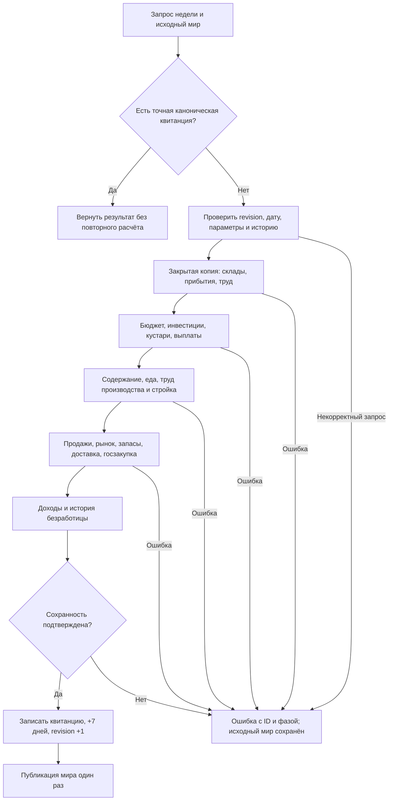

# Полная Rust-неделя в памяти

Архитектурный этап 10 общей цели десяти недель. Самостоятельно утверждён по разрешению автора. Предыдущий этап фактически опубликован: `reports/rust-supply-2026-10-13/results.json`, 558 workspace / 150 release PASS, fingerprint `f3db3575610c2592090f1e61286c9fe7874f4bba673393a6e71d9a1359f4db4a`. Это не доказательство здоровья экономики.

## Наблюдаемый результат и границы

Один вызов рассчитывает настоящую автономную неделю в RAM: существующие рабочие места и переходы ПОПов, выплаты и бюджет, производство, строительство, рынок и потребление, доставка и запасы еды, государственные закупки, доход владельцев и история безработицы. Успешный ход изменяет дату на 7 дней по календарю 12×30 и revision ровно на 1. Ошибка в любой фазе оставляет исходный мир целым. Повтор подтверждённого запроса не повторяет выплат, потребления и календарного перехода.

Не подменять отсутствующую механику пересборкой мира. Источник — текущая рабочая база, чтение без изменения JS runtime/SQLite. Не вводить деньги, товары, приказы или новые нормы. Сохранять авторские неизвестные поля, ID и типы ID, рецепты, численные формулы, права, разрешённые долги и бюджетные ползунки.

Долговременный native checkpoint и программа X-недельного прогона — следующий связанный этап, а не исключение из общей цели. Полный мир не запускать до проверки checkpoint и автономного запуска. Устаревший интерфейс detached recipes не становится действующим расчётом. Совпадение миниатюрного теста с JS и зелёные проверки не заменяют измерений полного мира.

## Недостающие динамические правила

1. **Вместимость складов.** Для складов с `capacity_rule`: `max(реальная занятость, minimum_capacity, opening_space + buffer_weeks × недельный объём)`. Учитывать текущие мощности ДП, расширения/технологии, оборудование и эффекты заводов, мощности кустарей и переналадку, сырьё рецептов, публичные склады сырья, потребности еды и реальные товарные единицы. Правило без `capacity_rule` сохраняет назначенную вместимость; уровень здания не придумывать. Неверная формула отклоняется без записи. Не создавать новые стартовые склады.
2. **Предложения продажи.** Перед закрывающим рынком и перед доставкой заново строить только автоматические предложения из реально существующих положительных запасов. Ручные предложения сохранять. Не продавать пищевые резервы, защищённые входные материалы заводов/кустарей, неавторизованный товар населения или чужой публичный склад. Выходы ДП сохраняют разрешение продажи. Валюта и единица берутся из товара, цена и точная дробная ставка — из действующей калибровки. Конверсия еды расширяет допустимые выходы, не создавая товар. ID `standing-sale:<stockID>`, исходный порядок, период и права сохраняются.

Источники правил: JS `scripts/kingmaker/storage-capacity.cjs`, `foundation-network.cjs:planTradeOffers`, `foundation-turn.cjs`. Gemini используется как источник краткой карты проверок, все существенные выводы сверяются с этими файлами.

Уточнение Task1: неверные отрицательные/нечисловые нормы вместимости и неразрешённые единицы занятого места отклоняются, даже если прежний JS мог спрятать ошибку через `max`/пропуск. Исходные данные не исправляются этим отказом. Если строковый и числовой ID товара дают одинаковый `standing-sale` ID, отклонять неоднозначный результат без записи, сохраняя оба исходных права; не выбирать один товар и не подменять его ID. Это защита от дефекта идентичности, а не изменение цены или спроса.

## Порядок и договоры фаз

Замороженное начало для признания доходов сохраняется до прибытия и переходов. Затем: склады → грузовые прибытия → пассажирские прибытия/места/найм/кустари/профессии/отъезды → начало бюджета (авантюристы, государственные и частные средства, старые обязательства) → автоматические инвестиции → выбор и капитал кустарей → выплаты службам → полное содержание рабов → ранняя еда при действующем `instant_food` → зарплата строителей и производственный цикл → 7 дней строительства → обновление продаж → закрывающий рынок → обновление продаж → местные запасы еды → отправка грузов → госзакупка сырья → доход кустарей и предприятий → история безработицы → проверка и завершение недели.

Намеренные изменения реализации, а не баланса: разделить нынешний объединённый бюджет на подтверждённое открытие и подтверждённую выплату службам; разрешить открывающий выбор кустарей после настоящего открытия бюджета, но до выплат/рынка/производства; запрет зарплаты строителей после закрывающего рынка сохраняется, ранние фазы еды допускаются; восстановить источник порядка выплат кустарей и производств при общем владельце. Старые изолированные API остаются обёртками над теми же правилами, без альтернативного экономического режима.

Уточнение Task2: объединённый бюджет исполняет обе стадии в одном закрытом `OperationSession`, сохраняя полную атомарность и те же квитанции/экономические операции; промежуточная публикация при таком вызове не требуется. Новые счета публикуются по уже назначенному внутреннему ID, сохраняя порядок существующих счетов: устранена случайная перестановка новых строк из HashMap, без изменения ID, денег или правил. Выбор кустарей после открытия бюджета хранит доказательства этого открытия и хеш входов; потеря или изменение доказательств отклоняет повторное исполнение.

## Атомарность, история и диагностика

Уточнение итогового ревью: открытие кустарей действительно исполняет `artisan-working-capital.cjs`, а не только прогноз. После завершения прежней переналадки построить котировки на текущих потребностях с выбранным market profile; при нерентабельном старом методе оплатить разрешённую выгодную переналадку из реальных личных денег. Её дата готовности — текущая дата + авторская длительность, в отличие от выбора при закрытии, который начинается после недели. Затем по владельцу и валюте пополнить оборотный кошелёк до утверждённого общего минимума в пределах личных денег; действующим предприятиям вернуть только лишний лично внесённый капитал. Неактивным — выплатить накопленную прибыль с действующим налогом и отдельно вернуть капитал. Распределить principal и retained profit между предприятиями с точным последним остатком. Сохранять каждую операцию, метаданные и выбранный профиль в аутентифицированной квитанции. Публичный payload не разрешает эти платежи.

Начальные запасы для признания дохода остаются замороженными до прибытия/переходов. Обязательные операции открытия труда, разделения когорт и открытия кустарей воспроизводятся в фактическом порядке канонической истории. Недельная история проверяет также отдельные обязательные квитанции профессий/миграции/когорт, их единственность и содержание. До любого нового периода завершённая цепочка дат/revision обязана быть непрерывной, а campaign header — равен её последнему концу; новый ID запроса не разрешает повтор уже завершённого интервала.

Новый `NativeWeekRequest` содержит expected_revision, period, существующие policies и профили. Никаких скрытых государственных действий: используются действующие настройки, естественные инвестиции и авторизованные автоматические системы. Команды игроков о восстановлении/возврате транспорта сами не создаются.

Приоритеты рынка имеют отдельный необязательный `market_priorities`, повторяющий контракт существующего `MarketRequest.priorities`: отсутствие наследует действующие обычные настройки, явно заданный пустой список остаётся пустым. Этот выбор сохраняется в недельной квитанции. Сопоставление миниатюрной недели с JS задаёт одинаковый явный список обеим сторонам; пустой JS-массив является явно заданным значением, а не отсутствием параметра.

Расчёт использует один закрытый рабочий мир; фазы сохраняют собственные квитанции и канонические операции. Финальная квитанция содержит начало/конец, эффективные параметры, порядок фаз, доказательства операции/изменения регистров, компактные итоги и измерения времени. `source: Arc<SourceSnapshot>` сохраняется; этот этап не сериализует его и не объявляет полноценный снимок проверенным. Не считать техническую диагностику обязательной экономической историей.

Сверять деньги по валютам с допустимой эмиссией, товары по операциям выпуска/конверсии/покупки/потребления/грузов, людей и труд с подтверждёнными переходами. Собственные аудиты фаз обязательны. `NotMeasured` не заменяется успехом или нулём: полный аудит имущественного графа, показатели без поддержки и отсутствующие школьные/медицинские эффекты прямо отмечаются. Прошедшие операционные проверки прав не выдаются за полный аудит исходного графа.

Прогресс сообщает фазу и время; завершённый ход сообщает даты/revision. Сохранение и загрузка будут измеряться отдельно. Здесь регрессионные миниатюры и source comparison, без недель полного мира.

Самопроверка схемы: положительный исход, недостаток денег/мест/сырья как объяснённый частичный экономический результат, поздняя ошибка как отказ всей недели, повтор запроса без новых действий. Переход года — по настоящей дате, без предположения 52 недель.
