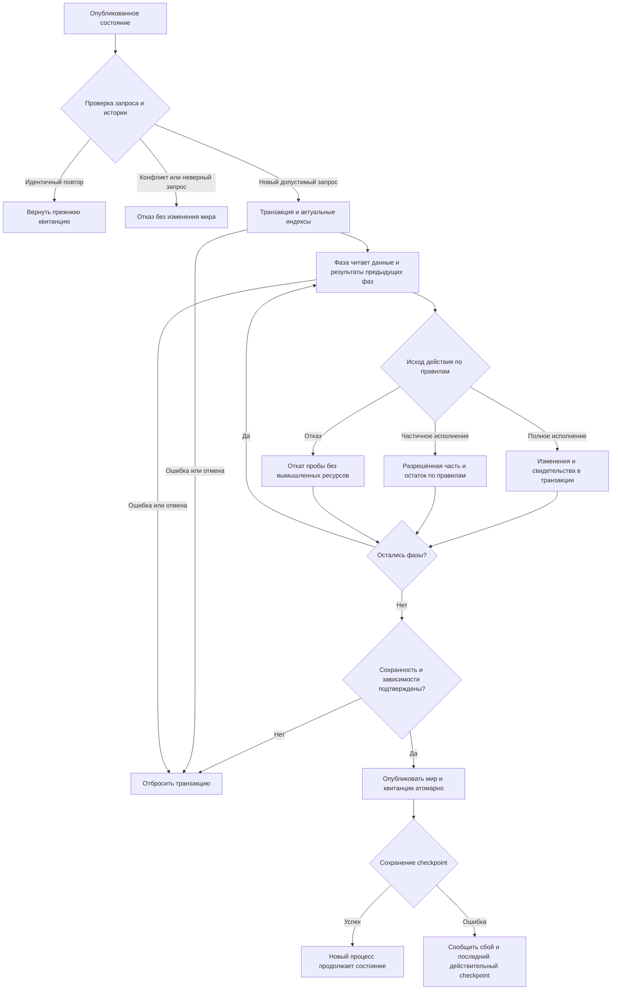

# Методы Project Alice в собственном движке Кингмейкера

Дата: 14 октября 2026. Статус: письменное дополнение согласовано пользователем ответом «Окей»; реализация ожидает проверки плана первого этапа.

## Намерение и границы

Пользователь выбрал методы Project Alice как архитектурную основу дальнейшей оптимизации, сохраняя самостоятельность Кингмейкера. Наблюдаемый результат: полный игровой ход быстро рассчитывается на текущем мире, загрузка и сохранение укладываются в бюджет памяти, длительная кампания не замедляется из-за повторной обработки всей истории. Формулы, выплаты, трудоустройство, склады, владение товарами и прочие существующие механики продолжают автоматически работать на каждом ходе.

Это дополнение к `2026-10-14-rust-week-performance-design.md`. Все восемь игровых контрактов, критерии времени недели, атомарность и требования к checkpoint сохраняются. Пользователь затем разрешил расход 8–12 ГиБ и поставил скорость цикла правок выше экономии памяти: действующий верхний предел — 12 ГиБ, прежняя цель 4 ГиБ отменена. Новый документ меняет технический подход и порядок дальнейших работ. Старый план не исполняется автоматически до согласования его продолжения. Уже проверенные исправления не отменяются только из-за выбора нового ориентира.

Проект остаётся на Rust. Не переносим исходный код Alice, её формат мира, правила рынка или модель многопоточности. Используем изученные способы организации данных и вычислений.

## Уточнение приоритета пользователем: быстрый цикл правок

Допустим расход 8–12 ГиБ, если он ускоряет получение результата; 8 ГиБ не является обязательной целью снижения памяти. Защитный предел диагностического процесса — 12 ГиБ (12288 МиБ). Бесконтрольный рост между ходами по-прежнему недопустим.

Главный пользовательский показатель — время от применения правки до доступного обновлённого результата. Раздельно показывать холодный запуск и повторный пересчёт; учитывать чтение изменённых данных, инвалидирование/восстановление зависимых индексов, расчёт, публикацию и существующий путь доставки результата пользователю. Время сборки при изменении Rust-кода отделять от правок данных. Нельзя выдавать одну длительность CLI prepare/apply за измерение полного цикла редактирования.

Перед выбором оптимизации установить фактический существующий путь правки и запуска, отметить измеренные границы и непокрытые участки. Новый hot reload/UI этим документом не вводится. По результату может потребоваться сохранять загруженное состояние и индексы между пересчётами; кеши должны корректно учитывать правки правил и данных. Использование диска само по себе не цель: при укладывании в 12 ГиБ предпочитать подтверждённо более быстрый вариант. Численный SLA полного цикла не выдумывается; прежние <=3 с median / <=5 с p95 относятся к расчёту недели и не доказывают мгновенный пользовательский отклик.

## Проверенное исходное состояние

- Удалена часть глубоких копий мира; складская выборка больше не строится заново для каждой партии surplus. Эти изменения имеют локальные проверки, но не доказывают скорость полного хода.
- Последний успешный замер только загрузки: 3 935 006 720 private committed bytes, 303,42 с. Это исторический результат при прежнем лимите 4 ГиБ, а не недельное время. Загрузка длительностью около пяти минут сама является существенным расходом в цикле правок, если повторяется для каждого пересчёта.
- `native_week.rs:37-42` строит BorrowedWorld и проверяет историю до таймеров фаз; `:98-99` создаёт исходную базу дохода и транзакцию также до них. Таймеры фаз `:105-123` сохраняются лишь при успешном завершении тела.
- `read_guard.rs:67+` хеширует большие таблицы; несколько prepare/apply-входов вызывают его повторно. Доля затрат пока неизвестна.
- `runner.rs:213` собирает исходную сводку до turn_clock; `:264-289` отдельно считает prepare, метрики и apply. Сумма phase_timings не равна полной цене хода. Это диагностическая граница, а не доказанное узкое место.
- Введение дискового архива истории не завершено. Сохранение populated HistoryBacking явно запрещено до реализации полного checkpoint; запрет нельзя снимать ради измерения. Активный мир и runtime не переключались.

## Варианты и выбранное направление

1. **Поэтапное компактное расчётное ядро — выбранный вариант.** Профиль полного хода определяет первый участок. Для него меняются представление и доступ к данным; остальные механики переходят только по подтверждённой необходимости. Цена: временные адаптеры, которые не должны превращаться во вторую копию мира.
2. Полный перевод всех сущностей в колоночное хранение за один проход. Сразу единая форма данных, но слишком большой объём непроверенных изменений и нет свидетельства, что все таблицы требуют SoA.
3. Только продолжать общие Arc/JSON-кеши. Снижает повторное хранение, но само по себе не устраняет сериализацию, хеширование и обходы больших динамических объектов.

## Что берём у Alice и как адаптируем

### Типизированные идентификаторы и компактные поля

В подтверждённом горячем участке внешние ID разрешаются в типизированные числовые handles. Отображение сохраняет исходный JSON-тип: число 7 и строка "7" различны. Разные виды сущностей и валют не смешиваются. Handle не становится новым публичным ID и не задаёт приоритет распределения.

Горячие числовые поля хранятся компактно; отдельные массивы свойств (SoA) применяются там, где код действительно обрабатывает одно поле у многих сущностей. Связанные небольшие записи могут оставаться обычными структурами. Авторские формулы, неизвестные расширения и исходные сведения сохраняются отдельно от горячего прохода без утраты доступа и данных.

Стоимость создания компактной выборки и переноса результата включается в замер; такой адаптер не вводится автоматически на каждую фазу. Пик памяти включает старое хранение, выборку и изменения одновременно.

Первоначальный порядок, влияющий на дефицит, сохраняется явно. Сортировка по внутреннему handle не заменяет его. Создание, удаление и разделение сущностей обновляют индексы транзакционно; устаревший handle не может незаметно начать обозначать другую сущность. Конкретная стратегия свободных слотов/поколений определяется в плане первого выбранного участка. Переполнение диапазона handles вызывает отказ до публикации.

### Единственный источник актуального состояния

Компактное представление заменяет соответствующее рабочее хранение либо является ограниченной производной выборкой одной фазы. Запрещено создавать второй полный изменяемый WorldState и синхронизировать два мира после каждой фазы.

Авторские определения, актуальные записи, временные буферы и долговременная история имеют разные сроки жизни. Неизменяемые определения разделяются; вычисляемые последствия обновляются движком при изменении базовых параметров. Внешние форматы могут преобразовываться на границе загрузки/сохранения, но не заново на каждой фазе.

### Проходы, буферы и индексы

Одна необходимая выборка строится на область расчёта и переиспользуется; ёмкость временных массивов сохраняется между однородными операциями. Индекс имеет явные зависимости и инвалидируется при создании, удалении или изменении соответствующих записей. Кеширование отсутствия и состава выборки учитывает появление новых участников.

Приоритет — сокращение количества работы и доступа к памяти. SIMD применяется после определения числовых контрактов; денежные величины не заменяются float. Перегруппировка сумм и округлений не должна менять выплаты, долги или распределение дефицита. Допуски количества берутся из действующих правил.

Первичная приёмка остаётся workers=1. Многопоточность допускается только после установления независимых записей и общего бюджета ресурсов. Два товара могут зависеть от одного счёта или склада, поэтому разбиение по товарам ещё не доказывает независимость. Условные допущения DataContainer о гонках данных не переносятся в Rust.

### Фазы, транзакции и история

Порядок игровых фаз и видимость результатов предыдущих фаз сохраняются. Внутренние фазы одной недели работают в общей транзакции. Вложенная неудачная проба откатывает только собственные изменения, включая handles, деньги, резервы и квитанции.

Полные повторные fingerprints нельзя просто удалить. Для отдельного prepare/apply проверяются реально прочитанные записи, отсутствие записи и состав выборки. Версии заменяют проверки содержимого лишь после закрытия всех путей записи без обновления версии. Для внутренней фазы доказательством может служить исключительное владение транзакцией; это должно быть обеспечено интерфейсом, а не комментарием.

История повторов и аудита остаётся долговременной. Ограниченные кольцевые массивы Alice пригодны для графиков, но не заменяют наши квитанции. Завершение архива включает самодостаточный checkpoint и повтор после перезапуска. Незавершённый архив не активируется ради эксперимента.

## Первый исполняемый этап: полная картина затрат

До новой перестройки хранения нужен профиль существующего пути. Его результат — пригодный для выбора участка отчёт, включая неуспешный прогон, а не обещание ускорения.

1. Измерять загрузку, исходный аудит/сводку, подготовку индексов, проверку истории, подготовку недели, все фазы, проверку перед apply, публикацию, метрики и сохранение. Существующие таймеры использовать, закрывая пробелы; не строить отдельный универсальный framework.
2. Для вложенных областей отдельно обозначать полное и собственное время, чтобы не суммировать один расход дважды. Считать вызовы и объём сериализации/хеширования, построение индексов, объём временных выделений там, где он измеряется корректно, и чтение дискового кеша. Непокрытые категории помечать как неизмеренные, не как нулевые.
3. Диагностика не добавляет игровые события, не входит в fingerprint/replay identity и не меняет результат. Накладные расходы подробных счётчиков проверять отдельным повтором без них. Подробный профиль и итоговая приёмка скорости — разные прогоны.
4. Полный мир запускать в собственном диагностическом процессе под согласованным защитным лимитом 12288 МиБ и конечным timeout. Промежуточный журнал должен позволять определить последнюю начатую и завершённую область после лимита памяти, ошибки или отмены. Не завершать чужие процессы.
5. Если процесс не достигает конца недели, отчёт показывает блокирующую область; это не считается выполнением цели скорости. Первым кандидатом становится измеренный препятствующий участок. Иначе выбирается наибольшая измеренная устранимая затрата, с учётом стоимости границ преобразования.
6. По результату уточнить план конкретного компактного участка. Не утверждать заранее, что виноваты склады, POPs, guards или история. Если главный расход — загрузка/сохранение, исправлять соответствующий путь, а не начинать SoA ради самого SoA.

## Намеренные изменения поведения

Игровых изменений этим дополнением не вводится. Разрешены изменение внутреннего размещения, добавление диагностических полей отчёта и новый порядок независимых вычислений. Частота игровых расчётов, правила дефицита, авторские формулы, настройки, пустые списки приоритетов и расходы бюджетов сохраняются.

Не наследовать известный дефект ради совпадения с оригиналом: при обнаружении расхождения сначала закрепить ожидаемое авторское правило и отдельную регрессию. Существующее поведение не становится нормой только потому, что оно есть в старом движке.

## Проверки, обязательные до изменения расчётного участка

- Дефицит на двух конкурирующих получателях, нестандартный порядок ID и явный пустой список приоритетов: сохраняются разрешённые объёмы и порядок; пустой список не заменяется настройкой по умолчанию.
- Числовой/строковый одинаково выглядящий ID, две валюты, создание и удаление/разделение POP: нет смешения личности, денег, людей и занятости, в том числе после сохранения.
- Полная, частичная и отклонённая операция при ограниченных деньгах и вместимости: выплаты, долги, товары, права и труд соответствуют формулам; нет фиктивной вместимости, бесплатной аренды или двойного расхода бюджета.
- Ошибка и отмена после частичной подготовки: опубликованный мир, счётчики, новые handles и квитанции не меняются. Конфликтующий повтор отвергается; идентичный возвращает прежний результат без исполнения.
- Изменение прочитанной записи без revision и появление отсутствовавшего участника между prepare/apply: устаревший результат отвергается; кеш не скрывает изменение.
- Самодостаточное сохранение и продолжение новым процессом без исходной базы/временного кеша: актуальное состояние и доказательства повторов доступны.
- Диагностика включена/выключена: одинаковые экономические результаты и ошибки; провал измерения не публикует частичную неделю.

Использовать существующие `ordering_test`, `world_transaction_test`, `read_guard_test`, `native_week_test`, `native_week_history_test`, `archived_week_test`, `storage_production_test`, `performance_contract_test` и IO checkpoint-тесты. Недостающие сценарии сначала должны показать воспроизводимый RED; рабочие assertions правил не ослабляются.

## Поток расчёта и проверка схемы

Все ветви имеют выход. Частичный исход не обходит бюджетные и количественные ограничения; отказ действия продолжает фазу только там, где это предусмотрено её правилами. Ошибка до публикации сохраняет исходное состояние; ошибка сохранения не выдаётся за успешный checkpoint. Проверка этой схемы не заменяет тестирование движка.

## Приёмка и ввод в работу

Сохраняются прежние условия: release, полный мир, workers=1; две серии по 10 недель из одного исходного снимка; медиана <=3 с, p95 <=5 с как 19-е отсортированное значение из 20. Загрузка/сохранение измеряются отдельно. Служебные затраты не скрываются в переносе работы за пределы таймера: отчёт дополнительно показывает полный путь хода и всю диагностику.

Private committed peak <=12 ГиБ охватывает загрузку, расчёт, сохранение и продолжение до 52 недель. История на диске может расти; её полное содержимое и все ключи не должны неограниченно дублироваться в RAM. До успешной приёмки активная кампания не подменяется результатом диагностических прогонов. После приёмки используется одна проверенная версия через существующий runtime.json.

Изученные источники зафиксированы в `work/rust-week-performance-2026-10-14/progress.md`: Alice 682d019d879c7be9eaa92834d6c1a836b19f5474, DataContainer e461e3ee24270712fed2e7394807b9753ccc6ce7. Этот документ не утверждает сравнительную скорость Alice и Кингмейкера.

## Статус согласования

Направление применения методов Alice одобрено пользователем. Письменное дополнение утверждено ответом «Окей». План первого измерительного этапа: `../plans/2026-10-14-alice-profile-first.md`; он связан с незавершённой работой прежнего плана и проходит отдельную проверку. До этого продуктовые правки остаются на паузе. Git-репозитория у рабочего Rust-проекта нет; документ сохранён без заявления о коммите.

Самопроверка: сверены сохранение игровых контрактов, отсутствие обещаний непроверенного ускорения, все выходы Mermaid и граница между измерением и будущей перестройкой. Gemini 3.8 Flash High проверил переданные фрагменты Rust; замечания о двойном хранении и пробелах phase_timings подтверждены. Предложения о безусловном выборе production как пилота, побайтовом совпадении с прежним движком, сохранении порядка JSON-ключей и изменении любого непрочитанного поля как обязательном конфликте не приняты. Число таблиц из его оценки не используется без отдельного подсчёта. Продуктовый код и runtime в этом этапе не изменялись; новые тестовые прогоны не требовались для документа.
