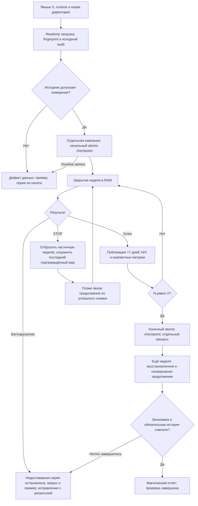
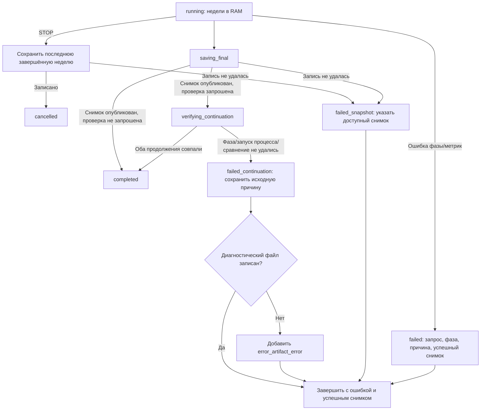

# Lossless checkpoint и самостоятельный прогон Rust

Следующий этап общей активной цели; самостоятельно утверждён по явному разрешению автора. Используются Superpowers brainstorming/writing-plans. Цель автора: одна программа рассчитывает X недель в RAM и даёт материал для анализа; никакой ручной недельной работы через модель или браузер. Экономические правила, баланс, рабочая SQLite-база и runtime остаются неизменными во время измеряемой серии.

## Наблюдаемый результат

Терминальная команда с явными `--run-weeks X --output <новая диагностическая директория>` читает текущий runtime и полный мир, создаёт отдельную тестовую кампанию в RAM и отдельные сохранения. Вывод: `Готово N/X недель; ход ... с; дата ...; revision ...`. Для длительной фазы сообщает её имя и прошедшее время. Сохранение и загрузка имеют отдельные времена. Ошибка фазы или существенного аудита прекращает недостоверную серию, сохраняя параметры, фазу, ID, последнее подтверждённое состояние и воспроизводимый запрос. Не изменять источник и не вводить товары, деньги или государственные решения.

## Выбранный подход

Использовать существующие `RuntimeConfig`, `SqliteLoader` и закрытый `execute_native_week`. Варианты: ссылка на исходную БД дешевле, но не является самостоятельным снимком; один гигантский JSON через `to_value` создаёт лишний полный мир в памяти. Выбран потоковый native checkpoint с манифестом и самостоятельным сохранением неизменяемого SourceSnapshot. Не добавлять миграции старых alpha-сохранений, новую СУБД или новый механизм экономических операций.

Снимок — новая директория: `world.json` (полное native состояние и обязательная история), `source.jsonl` (заголовок исходника, dictionary, shared, таблицы и метаданные) и `manifest.json` (schema1, идентичность кампании, дата/revision, fingerprint Rust/правил/источника, размеры и потоковые SHA256). Если source отсутствует у миниатюры, это явно отражается в манифесте. Source строки сохраняют raw payload, ordinal, sequence, ID и тип ID; shared tuple keys пишутся массивами, без преобразования в строковые ключи объекта. Unknown author fields не пересобирать из native проекции. Снимок не зависит от наличия прежней рабочей БД при восстановлении.

Уточнение по найденному дефекту: публикация новых строк из staging HashMap должна быть детерминированной. Новые запасы идут по уже назначенному внутреннему ID; новые складские резервации и обязательства — по каноническому типизированному ID, как их свидетельства в реестре. Существующие строки сохраняют позиции. Количества, деньги, ID и имущественные права не меняются; потоковое сравнение продолжений не ослабляется.

Запись в новую временную соседнюю директорию, flush/sync файлов, манифест последним, затем rename в ранее отсутствующий целевой путь. Никогда не перезаписывать прежний успешный снимок; при ошибке он остаётся доступен. Указанные манифестом имена файлов фиксированы; загрузка не читает произвольные пути. При загрузке сверять потоковые хеши/размеры, schema и campaign header, собирать SourceSnapshot и account index, проверять обязательную историю. Не считать mini serde проверкой полного мира. Не запускать дополнительный полный digest: хешировать в ходе необходимого сохранения/чтения; сравнивать продолжения потоково по экономике и обязательной истории, исключая только timings и техническую диагностику. Native записи не изменяют авторский исходник.

## Запуск и остановка

Начальная проверка всех провинций, людей, рабочих мест, денег, запасов, ID, рецептов, владельцев и ссылок выполняется до измеряемой недели. Отделять дефекты исходных данных от ошибок расчёта. Вместимость и найм рассчитываются движком; стартовые значения не подгоняются.

Программа сохраняет начальный снимок и компактный `run.json`, затем недели считает только в RAM. Недельные JSONL/CSV содержат мир, государства, проблемные товары/провинции, реальные операции и причины; никаких полных экспортов/SQL по ходам. Метрики: выпуск/сырьё по ДП, заводам, кустарям; покупки/потребление, остатки/цены/дефициты, занятость/простой, доходы/расходы/потребности ПОПов по классам, деньги и налоги/расходы/долги, прибыль, стройки/взносы/возвраты, реальные грузы/маршруты и ограничения. Для неподдерживаемого показателя строка «не реализовано»/«нет измерения», а не ноль. Записывать свидетельства первой проблемной недели и конкретные ID; не объявлять отсутствие роста багом.

Обычный автономный сценарий использует действующие бюджетные ползунки, капиталистические стройки и текущие автоматические правила. Игровые команды не создаются. `workers=1`, RAM; heap limit отдельно «не реализовано», если ограничения ещё нет. Дата считается настоящим календарём 12×30 и 7 дней на ход.

Файл STOP в директории прогона проверяется между фазами. Остановка завершает расчёт без публикации незаконченной недели, сохраняет последний завершённый мир и статус cancelled. Поддержать возврат ошибки из progress callback в отдельном закрытом API, сохранив текущую обёртку `FnMut(&str)` для совместимости. Жёсткое завершение процесса не меняет рабочую кампанию, но незаписанный RAM прогресс теряется; не выдавать его за сохранённый. Существующий `--inspect` остаётся read-only. Серверу не приписывать возможности CLI, которых его обработчик не реализует.

## Проверка и фактический эксперимент

Сначала маленькие полноценные тесты checkpoint/CLI, повреждения и нового процесса. Затем актуальный полный мир: начальный audit, отдельный снимок и загрузка; 10 последовательных фактических недель, остановка на существенном баге и новая измеряемая серия только после исправления с регрессией. В конце — снимок, отдельный процесс, продолжение ещё на одну неделю и сравнение с непрерывным продолжением. Эта дополнительная неделя помечается как проверка восстановления. Неделя/сохранение/загрузка измеряются отдельно. На обнаруженном баге сохранить минимальный пример; исправлять движок, не правила и не численный баланс. Механику, которую естественный мир не активировал, проверять отдельной явно описанной миниатюрой.

Отчёт и компактные результаты внутри Rust-проекта: точные входы/fingerprints/границы, старт→конец, графики производства/нужд/занятости/денег/строительства, причины с ID, приоритет исправлений и пять категорий: реализация, исходные данные, баланс, ожидаемые правила/нет решений, диагностика. Полный аудит property graph и отсутствующие эффекты нельзя объявлять проверенными на основании текущих частичных аудитов. Завершить общую цель только после фактических10 недель и проверки снимка; зелёные тесты не доказывают здоровье экономики.

Самопроверка: граф имеет выход для успеха, невалидного источника, частичного финансирования внутри корректной недели, отказа, отмены, повреждённого снимка и повторного запуска. Платежи/люди/право остаются у закрытых фаз; сохранение не производит экономические операции. Повтор X-недельного запуска не дописывается в чужую директорию. Спецификация утверждена самостоятельно 2026-10-14; предположения о неизвестных игровых результатах не являются выводами.

Уточнение по итоговому ревью: реальные бюджетные зарплаты и старые долги измеряются по аутентифицированным `budget_state_id`/`budget_sector`, независимо от наличия `contract_id`; финансирование работодателя не считается зарплатой. Недельные JSONL сохраняют реальные причины ограничений из receipt и компактные ID событий перевозки. Агрегация перевозок по государству/провинции пока явно «нет измерения»; агрегаты мира и ссылки на участников/маршруты остаются доступны.

`completed` публикуется после всех запрошенных проверок. Ошибка записи диагностического примера не скрывает исходную ошибку. `last_recoverable_checkpoint` указывает только на действительно опубликованный снимок. Время конечного сохранения фиксируется до проверки продолжения.

