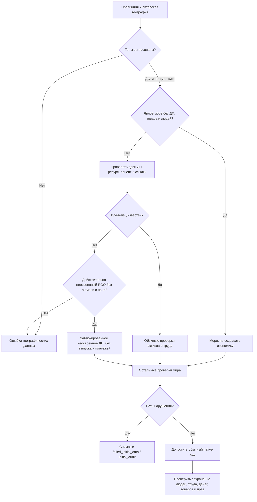

# Допуск полного мира: море и неосвоенные ДП

Самостоятельно утверждено по явному разрешению автора продолжать этапы цели. Применяются Superpowers brainstorming/writing-plans; источник — фактическая серия run-01, остановленная до первой недели.

## Наблюдаемый результат и причина

Аудит принимает законные морские зоны без экономики и действительно неосвоенные ДП, сохраняя жёсткие проверки всех сухопутных ресурсов и активных имущественных прав. Никаких ресурсов, людей, владельцев, денег или рабочих мест не назначается. После исправления запускается новая серия10недель с новым зафиксированным EXE; старая остаётся воспроизводимым примером.

Фактический исходный мир:2679 географических провинций. Полная потоковая сверка дала1571 сухопутную с ровно одним ДП,1058 морских зон и50озёр без ДП. Аудит ошибочно требовал ДП и у воды. Все50ДП1522..1571 не освоены: owner/facility отсутствуют, land_access=false, assignments пусты, провинции без владельца/контролёра и населения, положительные деньги/товары/долги/резервы ДП отсутствуют. Их отсутствие операционного владельца ошибочно считалось потерей имущественных прав. Мини native ход дополнительно воспроизвёл настоящий расчётный сбой income: Reserve owner missing.

Свидетельства: `reports/rust-economy-ten-weeks-2026-10-14/run-01/initial-audit.json`, самостоятельный initial snapshot, `work/rust-checkpoint-runner-2026-10-14/initial-audit-samples.json`. Fullworld snapshot1473912265B native +2504582379B Source загружен отдельным процессом и записан повторно с точно теми же потоковыми SHA/размерами: `full-initial-checkpoint-proof.json`. Недель ещё0/10; продолжение не проверено.

## Контракты и намеренные изменения

- Физический тип берётся из уже загруженной авторской market territory/navigation geography. Не использовать диапазоны ID, имя, отсутствие ресурса или пустой pop_range как доказательство моря. Явное противоречие географических типов отвергается; неизвестный тип не освобождает от прежней проверки одного ДП.
- Явная водная зона kind=sea/lake без ДП, товара и населения не требует вымышленного ДП. Сухопутная провинция всегда сохраняет проверку ровно одного ДП и соответствия единственного ресурса. Экономическое содержимое/ДП водной провинции не прячется: существующие строки, ссылки, рецепты и права проверяются.
- Отсутствие владельца допустимо только у действительно неосвоенного RGO: явно закрыт land_access, нет назначений/работников, владельца/контролёра провинции и населения. Не допускать такое исключение для заводов/кустарей, неизвестного непустого owner_id, действующих работников или положительных денег/товаров/долгов/резервов самого ДП.
- Такое ДП остаётся заблокированным: настоящий native ход не выпускает ему товар, не платит зарплату и не создаёт деньги/права. Если мини-регрессия выявит нарушение в расчёте, исправить соответствующую динамическую фазу, не подгонять исходные данные.
- Общая строгая проверка неосвоенности используется аудитом и producer_reserves. Подтверждённое пустое неосвоенное ДП не создаёт операционный денежный резерв; остальные владельцы, обязательства и формулы резервирования не меняются. Доли собственности и действующее служебное трудоустройство тоже исключают статус пустого ДП.
- Ошибка исходного аудита помечается failed_phase=initial_audit, даже если воспроизводимый снимок записан после проверки. Сохранение/загрузка и завершённые этапы11 не ослабляются.
- Рабочие SQLite/runtime и базовые авторские ресурсы не меняются. Баланс, рецепты, классы, бюджеты, календарь, транспорт и строительные правила остаются прежними.

Самопроверка: море/сухопутная провинция, неизвестный/противоречивый тип, действующий/неосвоенный/частично активный ДП имеют отдельные исходы. Пропавший сухопутный ресурс и любой неизвестный активный владелец по-прежнему отвергаются. Изменение касается диагностики и, только если фактически потребуется, корректного бездействия закрытого ДП; не начальных данных и не балансировки.
