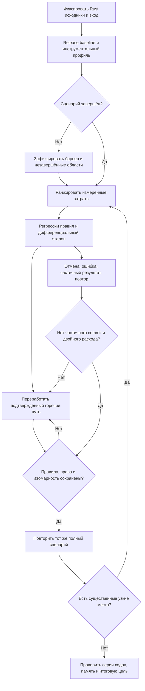

# Фундаментальная оптимизация Rust: полный сценарий ≤1 секунды

Дата: 2026-10-14. Статус: спецификация подготовлена для проверки пользователем; реализация нового этапа не начата.

## Результат и границы

Единственный проект изменений: `kingmaker-rust`, пять Rust crates и его диагностические scripts/tests. Пользователь требует фундаментального ускорения вычислительного ядра с сохранением механик. JS-проект не является объектом оптимизации. Референс — Project Alice, а не замена правил Kingmaker правилами Alice.

Рабочая трактовка операции по существующему Rust runner: один полный native ход — prepare, metrics, apply, report. Загрузка, аудит, начальный и конечный checkpoint также измеряются: отдельно и в полном времени CLI от запуска до выхода. Нельзя выдавать ускорение прогретого ядра за ускорение холодного процесса. Указанные пользователем 50 секунд пока не воспроизведены; не использовать их как измеренный baseline.

Цель ≤1 секунды на сопоставимом входе и той же машине. Старые цели median≤3/p95≤5 не заменяют новую цель. В отчёте показывать все измерения и границы, а не только лучший результат. Если полный сценарий не достигает цели, продолжать разбор крупнейших подтверждённых затрат; незавершённая неделя, микробенчмарк или успешная сборка не означают завершение задачи.

## Проверенный исходный контекст

- `crates/kingmaker-cli/src/runner.rs` содержит путь загрузки/аудита/снимков и native недели.
- `work/alice-profile-first-2026-10-14/profile-summary.json`: старый незавершённый профиль, timeout1800s. Нельзя считать текущим baseline.
- `work/performance-remediation-2026-10-14/full-world/profile-summary-v2.json` и `progress.md`: более поздний незавершённый профиль; load70.17s, initial save37.81s, storage31.255s, arrivals7.300s, mobility142.525s. Инвестиции прерваны, их249.586s не являются временем завершённой фазы.
- `shipping_invariants.rs` уже индексирует остатки/изменения. Повторная реализация устранённого квадратичного поиска не нужна.
- `six-fixes-result.md` документирует последующие изменения инвестиций и отсутствие полного замера после них. Все старые показатели требуют привязки к исходникам/бинарнику.
- Проект без Git. Перед изменениями сохранять затронутые файлы и SHA256; не перетирать чужую работу и не создавать Git ради процедуры.

## Выбранный подход и альтернативы

Выбран профильный последовательный подход: воспроизвести текущее состояние, выделить главные затраты, менять устройство конкретного горячего пути, проверять эквивалентность и полный эффект, затем переходить к следующему. Он допускает глубокую перестройку структуры данных, когда измерения её обосновывают.

Полная немедленная замена мира на SoA без профиля создаёт большой риск для правил и отложит проверку эффекта; не выбирается. Немедленное распараллеливание существующего пути также не выбирается: оно может ускорить избыточную работу и изменить порядок вычислений. SIMD/Rayon допустимы после сравнения с последовательным вариантом и доказательства независимости.

## Измерения до продуктовых правок

Сохранить идентичность исходников, release exe, входного снимка, оборудования и аргументов. Компиляцию закончить до отсчёта. Использовать существующий Windows Job Object monitor, один worker, лимит12ГиБ и ограниченный1800s запуск; не повторять неизменённый timeout вслепую. Прогоны из отдельного неизменяемого входа, без продвижения активной кампании измерением.

Использовать существующие инструментированные области и добавить точные границы для непокрытых горячих участков. Проверить доступность samply/ETW CPU sampling и получить стековый профиль при доступности; отсутствие sampling явно указать, не выдавать таймеры за CPU samples. Отдельно измерять аллокации/их байты, SQL, сериализацию, память процесса и ожидания, где нужно различить причины. Незавершённые области — нижняя граница, inclusive-времена не суммировать.

Текущие кандидаты для проверки: `pop_mobility`, `read_guard`, расчёт потребностей складов, оставшаяся инвестиционная обработка, loader/projection/checkpoint. Их приоритет определяется новым воспроизводимым профилем. Глобальная сериализация и многократные сканы требуют измерения объёма/числа вызовов; не отключать guards для красивого результата.

## Архитектура изменений

Выносить повторяемое чтение и индексацию на границу фазы; использовать типизированные индексные идентификаторы и компактные массивы там, где профиль показывает массовый доступ. Переиспользовать буферы, исключать копии целого мира и повторные поиски. Кеши должны учитывать все читаемые зависимости, отсутствие записи и появление новых участников, а также допустимые изменения без revision.

Сохранять исходный порядок суммирования и распределения дефицита, семантику числовых/строковых ExternalId, все валидации и транзакционную атомарность. Инкрементальность допустима только при полной модели зависимостей. Изменение представления данных не должно требовать ручного назначения людей или подгонки сохранения.

Project Alice: изучить `docs/economy_design.md`, реальные циклы `src/economy/economy.cpp`, устройство world/data container и используемых буферов. Уже найдены `execute_serial_over_pop`, `execute_serial_over_market` и векторные операции; сам факт наличия не доказывает применимость к Rust. В отчёте связать каждую перенесённую идею с конкретным источником и измеренным эффектом; экономические приближения Alice не переносить.

## Сохраняемые контракты и намеренные изменения

Игровых изменений нет. Формулы, количество, настройки, пустые приоритеты, зарплаты, бюджетные расходы, валюты, долги, собственность, люди, труд, права, календарь и частичное исполнение сохраняются. Ошибка/отмена не публикует частичный ход; повтор не проводит оплату дважды. Stale prepare/apply по-прежнему отвергается. Сохранение/загрузка новым процессом сохраняют состояние и replay.

Намеренно меняются только внутренние алгоритмы/хранение и диагностика. Обнаруженные логические дефекты оформляются отдельно с ожидаемым правилом, а не маскируются под оптимизацию. Не ослаблять existing assertions и не считать NotMeasured пройденной проверкой.

## Проверки и приёмка

До каждого изменения закрепить контракты регрессиями: полное/частичное/отклонённое исполнение, дефицит, две валюты, права и занятость, отсутствие/появление записей, mutation без revision, повтор, отмена и roundtrip checkpoint. Для переписанного алгоритма использовать дифференциальный эталон и N/2N/4N счётчики сложности; тестовый эталон не включать в production.

После каждой существенной оптимизации повторять тот же сценарий до/после; сравнивать нормализованный экономический результат, не только итоговые суммы. Случайные IDs, timings и диагностические поля исключать лишь явно и обоснованно. Использовать release и фиксированную нагрузку; серия замеров отделяет шум от эффекта. Проверить повторные последовательные ходы и рост памяти, затем общие regression suites.

Финальный отчёт: время полной операции, каждой крупной подсистемы, холодного запуска, пиковые private/working set и ускорение. Неполученные значения помечать «не измерено», без подстановки старых чисел. Указать оставшиеся ограничения, использованные идеи Alice, команды, исходные результаты и пути spec/plan.

Проверенные изменения должны войти в актуальную Rust-сборку. Активный мир не продвигается бенчмарком; применение обновлённого движка не подменяется разовой правкой данных. Не переключать интерфейс на неработающий Rust execute и не заявлять ускорение JS/UI по CLI-замерам.

Самопроверка: цель Rust-only и1s отделена от старых SLA; незавершённые профили не объявлены baseline; сохранены игровые контракты и отрицательные пути; измерение проекта процедуры не подменяет тестирование движка. План реализации составляется после проверки этой спецификации согласно обязательным review gates пользователя.