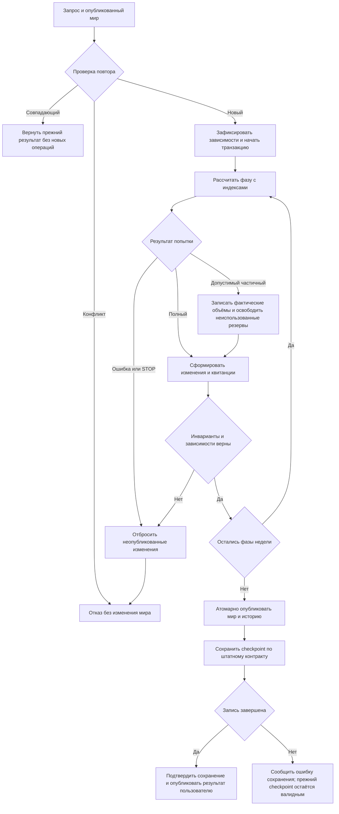

# Исправление производительности Rust Kingmaker после ревью

Дата: 2026-10-14. Статус: спецификация подготовлена для проверки пользователем; реализация и новый план исполнения этим документом не объявлены согласованными.

## 1. Назначение и приоритет документов

Наблюдаемый результат: полный мир быстро рассчитывает игровые недели; после правки правил или авторских данных пользователь быстро получает соответствующий результат через штатный путь запуска. Система автоматически обновляет зависимые вместимость, занятость, выплаты, производство и другие последствия как на старте, так и на следующих ходах. Оптимизация должна устранять подтверждённую лишнюю работу, а не ограничивать размер мира или выключать механики.

Это архитектурное продолжение согласованных `2026-10-14-rust-week-performance-design.md` и `2026-10-14-alice-methods-adaptation-design.md` из этой папки, основанное на новом ревью. Их игровые контракты сохраняются. Актуальный предел памяти — **12 ГиБ (12288 МиБ)**; 8 ГиБ не является обязательной целью. Старый предел 4 ГиБ отменён пользователем. Ориентир — методы Project Alice, адаптированные к собственному проекту, без копирования её игровых правил.

Сохраняется ранее согласованная цель расчёта недели: **median ≤3 с, p95 ≤5 с**, целевой диапазон 1–3 с. Это критерий приёмки, а не достигнутый результат. Пользователь требует быстрый цикл правок; отдельный численный SLA полного пути до интерфейса пока не согласован. Его длительность обязательно измерять, а не заменять временем CLI.

## 2. Рабочие каталоги и исходные доказательства

- Rust: `D:/ЛИЧный хлам/🎲 ДнД для поляны/Карты тейванкаля/Фулл карта/kingmaker-rust`.
- Исходный проект, запуск и активные данные: `D:/ЛИЧный хлам/🎲 ДнД для поляны/Карты тейванкаля/Фулл карта/Проект карты Тейванкаля`.
- Единственный выбор базы/кампании: `D:/ЛИЧный хлам/🎲 ДнД для поляны/Карты тейванкаля/Фулл карта/Проект карты Тейванкаля/data/kingmaker/runtime.json`. Читать при запуске; не хардкодить текущие dbPath/campaignId.
- Ревью: `D:/ЛИЧный хлам/🎲 ДнД для поляны/Карты тейванкаля/Фулл карта/kingmaker-rust/work/performance-review-2026-10-14/review.md`.
- Новые пробы: `work/performance-review-2026-10-14/probes.jsonl`, `harness/src/main.rs`, `source-verification.json` относительно Rust-каталога.
- Прежний полный профиль: `work/alice-profile-first-2026-10-14/profile-summary.json`, `measurement-result.json`, `progress.md`, `profile-arguments.json`, `hardware.json`, `input-identity.json`, `final-code-identity.json`.

Прежний release-прогон с workers=1 остановился через 1800 с в mobility, завершённых недель 0. Загрузка 176,459 с; начальное сохранение 181,014 с; склады 75,188 с, включая 47,776 с guard.serialize; прибытия 1291,034 с, из них 1036,792 с вне измеренных дочерних блоков. Суммарное собственное время guard.serialize 302,016 с, объём 7 306 348 283 байта; Source SQL 3 582 720 запросов. Пик private committed 7,44 ГиБ. Эти числа не складывать с вложенными inclusive-временами.

Микропробы подтвердили квадратичную verify_arrivals даже без операций (1k/2k/4k/8k stockpiles: 3,179/12,390/50,331/185,482 мс) и линейный at(i) (4k позиционных чтений: 8 002 000 посещений). Время проб получено со счётчиком выделений и не является прогнозом времени полного мира.

Не установлено: какой точный участок занимает все 1036,792 с собственного времени arrivals; причина оставшихся 27,412 с складской фазы; полный runtime недели; доля накладных расходов профилирования; источник пика памяти. Нельзя объявлять эти вопросы решёнными только из-за найденного O(N²).

## 3. Сохраняемые игровые и системные контракты

1. Сохраняются все настройки, включая явно пустые приоритеты, авторские формулы, нормы количества, источники финансирования, бюджетные ограничения. Недостающие деньги, права, люди и товары не создаются ради успешного выполнения.
2. Сохраняются люди, труд, занятость, деньги отдельно по валютам, права и товары с учётом законных операций. Выпуск/потребление сверяются с преобразованиями; постоянство общей массы разных товаров не вводится как новое правило.
3. Вместимость, единицы, доступ, резервы, частичное исполнение, аренда, долги и возвраты сохраняют смысл. Не округлять остаток вверх и не делать аренду бесплатной.
4. Сохраняются порядок распределения дефицита и численные правила суммирования/округления. Индекс или HashMap не задаёт новую очередь получателей. Внешние числовые и строковые ID различаются.
5. Ошибка/отмена не публикует часть недели, счётчиков ID, платежей, резервов, назначений, квитанций или истории. Отказ вложенной попытки возвращает её предварительные изменения; законный частичный результат отличается от незавершённого commit.
6. Повтор запроса не исполняет результат снова; конфликтующий повтор отвергается, в том числе после восстановления другим процессом.
7. Stale-результат отвергается при изменении прочитанных данных, включая изменения без увеличения revision, появление ранее отсутствующего ключа и изменение состава выборки.
8. Неизвестные авторские поля сохраняются. Изменённое состояние не подменяется исходным снимком. Кеш не переживает изменение своих действительных зависимостей.
9. Checkpoint сохраняет необходимые сведения и историю для продолжения без исходной базы и временных кешей; новое состояние публикуется только после успешной проверки/записи. После аварии восстанавливается последний завершённый checkpoint.

Kahan summation, новая сортировка слагаемых и иная редукция не вводятся автоматически: это потенциальное изменение численного результата, а не обязательная оптимизация. Побайтовое равенство старому JS и старый внутренний формат не требуются. Оптимизация сама по себе не разрешает менять перечисленные игровые исходы. Обнаруженное ошибочное правило фиксируется отдельно с предлагаемым поведением и регрессионным примером; его нельзя молча сохранять ради битовой совместимости или молча менять ради скорости.

## 4. Выбранный подход и альтернативы

**Выбрано:** поэтапно исправить алгоритмы доступа, проверок и ввода-вывода в существующем движке. Использовать типизированные ключи, плотные числовые представления там, где они оправданы, переиспользуемые индексы и буферы, разделение неизменяемых определений, рабочего состояния и истории. Сначала сокращать число операций на одном worker.

Полная одномоментная переделка всего мира в SoA несёт большой риск и не требуется для устранения восьми дефектов. Только повышение памяти, распараллеливание, замена хешера или общие JSON-кеши не устраняют квадратичные обходы. Эти альтернативы не выбираются как первый этап. SIMD/многопоточность допускаются позже при измеренной необходимости и доказанной независимости изменений.

## 5. Обязательные изменения

| ID | Место | Требуемый результат | Регрессионные доказательства |
|---|---|---|---|
| R1 | shipping_invariants.rs:114–126 | Поиск stockpile по ключу; однократная группировка изменений с прежним порядком суммирования внутри ключа; O(S+C) ожидаемого доступа вместо O(S²+S×C) | Пустые операции; пропажа записи; смена владельца, товара, единицы и прав; объяснённое/необъяснённое количество; повторные изменения одной записи; законные новые записи и частичное прибытие |
| R2 | row_store.rs:114–116; local_hiring.rs:214; migration_cycle.rs:558; income_capital.rs | Убрать скрытый nth-доступ из горячих потребителей; ключи либо действительно быстрый позиционный доступ; len без полного обхода для поддерживающего это хранилища | Счётчик посещений; вставка/удаление/замена в overlay; порядок; отсутствие устаревших позиций/handles; правильные ПОПы и запасы после изменений |
| R3 | read_guard.rs; prepare/apply; world_transaction | Локальная транзакция не сериализует повторно весь неизменённый мир ради проверки; область зависимостей и повторное использование вычислений явно определены | Изменение прочитанного поля без revision; absent-key→present; вставка/удаление участника выборки; вложенная транзакция; устаревший кеш; повтор; отказ без публикации |
| R4 | read_guard.rs:12; run_control.rs:34 | Файловый STOP проверяется ограниченно по времени/объёму работы, а не по каждому 256-му фрагменту serde; горячий путь отмены дешёвый | Одинаковый хеш; STOP до/внутри длинной фазы, во время записи; ограниченная реакция; отсутствие частичной публикации |
| R5 | production_invariants.rs:340–408 | Однократные индексы населения, выплат, операций и агрегаты выпуска; отсутствие вложенного глобального поиска по каждому назначению/выходу | Нехватка бюджета; частичная зарплата; FTE; рабы/ремесленники; повторные ID; ложный/лишний выпуск; исчезнувший ПОП; соответствие операций |
| R6 | kingmaker-io/source_store.rs:101–116 и сканирование ссылок | Последовательный курсор/ограниченные пакеты вместо отдельного LIMIT 1 на каждую строку; кратность SQL-исполнений по пакетам | Пустая таблица; неполный последний пакет; пропуски seq; порядок; ошибка чтения; полная выгрузка и продолжение из автономного checkpoint |
| R7 | shipping/income/construction/investment_invariants | Сравнение населения без двух полных временных Vec<PopRecord>; исключаются только разрешённые поля | Изменение каждого запрещённого поля обнаруживается; разрешённые поля принимаются; счётчик выделений на масштабируемой фикстуре |
| R8 | construction_invariants.rs:96–99 | Проверка проектов через ключи, без повторного полного поиска | Сохранность проекта, владельца, назначений и условий; пропажа/дубликат; частичный ход, отмена и повтор |

Линии — ориентиры ревью, перед правкой сверить текущий код. R2 требует проверки всех потребителей позиционного API, а не только перечисленных трёх файлов. Порядок приоритета: R1/R2, затем R3/R4, затем R5/R6/R7/R8 с учётом новых замеров. Это зависимости и область спецификации, не готовый пошаговый план реализации.

Для R3 одних revision недостаточно. Версии безопасны только при покрытии всех путей записи и корректной инвалидизации. Пока это не доказано, внешние входы с неконтролируемыми мутациями сохраняют необходимую проверку содержимого; её стоимость учитывается. Внутри контролируемой транзакции не должно быть скрытого повторного глобального fingerprint на каждой фазе. Не отключать аудит и не доверять неподтверждённым версиям ради benchmark.

Для R7 Extra уже использует Arc; устранять копии структур/строк и временные массивы, не описывать это как глубокую копию всего JSON. Новые кеши должны иметь понятного владельца, срок жизни, предел и инвалидизацию. Второй полный изменяемый WorldState не вводится. В плане до реализации зафиксировать совокупный бюджет индексов, пакетов SourceStore, кешей и дельт с учётом одновременно живого исходного мира и буферов сохранения; изолированный лимит каждого кеша не гарантирует соблюдение общего предела. Повторное построение/эвикция не должны менять игровой результат.

## 6. Переходы транзакции и самопроверка

Самопроверка: положительный путь проходит все фазы; отрицательный не публикует частичную неделю; частичный экономический исход хранит только объяснённые операции и резервы; повтор не списывает деньги/товары/труд заново. Ошибка checkpoint после commit не выдаётся за откат уже опубликованного мира: до перезапуска он актуален в памяти, после аварии действует последний сохранённый снимок. Если фактический контракт публикации требует иного порядка, уточнить его в плане и согласованно обновить схему. Диаграмма описывает требуемые свойства; её проверка не заменяет тест движка.

## 7. Быстрый цикл правок и активный мир

По последней проверке конфигурированный запуск использовал Node, Rust HTTP execute возвращал 503. В новом чате перепроверить этот факт по исходникам и фактическому запуску; не считать сведения вечными. Сейчас ускорение Rust CLI само по себе не ускоряет штатный интерфейс.

Обязательны отдельные измерения: правка авторских данных → перечитывание/инвалидизация → пересчёт → публикация → видимое обновление; отдельно холодный запуск и повторный расчёт. Изменение Rust-кода дополнительно включает сборку, её время показывать отдельно. Сохранённый загруженный мир и индексы предпочтительны, если это корректно и ускоряет повторный цикл в пределах 12 ГиБ. Нельзя кешировать будущие игровые исходы или пропускать чтение изменённых правил.

Исправления выполняются в движке, не ручной подгонкой сохранения и не разовой пересборкой стартового мира. Базовые авторские параметры меняются в исходных данных, вычисляемые последствия — движком. Для перехода на Rust штатный путь должен действительно выполнять нужную операцию и доставлять результат, включая отказ/отмену/повтор; просто сменить launcher на сервер с 503 нельзя.

R1–R8 — первый самостоятельный этап. Подключение полного рабочего пути — следующий обязательный этап общей цели, если его ещё нет. Его отдельная спецификация и план должны описать обнаруженный интеграционный разрыв; текущий документ не выдаёт разрешение на произвольную переделку API/UI или новый hot reload. Общая цель «быстрая правка → результат» не объявляется выполненной до этой проверки и интеграции. После проверки согласованных изменений активный мир переводится на актуальный рабочий путь через единственный runtime.json; диагностические копии не становятся альтернативными рабочими кампаниями. Универсальная миграция старых альфа-сохранений не добавляется.

## 8. Приёмка и протокол измерений

### Корректность и сложность

- До изменения продуктового кода зафиксировать регрессиями затронутые контракты. Сохранять ранее действующие смысловые тесты. Тесты старого представления можно заменить только с объяснением и сохранением проверяемого правила.
- Для R1/R2/R5/R8 использовать масштабируемые фикстуры и счётчики посещений/поисков. При неизменной форме данных суммарная работа должна иметь линейную либо N log N оценку от соответствующих входов; тест на счётчик важнее нестабильного порога миллисекунд в CI.
- Для R3 считать байты/вызовы guard и обоснованность каждой глобальной проверки; для R4 — число реальных файловых опросов и максимальную задержку отмены на длинных горячих участках; для R6 — число SQL-исполнений; для R7 — выделения и временный живой объём. Новый предлагаемый критерий отмены для плана: обнаружение STOP не позднее 1 с на длительных CPU-участках при нормальной работе ОС; время возврата включает безопасное прекращение операции. Для блокирующего ввода-вывода отдельно определить границы порций и измерить задержку; не обещать универсальный таймаут файловой системы. Размеры пакетов выбрать и явно записать в плане до реализации.
- Не сравнивать только хеш всего мира: нужны проверяемые смысловые исходы дефицита, труда, валют, прав и повторов. Одинаковые неверные результаты не подтверждают корректность.

### Последовательность допуска к полному миру

1. RED/GREEN по исправляемым дефектам и игровые регрессии; локальные release-пробы N/2N/4N с повторениями и сохранёнными сырыми результатами.
2. Ограниченный прогон затронутых фаз, чтобы обнаружить следующий bottleneck и объяснить ранее нераспределённое время. Не ставить таймер/лог на каждый мелкий write.
3. После локального допуска — ограниченный полный прогон из зафиксированного снимка, workers=1, внешний предел 12 ГиБ, таймаут 1800 с для первого сравнения. При повторном стопе исследовать новые данные; не повторять одинаковый 30-минутный прогон без изменения или проверяемой гипотезы.
4. После успешного завершения — две серии по 10 последовательных недель из одного исходного снимка. Median ≤3 с, p95 ≤5 с; p95 — 19-е значение отсортированных 20 результатов. В расчёт недели входят её подготовка, проверки, применение и обязательная финализация; загрузку/сохранение показывать отдельно. Не прятать работу за границами фазовых таймеров.
5. Продолжение до 52 недель проверяет накопление памяти/истории; предел 12 ГиБ действует также при загрузке и сохранении. История может расти на диске, но не размножаться бесконтрольно в RAM. Проверить восстановление другим процессом и последующий повтор запроса.
6. Отдельно измерить холодный и повторный путь до пользователя. Финальная проверка обычного режима без подробного профиля нужна для оценки накладных расходов; выполняется после успешного диагностического прогона, не вместо него.

Фиксировать сборку, входные данные и правила, runtime, hardware, workers, режим профиля и кешей; не использовать старые цифры после изменения этих условий как строгую пару before/after. Холодный запуск процесса не означает холодный дисковый кеш ОС. Режим кеша обозначать явно; не сбрасывать системный кеш и не перезагружать машину без отдельного основания. Сравнивать одинаковые условия, а непроверенный truly-cold I/O отметить как неизмеренный. Пиковая private committed память, working set, суммарные выделения и логические/физические байты — разные метрики. Предел 12 ГиБ для Rust не выводится из Node maxHeapMiB.

Готовность R1–R8: все восемь требований проверены, затронутые регрессии проходят, приложены сопоставимые замеры, нет замаскированного ухудшения соседних фаз. Завершённый этап локальных исправлений не равен достижению недельного SLA или полной пользовательской цели. Если SLA не достигнут, фиксировать оставшийся измеренный bottleneck и продолжать по данным, а не объявлять перенос завершённым.

## 9. Передача в исполнение

Следующий артефакт — новый письменный implementation plan по этой спецификации через Superpowers writing-plans после её принятия пользователем. План должен содержать конкретные файлы/тесты/команды, зависимости этапов, измеримые границы, метод исполнения и безопасную публикацию. Старый план alice-profile-first уже выполнен как измерительный; запускать его заново вместо исправлений нельзя.

До продуктовых правок пользователь проверяет план и выбирает исполнение; повторно не запрашивать разрешение на уже согласованные действия. Gemini 3.8 Flash High через Antigravity используется для подходящего поиска и проверки полноты, Codex проверяет выводы и применяет изменения с последствиями. При недоступности Gemini продолжать локально. Полные миры и тяжёлые профили не запускать параллельно.

В отчёте каждой реализации указывать spec/plan, изменения наблюдаемого поведения, RED/GREEN, свежие benchmark, неизмеренные области и состояние активного запуска. Спецификация не утверждает, что найденные проблемы уже исправлены.
