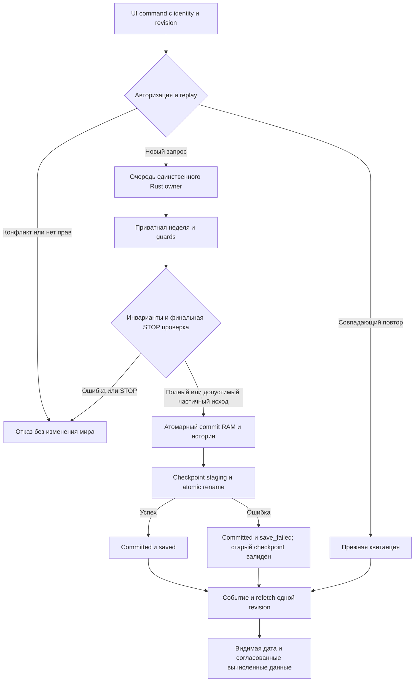

# Rust Kingmaker: выполнение из интерфейса и единственный владелец мира

Дата: 2026-10-14. Статус: **проект отдельной спецификации, не принят; реализации интеграции не разрешает**.
Основание: §7 принятой performance-remediation specification и Task 10 принятого implementation plan.

## Наблюдаемый результат и границы

Ведущий открывает штатную карту, выполняет неделю и видит новую дату, revision и согласованные вычисленные данные провинции, населения, предприятий, складов и бюджета. Расчёт выполняет оптимизированный Rust engine в уже загруженном мире. После штатного изменения авторского базового параметра и явного перечитывания движок сам пересчитывает зависимые места, найм, выплаты и результат на старте и в следующем ходе. Подгонка сохранения или ручное назначение работников не заменяют механику.

Единственный источник выбора базы и кампании — `P/data/kingmaker/runtime.json`; P — исходный проект карты, R — kingmaker-rust. Один актуальный рабочий мир. Диагностические checkpoint не становятся альтернативной активной кампанией. Целевые week median≤3с/p95≤5с и private committed≤12ГиБ остаются независимыми критериями; быстрый CLI не подтверждает путь до UI. Build, load, перечитывание авторских данных, week, save, publication и browser refresh измеряются раздельно.

Не добавлять скрытый hot reload, миграционную систему альфа-сохранений, параллельный расчёт недели, новые экономические формулы или автоматическое изменение правил ради производительности.

## Подтверждённое исходное состояние

- `P/scripts/kingmaker/configured-server.cjs` запускает Node server; runtime-gateway принимает commands/execute, создаёт async run и обслуживает polling/SSE.
- `P/viewer/kingmaker/client.js:43–49` отправляет token, generation, command_id и expected_revision, использует transport.exchange и refetch; смешанная generation/revision отвергается.
- `R/crates/kingmaker-server/src/routes.rs` явно возвращает SERVER_WEEK_EXECUTION_NOT_IMPLEMENTED/503; health/session маркируются read_only. `tests/server_api_test.rs` закрепляет отказ и отсутствие изменения мира.
- Rust AppState содержит Arc<RwLock<WorldState>>, но не серверный жизненный цикл команд/commit/checkpoint. Наличие этого контейнера не доказывает поддержку записи.
- При последней проверке в этом чате Node-процесс Kingmaker отсутствует. instance.json с PID50680/портом56897 — устаревшая запись, не свидетельство работающего сервера. Runtime выбирает current-world.sqlite/world-306, workers=1. Активный runtime не изменялся.

## Предлагаемый архитектурный выбор

Сохранить существующий Node gateway как HTTP/UI оболочку (assets, текущие проверки доступа, session/generation и transport protocol), а persistent Rust process сделать единственным владельцем экономического мира. Новый runtime adapter реализует используемый gateway контракт: head/read/submit/wait/control/events/save/close, маршрутизируя экономические операции и чтение к Rust owner. Node не хранит вторую изменяемую копию WorldState и не выполняет неделю параллельно.

Альтернативы: полностью заменить HTTP/API/assets на Rust — больше изменений и риск потери существующих UI/прав; запускать CLI на каждую неделю — повторные load/save разрывают быстрый цикл и владение. Предпочтён persistent owner с сохранением gateway, но этот выбор ещё требует принятия спецификации.

До implementation plan составить точный перечень реально используемых endpoint/payload/ошибок и проверок прав по runtime-gateway, memory-world-runtime, client и transport. Не объявлять существующие commands/rounds/participants/export/save workflows ненужными: каждый используемый маршрут получает адаптер или остаётся явным блокером переключения. Недоступные экономические команды не отправляются в старый Node engine на другую копию мира.

## Контракт команды и публикации

1. Единственная очередь сериализует команды кампании. Read endpoint видит один завершённый снимок; нельзя соединять карту revision N с бюджетом N+1.
2. До исполнения проверяются campaign, авторизация, generation, expected_revision, нормализованная команда и command_id. Совпадающий повтор возвращает прежнюю квитанцию; тот же ID с иным содержимым отвергается. Не создавать новые IDs/платежи при retry после потери ответа.
3. Неделя рассчитывается приватно существующим Rust transaction engine. Сохраняются authored formulas/settings/quantity/budget/wages/employment/currencies/rights, допустимые частичные исходы, stale/absent-key/phantom guards и история. Внешние content guards не заменяются revision.
4. Error/STOP до финального commit отбрасывает неопубликованную неделю. После последней fallible проверки выполняется неделимый commit; прерывать публикацию на середине нельзя. Поздний STOP применяется к следующей операции, а текущий commit явно сообщается.
5. Async run имеет terminal states committed/cancelled/failed и явный сохранённый receipt/error. Poll/SSE не могут навечно оставлять running после завершения владельца; смена процесса меняет generation, клиент делает resync.
6. Checkpoint записывается через staging/atomic rename. Ошибка save после RAM commit не означает rollback RAM: UI показывает committed revision и save_failed, прежний checkpoint остаётся последним восстановимым. Поведение retrySave/continueWithoutSave должно сохранять действующий контракт, не выполнять экономику повторно.
7. После подтверждённого commit UI получает событие/terminal receipt, перечитывает карту, открытый detail и отчёты из той же generation/revision. Visible result подтверждается browser test, а не сообщением CLI.

## Авторские правки и invalidation

Явное штатное перечитывание строит кандидат из выбранного runtime источника и валидирует его. Публиковать кандидат можно только целиком. Malformed data оставляют последний валидный мир доступным и возвращают содержательную ошибку; никаких частичных runtime-подмен. До переключения plan обязан определить, что перечитывается как авторская база, а что продолжает актуальное состояние кампании, на основе действующего loader/runtime контракта. Автоматически сбрасывать накопленный ход/деньги при правке базы запрещено. Если текущий контракт этого не умеет, это отдельный явно названный блокер, а не разрешение придумать merge сохранения.

Все зависимые индексы/кеши перестраиваются по фактическому изменению данных, включая запись без revision. Сохранённые prepared commands старой generation/источника становятся недействительными. Runtime configuration — одна точка выбора источника; не добавлять второй файл выбора кампании.

## Состояния

Самопроверка схемы: отрицательные исходы не публикуют приватную неделю; частичный экономический исход содержит только доказанные операции; replay не расходует ресурсы повторно; save_failed честно отличается от precommit failure. Люди, труд, деньги, товары и права проверяются engine regression tests, а не только схемой.

## Приёмка перед единственным переключением

- API fixture: полный/частичный/отказ/STOP, stale revision, absent-key/phantom mutation, duplicate/conflicting command, потерянный ответ и retry, конкурентные commands, смена generation.
- Save fixture: mid-write failure сохраняет прежний checkpoint; retrySave не повторяет неделю; восстановление в новом процессе, replay и последующий ход.
- Author fixture: штатная правка базового параметра → перечитывание → правильные зависимые места/занятость/оплата/результат на старте и следующем ходе; malformed change оставляет валидный мир.
- Browser: реальная кнопка исполнения → terminal result → дата/revision/данные; generation change и error presentation; никаких read-only/503 endpoint в рабочем маршруте.
- Resource: единый RAM owner, workers=1; load/week/save вписываются в12ГиБ; измерены холодный и повторный путь до UI. Rust weekly SLA проверяется отдельными двумя сериями10 и продолжением52, результаты CLI не выдаются за UI.
- Только после принятия этой спецификации, отдельного плана и перечисленных проверок меняется штатный launcher/runtime adapter. Проверяются health, owner, campaign, revision и browser-visible результат. Старый owner выключается; диагностические миры не остаются рабочими альтернативами.

Следующий gate: пользователь принимает или корректирует эту спецификацию; затем writing-plans создаёт отдельный проверяемый implementation plan. Текущий remediation plan не разрешает незаметное переключение runtime на Rust.
