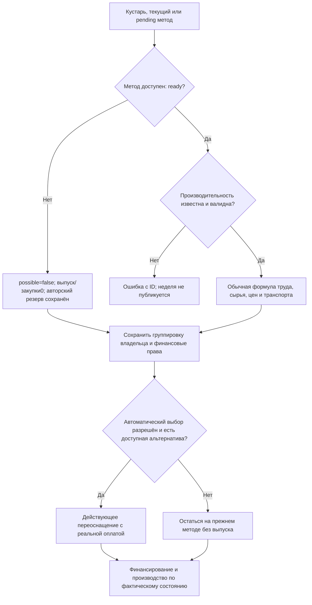

# Недоступный рецепт в планировании капитала кустаря

Самостоятельно утверждено по разрешению автора продолжать цель. Наблюдаемый результат: не реализованный рецепт не срывает недельный ход; кустарь сохраняет людей, имущество и объявленный денежный резерв, не выпускает товар по неизвестной формуле и может выбрать доступный рецепт по существующим автоматическим правилам.

Фактический run-02 остановлен до завершения первой недели в artisan_opening с `Capital productivity unresolved`. Состояние revision20/date306-01-01 и воспроизводимый запрос сохранены в run-02/failed и run.json. Потоковая сверка каталога87методов нашла единственный метод без weekly_productivity: `artisan:electrical_equipment`, kind=artisan,status=unresolved. В исходнике на него ссылаются15кустарей. Электрооборудование автор явно отложил на будущую реализацию. Это расчётный баг Rust, а не повод назначать ему вымышленную производительность или переписывать стартовый мир.

Rust `income_capital.rs` требует продуктивность раньше проверки status=ready. Текущий JS `artisan-working-capital.cjs` считает such method possible=false; native сериализация null даёт нулевой недоступный выпуск. Порядок проверки Rust нужно исправить, сохранив строгий отказ для ready-рецепта без нужной формулы.

Контракты:

- Недоступный метод status!=ready имеет нулевой осуществимый выпуск, нулевую производственную потребность в новых закупках и possible=false. Это явное отсутствие производства, а не присвоение неизвестной productivity значения0/1. Не изменять каталог или параметр None.
- Объявленный income_policy.cash_reserve_minor сохраняется; владелец, активность труда, вложенный личный капитал, удержанная прибыль и общая группировка резервов не удаляются. Не пропускать целое предприятие/группу ранним continue.
- Авторские формулы доступных методов, сырьё, цены, перевозки, вклад каждого участника и бюджетные расходы сохраняются. Ready+неизвестная productivity по-прежнему ошибка, с ID кустаря, метода и провинции. Pending retooling определяется прежним правилом.
- Автоматический выбор другого доступного метода остаётся действующим; запуск не включает принудительное переназначение15групп или деньги из воздуха.
- Настоящий мини native ход с недоступным рецептом должен завершаться без неизвестного выпуска и необъяснимых изменений. Ошибка ready-рецепта должна оставить исходный мир неизменным.
- Измеряемая серия завершена ошибкой; после исправления/проверки/публикации — новый frozen EXE и run-03 из того же источника. Старые серии и примеры не удалять, alpha-миграцию старого снимка не добавлять. Рабочие DB/runtime и баланс не менять.

Самопроверка: недоступный/валидный/невалидный ready-метод, pending смена, отсутствие альтернатив, частичные деньги и ошибка имеют явные исходы. Отсутствие выпуска электроприборов ожидается правилами; аварийный отказ всей недели — баг. Общая цель10настоящих недель и отчёт остаётся активной.
