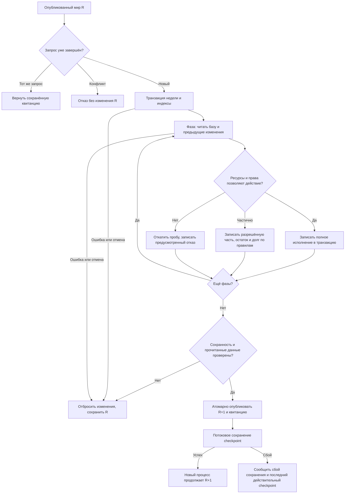

# Производительная неделя Rust: архитектура и критерии приёмки

> Уточнение пользователя от 14 октября 2026: приоритет — быстрый цикл «правка → результат»; 8–12 ГиБ допустимы. Для дальнейших полных прогонов верхний предел 12 ГиБ (12288 МиБ) заменяет прежние 4 ГиБ ниже. Исторические результаты и тестовые примеры не переписываются. Актуальное продолжение: `2026-10-14-alice-methods-adaptation-design.md` и план `2026-10-14-alice-profile-first.md` в соответствующих каталогах docs/superpowers.
Дата: 14 октября 2026. Статус: письменная спецификация, включая численные критерии, согласована пользователем ответом «Окей». Реализация по этой спецификации ещё не начата.

## Наблюдаемый результат и согласованное намерение

Пользователь переносил движок на Rust ради производительности полного игрового мира. Неделя должна рассчитываться быстро, несколько последовательных недель не должны вызывать лавинообразный рост памяти или времени. Совпадение внутреннего представления и JSON бит в бит с JS не является целью. Сохраняются игровые механики и авторские данные; неэффективные способы их вычисления заменяются.

Работа охватывает загрузку, расчёт всех существующих фаз, транзакции, историю и сохранение в той мере, в какой они ограничивают эту цель. Исправление одного складского цикла — промежуточный этап, а не завершение переноса. Новые игровые механики, переработка интерфейса и изменение авторских экономических правил вне области работы.

## Исходные доказательства

- `reports/rust-economy-ten-weeks-2026-10-14/run-03-memory-pressure-01.json`: 77 449 732 096 private bytes процесса; `run-03-interruption.json`: ноль завершённых недель, остановка в surplus/StorageBatch.
- `food_conversion.rs:362` строит глобальную складскую выборку внутри цикла сырья. Изолированный `work/memory-review-2026-10-14` показывает 107,5 / 430,4 / 1722,4 МБ суммарных выделений при 128 / 256 / 512 складах и стольких же повторах. Это объём выделений, не пик одновременно живой памяти и не доказательство утечки.
- `native_week.rs`, `income_cycle.rs`, `artisan_working_capital.rs` глубоко копируют WorldState на вложенных уровнях. `MarketReadSet::capture` копирует почти все экономические реестры.
- `OperationSession::new` повторно копирует полную историю событий. `find_land_path` пересобирает индекс территорий и обходит граф при повторных запросах одинаковых пар.
- В предыдущем ревью прошли 32 выбранных теста. Это доказательство ограниченных контрактов, а не производительности полного мира. Существующая проверка масштабирования EarlyFood не покрывает surplus заключительного рынка.

## Неизменяемые игровые контракты

1. Все настройки, явные пустые списки приоритетов, формулы, нормы количества, источники финансирования и бюджетные ограничения продолжают действовать. Отсутствующие деньги, владельцы, работники, права и товары не создаются ради успешного расчёта.
2. Люди, занятость, труд, денежные остатки по отдельным валютам, права и физические товары сохраняются с учётом законных переходов. Выпуск и потребление сверяются по операциям преобразования, а не по требованию постоянства общей массы всех товаров.
3. Складская вместимость, единицы, права доступа, удержанные объёмы, частичное исполнение, аренда, возвраты и долги сохраняют смысл. Недопустимы округление остатка вверх и бесплатная аренда ради скорости.
4. Очерёдность, влияющая на доступ к дефициту, зарплаты, покупки и бюджет, остаётся детерминированной и сохраняет правила распределения. Менять физический порядок независимых вычислений разрешено.
5. Ошибка или отмена незавершённой недели оставляет последний опубликованный мир, включая счётчики ID, квитанции и историю. Вложенная неудачная проба не оставляет товар, платёж, резерв или назначение.
6. Повтор того же запроса не исполняет неделю повторно; конфликтующий повтор отвергается. Проверки сохраняются после перезапуска. Числовые и строковые ID различаются.
7. Подготовленный результат отвергается при изменении прочитанных данных. Одного сравнения revision недостаточно, пока существуют пути изменения данных без увеличения revision.
8. Неизвестные авторские поля и исходные сведения не теряются. Текущее изменённое состояние не подменяется исходным снимком.

Существующие тесты этих требований сохраняются. Проверки, которые утверждают только старое техническое представление, заменяются проверками смысла с явной записью причины. Ослаблять проверки игровых правил ради зелёного набора запрещено.

## Рассмотренные подходы и выбранная архитектура

Локальная замена аллокатора или устранение только StorageBatch не решает вложенные копии и стоимость истории. Полная перепись всех механик в новые массивы сразу создаёт слишком большой риск изменения правил.

Выбран последовательный переход существующего движка на общие неизменяемые данные, индексы и транзакционные изменения записей. Он позволяет использовать уже проверенные механики, удаляя подтверждённые причины затрат. Параллелизм добавляется только при доказанной необходимости после оптимизации последовательного пути.

### Данные и индексы

Авторские каталоги, география и неизменяемые исходные записи разделяются между читателями без глубокого копирования. Активные сущности имеют стабильные идентификаторы и индексы. Большие одинаковые определения товаров и складских правил не размножаются на каждую фазу.

Производные индексы счетов, запасов, занятости, складов и заказов строятся один раз для соответствующего состояния и обновляются при изменениях. Их область жизни и инвалидирование привязаны к данным, от которых они зависят; скрытый глобальный кеш без версии запрещён. Добавление, удаление, разделение ПОПа и изменение здания обновляют зависимые выборки автоматически.

### Одна транзакция недели

Базовый опубликованный мир остаётся доступным для чтения. Транзакция содержит изменённые записи и созданные сущности; фазы видят изменения предыдущих фаз. Вложенные пробы используют точки отката в этой транзакции, а не полную копию мира. Квитанции, счётчики, резервы, долговые строки и производные реестры входят в ту же границу атомарности.

Независимые prepare/apply входы сохраняют отказ при устаревших данных: читаемые записи и зависимости выборок проверяются, включая отсутствие записи и добавление нового участника диапазона. Версии можно использовать только при контролируемых путях записи; иначе требуются компактные проверки содержимого. Простое удаление read guards недопустимо.

Публикация проверенного набора изменений не выполняет новые потенциально отказные экономические вычисления. Ошибки подготовки и проверки происходят до публикации. При исключительном аварийном завершении процесса восстанавливается последний успешно сохранённый checkpoint.

### Склады, рынок и маршруты

Внутри фазы складская вместимость рассчитывается один раз. Дальнейшие резервы, расход сырья, выпуск, освобождение и возвраты меняют только затронутые остатки. Неудачная попытка резервирования возвращает её предварительные поправки; перенос текущего `batch.adjust` за пределы цикла без такого отката некорректен.

Определения складов читаются по ссылкам. Заказы индексируются по товару, области рынка и другим используемым условиям. Географический индекс и маршруты переиспользуются в рамках неизменного графа; сохраняются направленные сухопутные связи, доступность, длина пути и значимый порядок выбора. Кеш не растёт без ограничения как все возможные пары провинций: область ограничена текущей фазой и реально запрошенными направлениями, с ограничением объёма.

### История и сохранение

История операций хранится один раз. Сессии используют индекс событий и заимствованные записи; новые события находятся в транзакции до commit. Завершённые сегменты допускается хранить на диске с ограниченным кешем. Проверяемые квитанции, ссылки на операции и индекс повторов остаются доступны; история не удаляется ради экономии памяти.

Бюджет памяти включает сами индексы и квитанции: перенос только payload на диск при неограниченном росте копий ключей не считается решением. При необходимости используются сегментированные дисковые индексы и ограниченный кеш. Неопубликованные сегменты транзакции не становятся свидетельством завершённой операции после сбоя.

Checkpoint потоково сохраняет актуальные записи и все сведения для продолжения и проверки повторов. Большой неизменяемый source может иметь общее дисковое представление, если измерения показывают необходимость. Новый формат должен быть самодостаточен: удаление исходной рабочей базы или временного кеша не делает checkpoint нечитаемым. Проверяется фактическое продолжение новым процессом.

## Намеренные изменения технического поведения

- Внутренние структуры, порядок сериализации независимых записей, расположение полей и физическое размещение истории могут меняться. Побайтовое равенство JSON не служит критерием приёмки.
- Меняется устройство транзакций и технические Rust-интерфейсы фаз, где это нужно для устранения копий. Поддержанные CLI/API сохраняют наблюдаемый смысл и идентификаторы.
- Если меняется формат checkpoint, версия обозначается явно. Не добавляется универсальная совместимость старых альфа-сохранений; существующий входной снимок читается для проверочного продолжения, затем рабочий запуск переводится на актуальный формат после проверки.
- Отмена проверяется также внутри долгих ограниченных порций работы; пользователь не ждёт окончания застрявшей фазы. Сохраняется последний завершённый мир.
- Меняются диагностические показатели: отдельно показываются загрузка, каждая фаза, сохранение, private committed bytes, working set и объём выделений. Эти разные показатели не смешиваются.

Изменения игровых формул и экономических исходов из-за нового алгоритма не разрешены автоматически. Если устранение неоднозначности требует нового игрового правила, это отдельное явно согласуемое решение.

## Переходы и самопроверка

Граф имеет выходы для положительного, отрицательного, частичного исхода, повторов, ошибок и отмены. При отказе отдельного действия продолжение разрешено только правилами соответствующей фазы. Проектирование схемы не считается тестированием движка.

## Приёмка и порядок доказательств

Ниже — согласованные численные критерии, не уже достигнутые результаты:

- На машине пользователя, release-сборка, полный мир: целевой диапазон расчёта недели 1–3 с; медиана не более 3 с и p95 не более 5 с на двух сериях по 10 последовательных недель из одного исходного снимка. Загрузка и сохранение измеряются отдельно и не включаются в скорость самой недели.
- Для воспроизводимости фиксируются хеш сборки, входной снимок, runtime, аппаратная конфигурация и workers=1; p95 определяется как 19-е значение в отсортированной совокупности 20 измерений. Прогрев служебных кешей не может пропускать игровые фазы или заранее рассчитывать будущие недели.
- Пиковая приватная committed память процесса не более 4 ГиБ за загрузку, расчёт и сохранение. Проверка продолжения до 52 недель выявляет накопление истории; лимит распространяется и на этот прогон. Объём истории на диске может расти, дополнительные полные копии её содержимого в RAM — нет.
- Это заменяет неподтверждённое обещание 100–150 МБ из ранней спецификации реалистичным проверяемым бюджетом; 4 ГиБ остаются проектной целью, достижимость должна быть доказана. Если лимиты не достигнуты, работа не объявляется законченной по одним микротестам.
- До полного запуска: функциональные регрессии отказов/частичных исходов/аренды/денег/людей/прав; затем масштабирование складов, запасов, заказов и истории по отдельности и вместе. При удвоении сбалансированного размера суммарные выделения фаз без намеренно комбинаторных игровых правил не должны расти квадратично; лимит теста — не более 2,5 раза после вычитания измеренного постоянного старта.
- Обязательны сценарии общей вместимости нескольких партий, отката после неудачной аренды, изменения прочитанного/отсутствовавшего объекта, отмены после рынка, сбоя поздней фазы, повторного запроса, конкурентного изменения подготовленного мира и сохранения/перезапуска с продолжением.
- Отдельно проверяются откат вложенной пробы со всеми созданными ID и долгами, вставка новой строки в ранее прочитанную выборку, стабильное распределение дефицита через асимметричные связи и отказ после записи ещё не опубликованного сегмента истории. Кеш географических путей не подменяет проверки текущей доступности транспорта, денег или склада.
- Сравнение с JS используется как свидетельство механик на выбранных сценариях: деньги по валютам, товары, люди, занятость, права, долги и удовлетворение потребностей. Формат JSON и технические события не требуют тождества. Деньги проверяются точно; допуски вещественных величин задаются по существующим количественным правилам, а не расширяются для сокрытия расхождений.
- Полный мир запускается с внешним наблюдением за private bytes и доступной памятью. До достижения безопасного профиля не повторяется неограниченный прогон на десятки гигабайт. Превышение бюджета фиксируется как провал измерения с завершением только диагностического процесса.

Сначала фиксируются регрессии и измерения, затем устраняются глобальные повторные расчёты, затем вложенные копии и стоимость истории, затем выполняется проверка полной серии. Полный мир может выявить дополнительные горячие пути; они входят в ту же работу, если мешают установленным критериям и не требуют изменения игровых правил.

После успешной проверки актуальные executable и необходимые форматы используются рабочим запуском. Единый выбор базы и кампании остаётся в `../Проект карты Тейванкаля/data/kingmaker/runtime.json`. Проверочные недели не продвигают активную кампанию и не подменяют авторские исходные данные. Сохраняются диагностические резервные копии, а не альтернативная рабочая версия.

Самопроверка спецификации: проверены область работы, все исходы схемы, сохранность авторских правил и границы новых критериев. Gemini 3.8 Flash High проверил переданный текст подхода без доступа к файлам; его замечания об откате, отсутствующих ключах и размере индексов учтены. Предложения об обязательной новой арене памяти и предположения об изменении географии из-за аренды не приняты без измерений и подтверждения в коде.

## Артефакты и следующий этап

Эта спецификация: `docs/superpowers/specs/2026-10-14-rust-week-performance-design.md`.
После проверки письменной спецификации составляется план `docs/superpowers/plans/2026-10-14-rust-week-performance.md` с конкретными файлами, интерфейсами, RED/GREEN-проверками и порядком внедрения. План пока не создан. Проект не является Git-репозиторием; документ сохранён в файловой системе, git commit не заявляется.
