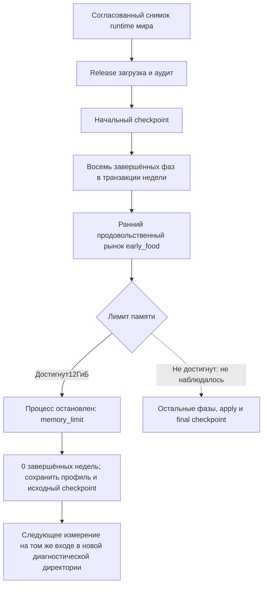

# Диагностика производительности Rust — 14 октября 2026

**Диагностический прогон не завершил неделю: внешний ограничитель остановил процесс на `early_food` при достижении 12 ГиБ private memory.** Наблюдаемое время процесса — около 1125.1 с (18 мин 45 с), завершённых недель — 0. Полное время успешного хода, apply, финального сохранения и последующих фаз не измерено.

Оптимизации и изменения продуктового кода не выполнялись. Указанные ранее пользователем 50 секунд — условный пример, не baseline и не воспроизводимая исходная скорость.

## Сценарий и достоверность

- Проект: `kingmaker-rust`. Release CLI, workers=1, Normal priority, AMD Ryzen 5 5600 (6 ядер / 12 логических процессоров), физическая память около31.9ГиБ.
- Выбранная runtime кампания: `world-306`, revision20, дата306-01-01. Транзакционно согласованный SQLite backup — 5,762,625,536 байт. Отдельный runtime и изолированная диагностическая кампания `rust-test-42988-20`; активная кампания не продвигалась.
- Сборка `cargo build --release --locked --offline -p kingmaker-cli` успешна, отдельно от замера. Исполняемый файл SHA256: `8867eddd547e1c92dae5be9ab9ee548fd5e3c981f2a1a981192eea2bc91697c5`.
- Подготовка снимка заняла 156.6 с и исключена из выполнения. Кеш файловой системы прогрет копированием/хешированием; запуск холодный по процессу, **не** по дисковому кешу.
- Лимиты диагностического процесса:12288МиБ private memory и1800с. Это внешний Job Object, а не вывод о падении обычного запуска с иным пределом. Лимит времени не сработал.
- `process.json`: outcome=`memory_limit`, exit999, PID42988, уведомление о лимите=true. Профиль PID совпадает;122058 завершённых областей, повреждений/обрезанной строки нет, footer отсутствует. `run.json` после принудительного завершения может оставаться running; он не переопределяет результат внешнего монитора.

## Измеренные времена

| Подготовка процесса | Время, с |
|---|---:|
| Загрузка | 65.025 |
| В том числе проекция внутри загрузки | 14.560 |
| Начальный аудит | 0.994 |
| Начальный checkpoint | 39.282 |
| Начало недельного цикла от старта профиля | 105.447 |

| Завершённая игровая фаза | Полное время фазы, с | Self вне вложенных измерительных областей, с |
|---|---:|---:|
| Вместимость складов (`phase.storage_capacity`) | 30.565 | 0.002 |
| Прибытие грузов (`phase.arrivals`) | 7.166 | 2.314 |
| Мобильность и труд (`phase.mobility`) | 132.451 | 35.141 |
| Открытие бюджетов (`phase.budget_opening`) | 20.827 | 13.546 |
| Инвестиции (`phase.investments`) | 210.020 | 208.493 |
| Открытие ремесленных доходов (`phase.artisan_opening`) | 389.264 | 383.157 |
| Выплаты за услуги (`phase.service_payroll`) | 95.030 | 87.532 |
| Содержание (maintenance) (`phase.maintenance`) | 101.322 | 94.040 |

`early_food` началась примерно на1093.1с и наблюдалась ещё около32.0с до остановки. **Это незавершённый интервал, не длительность фазы.** Отсчёт по процессу и профильному старту немного различается; границы по внешним сэмплам имеют точность около1с.

Вложенные времена не складывать с родительскими. Например, `storage.capacity.needs` —27.755с из30.565с всей складской фазы; это построение потребностей, преобразование еды и накопление вместимости вместе. Сумма self завершённых областей=1092.576с. Оставшийся интервал в основном относится к незавершённой `early_food`; это не точное измерение её внутренностей.

## Что доказано измерениями

1. **Дорогая подготовка:** до недели проходит около105.45с. Из неё65.02с загрузка и39.28с начальное сохранение. Нельзя скрывать эти затраты показателем одного prepare/apply.
2. **Основной завершённый вычислительный барьер — ремесленники:**389.26с, из них383.16с вне внутренних измерительных областей. Инвестиции —210.02с, из них208.49с вне внутренних областей. Их конкретные внутренние причины ещё не локализованы.
3. **Контрольная сериализация особенно дорога в mobility:** 97.310с self из132.45с фазы; 121,633 завершённых вызовов; 29.254ГБ логического сериализованного потока. Распределение показывает, что основную стоимость дают крупные вызовы, а не десятки тысяч крошечных. `guard.serialize` включает чтение/обход данных, JSON, SHA256 и проверки отмены; это не отдельный замер SHA256.
4. **Во всём завершённом префиксе guards занимают 135.206с self**, при 121,974 вызовах и 40.756ГБ логических байт. Этот объём содержит повторную обработку, не означает столько уникальных данных или дискового IO. Одним устранением этой стоимости все задержки не объяснить.
5. **Память — отдельный барьер.** Peak private=11.999962ГиБ, peak working set=11.193ГиБ. В `early_food` первый секундный сэмпл показывает около7.85ГиБ private; затем достигнут предел12ГиБ примерно за32с. Это локализует рост по фазе, но ещё не по выделяющей памяти функции. Утечка не доказана.
6. CPU-время процесса к последнему сэмплу=1096.75с при elapsed≈1125.09с, то есть почти одно ядро в среднем. Это не похоже на преимущественное ожидание диска, но точной разбивки CPU/ожиданий по функциям нет.

Счётчики завершённого префикса:58 построений индексов,979148 индексированных строк;3986 source SQL queries;3.043ГБ logical source payload. Это покрытие конкретных встроенных счётчиков, не все SQL/аллокации/физический IO процесса.

## Пробелы и следующий диагностический шаг

WPR установлен, но `wpr -start CPU -filemode` завершился ошибкой0xc5585011 (`Failed to enable the policy to profile system performance`). Запись не началась; CPU stack samples отсутствуют. Использована инструментальная трассировка Rust и внешнее сэмплирование памяти100мс, дополнительное CPU/память1с. Overhead трассировки не измерен отдельным полным контрольным прогоном. Суммарные аллокации и физический дисковый IO не измерены.

Следующий приоритет диагностики — детализация `early_food` по построению заявок, торговому расчёту, транзакционным копиям, квитанциям и проверкам, с замерами памяти между ними; затем детализация `artisan_opening`, инвестиций и крупных guards. Одного повышения лимита недостаточно для объяснения расхода памяти. Повторный полный запуск и повышение лимита в этом этапе не выполнялись.

Конкретные точки для ремесленников/инвестиций/mobility/складов записаны в [next-measurements.md](../work/rust-diagnostics-2026-10-14/next-measurements.md). Линейные `.find` внутри массовых циклов, копии котировок и условный64-шаговый подбор — статические гипотезы для проверки счётчиками, **не** доказанная причина всех389секунд.

Gemini 3.8 Flash High помог разметить вызовы и предложить гипотезы по присланным фрагментам. Codex проверил значимые места по исходникам; непроверенные выводы не использованы как факты. Изменения алгоритмов, SIMD, параллелизм, кеширование и изменения правил не выполнялись.

## Проверки сохранности и ограничения корректности

- 316 файлов crates проверены SHA256: изменённых0, новых0. Бинарник совпадает с начальной идентичностью.
- SHA256 входного диагностического SQLite и активного runtime совпали до/после. Размер и mtime исходной активной БД не изменились; полный повторный хеш активной БД не делался. Источник открыт read-only; диагностический ход не публиковался в активную кампанию.
- 8 тестов существующего анализатора прошли. Независимая группировка профиля совпала с существующим анализатором по сумме self, hash_calls и hash_bytes.
- Начальный аудит не нашёл issues, но содержит `not_measured`/не реализованные механики: полный граф прав, образовательные/медицинские результаты, голодные смерти, морская пассажирская миграция. Успех аудита не доказывает полноту движка.
- Финальный checkpoint и завершённая неделя не получены. Исходный checkpoint сохранён до расчёта; проверка восстановления новым процессом в этом этапе не проводилась. Оптимизационная спецификация предыдущего сообщения отложена по указанию пользователя; основание этого этапа — [диагностический протокол](../work/rust-diagnostics-2026-10-14/protocol.md).



Схема отражает наблюдаемый прогон и непосещённую ветку. Она не заменяет тестирование атомарности или восстановления после аварии.

## Воспроизведение и артефакты

Вход/бинарник/SHA: [identity.json](../work/rust-diagnostics-2026-10-14/identity.json). Аргументы: [arguments.json](../work/rust-diagnostics-2026-10-14/arguments.json). Отдельная новая директория обязательна для каждого повтора; текущие аргументы указывают уже существующий output и не предназначены для перезаписи.

```powershell
cargo build --release --locked --offline -p kingmaker-cli
# Для повтора скопировать arguments.json и заменить только --output новым путём.
./scripts/measure-native-performance.ps1 -Executable C:/Users/ill_lich/.cargo-target/kingmaker-rust/release/kingmaker-cli.exe -ArgumentFile <новые-аргументы.json> -OutputDirectory <новый-monitor> -PrivateLimitMiB 12288 -TimeoutSeconds 1800
```

Основные доказательства: [profile-summary.json](../work/rust-diagnostics-2026-10-14/profile-summary.json), [phase-attribution.json](../work/rust-diagnostics-2026-10-14/phase-attribution.json), [guard-distribution.json](../work/rust-diagnostics-2026-10-14/guard-distribution.json), [diagnostic-findings.json](../work/rust-diagnostics-2026-10-14/diagnostic-findings.json), [process.json](../work/rust-diagnostics-2026-10-14/monitor/process.json), [input-verification.json](../work/rust-diagnostics-2026-10-14/input-verification.json). Сырые profile.jsonl, process-samples.jsonl, stdout/stderr, snapshot и initial checkpoint находятся рядом. Wall wrapper1127.52с включает запуск монитора; не подменяет elapsed процесса1125.09с.
