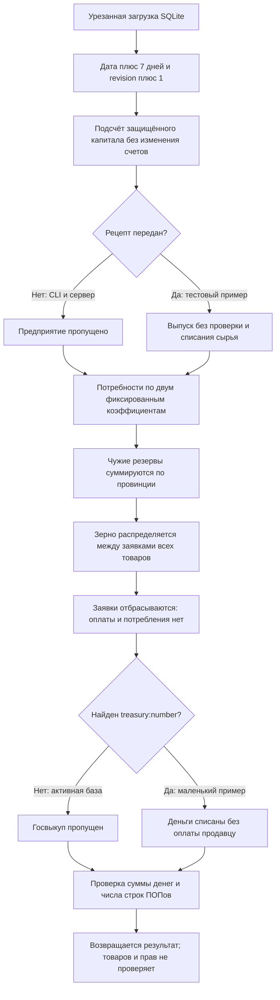

# Проверка Rust-Кингмейкера — 12 октября 2026

Полноценная работа текущего Кингмейкера в Rust **не подтверждена; обнаружены блокирующие ошибки переноса**. Проект компилируется и его 12 штатных тестов проходят. Однако он загружает урезанное, местами неверное состояние, пропускает экономические системы и не выполняет реальные покупки и потребление. Заявленные в README 13–16 мс нельзя сравнивать со временем полной недели JS-движка.

Проверялся код `kingmaker-rust`, не только готовые EXE. Рабочая база открывалась только для чтения. Полные недели, многонедельная серия, публикация базы и переключение runtime не запускались. Код движка, правила, README и исходные данные не изменены. Добавлены только этот отчёт, компактные результаты и отдельный диагностический Cargo-проект.

## Условия и подтверждение

- Rust: `rustc 1.99.0`, Cargo `1.99.0`.
- `cargo test --workspace --locked`: exit 0; 12 тестов прошли. Тест загрузки читает полный мир; тесты выполнения недели используют маленькое состояние в RAM.
- Дополнительные проверки контрактов: 19 тестов; 1 прошёл, 18 упали с воспроизводимыми нарушениями. Это диагностические ошибки проверяемого движка, а не ошибки компиляции проверок. Полный вывод: `contract-tests.txt`.
- Полный мир прочитан Rust-загрузчиком отдельно без вызова `simulate_week`: `rust-loaded-world.json`. Исходные данные сверены напрямую с SQLite и словарём ID: `source-world.json`, `source-audit.cjs`.
- Кампания: `world-306`, revision 20, дата 306-01-01. Источник: активный `current-world.sqlite`, выбранный JS `runtime.json`.
- Проверяемые Rust-исходники + Cargo manifests/lock: SHA-256 `11e3831d66843a08e3a1083e2756815b37c492dae47ea5c89a0ccbe7b30d2596`.
- JS-контракты последних исправлений: `../Проект карты Тейванкаля/docs/superpowers/specs/2026-10-12-economic-recovery-design.md`, план `../Проект карты Тейванкаля/docs/superpowers/plans/2026-10-12-economic-recovery.md`, фактическое применение — соответствующий отчёт в `reports/kingmaker/economic-recovery-2026-10-12/` JS-проекта.

## 1. P0: загрузчик меняет смысл данных и ломает связи

`crates/kingmaker-io/src/sqlite_loader.rs:18`, `:111`, `:144`, `:152`, `:241`, `:286`, `:314`.

Значение `__kingmaker_codec_v2__.value` — ordinal словаря, а не внешний ID. Загрузчик не читает `km_dictionary`, а принимает ordinal за ID, иногда обрезая его до `u16`. При этом провинции получают внешний номер из `external_id`. Эти пространства идентификаторов несовместимы.

Конкретный первый ПОП: исходная провинция **1000**, словарный ordinal **140080**. Rust получает **9008** после преобразования в `u16`. Тип `artisans` превращается в строку `361315`, культура и религия — тоже в строки с ordinals. Страна первой провинции — `state_001`; Rust получает число `33218`.

| Проверка полного загруженного мира | Результат |
|---|---:|
| Провинций | 2679 |
| ПОПов | 65 916 |
| Людей: источник / Rust | 94 955 590 / 94 955 590 |
| ПОПов с несуществующей провинцией | 63 529 |
| ПОПов с несуществующим счётом | 65 916 |
| Предприятий с несуществующим счётом | 15 229 из 15 229 |
| Предприятий с несуществующей провинцией | 1531 |
| Пустых диапазонов ПОПов у провинций | 2679 из 2679 |
| Распознанных казначейств | 0 |

Остальные ссылки, попавшие в диапазон существующих номеров, не признаны правильными: совпадение числа может быть случайным. Число строк и сумма населения сохраняются, но это не проверка отношений и прав.

Счёт ПОПа ошибочно берётся из **currency_id**. Счёт предприятия — из **owner_id**. В действующей базе счёт определяется владельцем, валютой и назначением; валюта и владелец не являются ID счёта. В `AccountBalance` исчезают владелец и валюта. Поле `owner_type` заполняется назначением счёта, а госвыкуп ожидает в нём выдуманный формат `treasury:<number>`.

`pop_range` всегда `(0,0)` и нигде не строится. Поэтому провинциальный API возвращает пустой список ПОПов даже для населённых провинций. Это дефект загрузчика/модели Rust, не стартовых данных.

## 2. P0: 40 752 записи запасов превращаются в зерно

`crates/kingmaker-io/src/sqlite_loader.rs:314–333`.

Товар определяется поиском нескольких английских слов в `external_id`; поле `goods_id` и каталог игнорируются. Всё нераспознанное получает `Goods::Grain`. В полном мире этим затронуты **40 752 записи запасов, 44 вида товаров**: соль, глина, медь, инструменты, кожа, бумага, лекарства, спирт, нефть, бензин, оружие и другие. Это не допустимая игровая конверсия.

Пример: `start-306-2026-10-08:stock:holding_region_004:salt:prod_69`. В источнике это **118,7129848606 соли в провинции 69**. Rust классифицирует запас как **зерно**, а провинцию берёт из `holding_region_004`, получая **4**. Номер холдинга не является номером провинции. Во всём наборе **16 269 запасам** таким кодом назначена неверная провинция.

Не следует исправлять авторские ресурсы под эту загрузку. Нужны правильное чтение ID/каталога и сохранение полей товара, места, владельца, единиц и получателя резерва.

## 3. P0: измеряется неполная неделя

`crates/kingmaker-cli/src/main.rs:20`; `crates/kingmaker-server/src/main.rs:22`; `crates/kingmaker-sim/src/pipeline.rs:20–81`.

Оба запуска передают **пустой HashMap рецептов**. Производство выполняет `recipes.get(...)?` и пропускает каждое предприятие. ДП вообще не загружены как производственные объекты; ресурс и установленная мощность провинции не представлены в `ProvinceRecord`. Подключение Rayon само по себе это не меняет.

В текущем недельном конвейере нет расчёта найма, зарплат, налогов, бюджетных выплат, дохода авантюристов, собственности/дивидендов, смены профессий, миграции, инвестиций и строительства. Нет исполняемой перевозки, прибытия грузов, возвратов, фрахта и предзаказа по срокам доставки. Поиск пути есть отдельной функцией, но в недельном конвейере не вызывается. Нет мгновенной пищевой конверсии по утверждённым рецептам и обновления складов на 12 недель.

На загруженном мире защита капитала не находит реальные счета предприятий, госвыкуп не находит казначейства, производство не находит рецепты, рыночные заявки отбрасываются. Поэтому скорость этого пути характеризует пропуск работы, а не ускорение той же экономики. Новое время полноценной Rust-недели здесь **не измерено**.



## 4. P1: производственный код делает бесплатный и иногда фиктивный выпуск

`crates/kingmaker-sim/src/production.rs:25–51`.

При непустом рецепте `inputs` не читаются. Завод с рецептом «10 железа → 5 стали» выпускает 5 стали без железа; при наличии 10 железа они остаются на складе. `total_consumed` никогда не заполняется.

Выход попадает в **первый** запас нужного товара в провинции без проверки владельца, назначения, вместимости или удержаний. Если такого запаса нет, количество всё равно записывается в `total_produced`, но реального товара не появляется. Проверки `factory_cannot_produce_without_inputs`, `factory_must_consume_recipe_inputs`, `reported_production_must_reach_real_stock` воспроизводят эти случаи. Это латентные ошибки после подключения рецептов; факт выпуска в основном мире сейчас не заявляется.

## 5. P1: потребление и рынок не исполняют сделки

`crates/kingmaker-sim/src/needs.rs:22–63`; `pipeline.rs:52–64`; `market.rs:20–37`.

Любая мука/зерно в провинции, включая коммерческий и чужой запас, считается общим пищевым резервом. Владелец и `beneficiary_pop_id` не учитываются. Вычитается только временная сумма, сам запас не уменьшается. Фиксированные потребности `size × 0,1` зерна и `size × 0,02` ткани заменяют утверждённые профили классов/видов/товаров. Денег, цен, платёжеспособности, маршрутов и прибывающих грузов здесь нет.

Дальше общий мировой запас зерна передаётся в `clear_market_orders` для всех товаров: заявка на ткань получает распределение из зерна. Затем локальный массив заявок уничтожается. Покупатель не платит, продавец не получает доход, товар не передаётся и не съедается, обеспеченность не записывается.

Малый пример: ПОП 100 человек с собственными 100 зерна после недели всё ещё имеет 100 зерна. Другой пример: чужой резерв 100 зерна обнуляет пищевую заявку ПОПа. Это воспроизведено тестами, не вывод из агрегатов полного мира.

## 6. P1: госвыкуп уничтожает деньги и не передаёт право собственности

`crates/kingmaker-sim/src/state_procurement.rs:22–58`.

В маленьком примере казна 10 000, продавец с 100 железа. Закупка на 5000 уменьшает казну до 5000, продавец получает **0**, общая сумма денег падает на 5000. У товара меняется только `purpose` на `state_raw`; прежний владелец остаётся. Нет финансового резерва служб/долгов, ползунка, рыночной цены, частичной покупки, публичной складской вместимости и защиты от повторной оплаты периода.

В основном загруженном мире эта ветка сейчас не активируется: распознанных казначейств 0. Нельзя выдавать это за измеренное уничтожение денег основного мира. Обе ошибки самой ветки подтверждены отдельными тестами.

## 7. P1: бухгалтерия допускает создание денег и неверные переводы

`crates/kingmaker-sim/src/ledger.rs:60–78`.

Самоперевод 50 со счёта с 100 даёт **150**: первоначальный баланс прочитан дважды, второе присваивание перезаписывает списание. Отрицательная сумма принимается и меняет направление списания без проверки денег адресата. Неизвестный адресат получает вновь созданный счёт вместо ошибки `AccountNotFound`.

Три отдельные проверки воспроизводят нарушения. Эта бухгалтерия пока не подключена к недельным операциям, поэтому её два штатных теста не подтверждают сохранение денег конвейером.

## 8. P1: положительные инварианты не доказывают сохранность

`crates/kingmaker-sim/src/invariants.rs:11–20`; `crates/kingmaker-server/src/routes.rs:97–111`.

`goods_ok` буквально всегда **true**. Проверка людей сравнивает число строк ПОПов, не сумму людей/рабочей силы. Можно уменьшить население ПОПа со 100 до 0 и получить `pops_ok=true`; можно добавить 1000 необъяснённого зерна и получить `goods_ok=true`.

Денежные счета суммируются без валют и объясняющих операций; разрешённая эмиссия не моделируется. Нет проверки занятости, прав, ссылок, допустимого долга, запасов и произведённого/потреблённого по операциям. API возвращает `executed=true` даже при нарушении денег; состояния отката или отказа при нарушении нет.

## 9. P1: существующая карта несовместима с API

`crates/kingmaker-server/src/routes.rs:12–18`; JS `viewer/kingmaker/bootstrap.js:2`, `client.js:26–49`.

Bootstrap карты запрашивает `/api/campaigns`; Rust такого маршрута не имеет. Затем клиент обязан получить `/api/campaign/{id}/reports`; его тоже нет. Внутренние HTTP-тесты дают **404** на оба запроса. Дальнейшие необходимые маршруты бюджета, команд, событий, сохранений и статуса расчёта тоже отсутствуют. Пакет сессии не содержит согласованную `generation`, ожидаемую клиентом.

Есть health, session, map, province и execute, но это не полный контракт существующего viewer. POST с **несуществующим ID кампании** всё равно продвигает активный RAM-мир: ID маршрута игнорируется. Проверка показала revision 20 → 21. Повторные запросы не защищены command ID/ожидаемой revision; нельзя безопасно повторять сетевой запрос как в текущем клиенте.

Полный браузерный прогон здесь не выполнялся. Два обязательных запроса и недопустимое выполнение другой кампании проверены непосредственно Router.

## 10. P1: загрузка возвращает неправильную дату; сохранения нет

`crates/kingmaker-io/src/sqlite_loader.rs:43–67`; `crates/kingmaker-server/src/routes.rs:97–98`.

Кампания в SQLite имеет envelope `payload.value.date`. Rust ищет `payload.date` и молча берёт 306-01-01. На текущем стартовом мире это выглядит правильно случайно. Проверка с сохранёнными **307-04-12, revision 123** загрузила **306-01-01, revision 123**. Несуществующая кампания тоже загружается без ошибки как пустой мир revision 20 с выдуманной датой.

Сервер изменяет только RAM. API сохранения, writer SQLite, снимки, обязательная история операций и продолжение из снимка **не реализованы**. Новый процесс читает прежнюю базу. Сам календарный переход 306-12-27 → 307-01-04 на малом RAM-примере проходит; это не проверка годового сохранения.

## Что действительно подтверждено

Сборка тестовых целей, базовые типы/арифметика Money, обычный перевод между разными существующими счетами, сортировка заявки по приоритету, отдельный поиск пути и несколько ответов Router работают на штатных примерах. Загрузчик прочитал ожидаемые количества строк и сохранил сумму размеров ПОПов. Календарь с 30-дневными месяцами проходит контрольный переход года. Это полезный каркас, но полнота и корректность экономики отсутствуют.

Gemini через Antigravity независимо проверил переданные фрагменты производства, потребностей, закупки и бухгалтерии; нашёл самоперевод, неоплату продавца и бесплатный выпуск. Код и выводы проверены напрямую, ключевые случаи воспроизведены тестами. Первая попытка дать Gemini чтение репозитория была запрещена headless-разрешениями CLI; повторная передача только нужных исходников вернула SUCCESS и содержательный ответ.

## Порядок исправлений

1. Исправить codec/dictionary и модель связей: одинаковые ID, реальные счета с владельцем/валютой/назначением, goods_id, province_id, диапазоны ПОПов, исходная дата. Запретить тихие подмены и фиктивную загрузку. До этого остальные результаты полного мира недостоверны.
2. Перенести полный состав состояния и недельных систем, включая ДП, занятость, доходы/налоги, реальные рецепты/покупки/потребление, бюджет, логистику, капитал и строительство. Связать их через объясняющие операции с контролем денег, товаров, людей и прав. Последние четыре согласованных исправления в Rust сейчас не соблюдаются.
3. Закрыть конкретные ошибки бухгалтерии, производства, выкупа и инвариантов приведёнными отрицательными/частичными тестами, затем добавить позитивные сценарии и сравнение одинаковых маленьких миров с JS. Базовые числа и баланс не подгонять под упрощённую модель Rust.
4. Восстановить контракт viewer и исполнения команд, единый выбор `runtime.json`, сохранение и загрузку в новый процесс. После совпадения экономических операций измерять настоящую полную неделю.

Здоровье мировой экономики, устойчивая динамика, производительность полного эквивалентного хода и годовое сохранение Rust **не проверены**. Здесь нет оснований утверждать, что экономика стала здоровой или ускорилась в 10 000 раз.

## Воспроизведение

Из корня `kingmaker-rust`, с Cargo в PATH:

```powershell
cargo test --workspace --locked
node reports/review-2026-10-12/source-audit.cjs
cargo run --manifest-path reports/review-2026-10-12/probes/Cargo.toml --offline -- '../Проект карты Тейванкаля/data/kingmaker/current-world.sqlite'
cargo test --manifest-path reports/review-2026-10-12/probes/Cargo.toml --offline
```

Последняя команда ожидаемо возвращает exit 101 до исправлений: 18 нарушенных контрактов, 1 пройденный контроль. Полный мир она не продвигает. Два SQLite-файла рядом с отчётом — миниатюрные диагностические фикстуры даты/отсутствующей кампании, не альтернативные рабочие версии.
