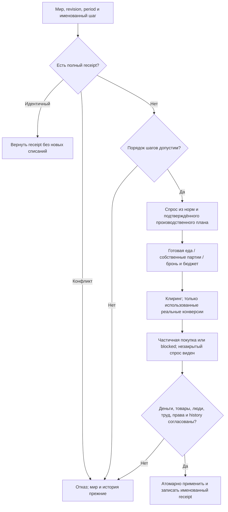

# Rust: рынок и фактическое потребление

Этап завершён13 октября2026: исходники проверены, пять существенных замечаний независимого ревью исправлены, CLI/server EXE опубликованы в bin. Одобренная спецификация — docs/superpowers/specs/2026-10-13-rust-market-design.md; план — docs/superpowers/plans/2026-10-13-rust-market.md. Машиночитаемый результат — results.json; фактическое чтение мира — world-inspect.json.

## Что работает

Исполняются три отдельные атомарные фазы: Maintenance, EarlyFood и ClosingMarket. Спрос вычисляется из настоящих профилей и норм; покупка требует реального товара, валюты, прав и денег. Один кошелёк распределяется между заказами общего приоритета. Собственные партии учитываются первым проходом; дефицит делится пропорционально. Личные запасы, резервы с бенефициаром, удержанные товары и входы предприятий защищены действующими правилами.

Складская покупка сначала бронирует место и оплачивает аренду. Затем хранится только купленный объём, освобождается остаток и возвращается аренда по договору. Партия продавца остаётся в его исходной провинции. Внутри авторского региона рынок мгновенный; вне региона товар этим этапом не доставляется.

Производственные закупки используют потенциальный/трудовой выпуск подтверждённого плана. Завод с нулевым фактическим выпуском из-за отсутствия сырья сохраняет реальный заказ на сырьё. Учитываются текущий рецепт, pending retooling, собственные свободные входы и допустимые материалы существующего проекта. Строительство и смена рецепта здесь не исполняются.

При instant_food сначала покупается готовая еда, затем только реально использованный объём конвертируется:1,03 зерна на1 муки,5 скота на1 мяса. Непроданное виртуальное предложение не материализуется. Surplus учитывает оплаченный конкурирующий спрос на сырьё, действительное место, аренду и исходный land-path множитель; это не отправка груза. Неоплаченный голод не блокирует промышленное использование зерна.

Содержание рабов считается по всем известным базовым потребностям, включая полностью непокрытые. Купленная еда при отсутствующей одежде не выдаёт полное подтверждение работы. Production принимает только подтверждённый текущий native receipt при наличии авторских нужд. Неизвестные количественные нормы остаются «нет измерения». Устаревшая численность profileRef диагностируется без подмены авторского количества.

## Исправления итогового ревью

1. Исполняемые вспомогательные planners закрыты внутри crate. Произвольный caller больше не может изготовить подтверждение покупки за чужого плательщика и завысить норму; внешние записи идут через именованную фазу с engine-built спросом.
2. Первый ранний шаг после производства/ClosingMarket отклоняется. Подтверждённый идентичный повтор возвращает старый receipt без новых списаний.
3. ClosingMarket учитывает explicit market priorities либо действительные purchase_priorities производства, включая override и пустой explicit список.
4. Полная проверка содержания/норм/истории выполняется один раз на неизменяемую сессию и запрос; индивидуальные receipts проверяются через typed lookup. Изменившиеся нормы и подделки по-прежнему отвергаются.
5. Общая рыночная политика больше не копируется на каждую покупку. Buyer/group/proposal/military/warehouse/artisan индексы строятся на текущих данных фазы; правила сортировки и денежного остатка сохранены.

Независимое ревью: work/rust-market-2026-10-13/final-review.md. Один проход исправлений: review-resolution.md. Все пять Important закреплены RED→GREEN; Critical и Important остатков нет. Отложенных minor замечаний нет.

## Проверки

- 182 fresh workspace tests прошли после ревью,0 ошибок. Единственная дорогая проверка полной загрузки была повторно использована: она прошла до sim-only исправлений за214,65с; loader/core/projections/runtime после этого не менялись. Всего183 проверенных случая. cargo fmt --check прошёл.
- 11 release проверок прошли: последовательность реальных малых фаз, lifecycle/replay/priorities/maintenance и рост выделений памяти. Это синтетические RAM fixtures, не недели рабочего мира.
- Операции, деньги и запасы совпали с настоящими JS-функциями в малых сценариях: нормы/заказы, приоритеты/fallback/military, склады, сырьё, пищевые конверсии и последовательность фаз с включённым/выключенным instant_food. Старые производственные проверки также прошли; их прежние результаты не выдаются за новые проверки экономики.
- Release `--inspect` успешно прочитал текущую базу:73,379с внутри CLI и76,804с общего времени процесса. Это время чтения и диагностики, не время недели.
- EXE в bin совпали по SHA256 с release; оба существующих launcher проверены и не изменены. Rust source SHA256:287794395f3e60199c4c2490299c3c7d58b77ca9c3de24be9cf13313b89414ac.

Результаты каждой проверки, hashes EXE/JS references, runtime и хранимые source/rules/engine signatures находятся в results.json. Использован один текущий source runtime: workers=1, storage=memory; maxHeapMiB=16384 прочитан, native enforcement этого лимита не реализован.

## Рабочий мир и границы

Фактически прочитано: world-306, revision20, дата306-01-01;2679 провинций,65916 ПОПов,94955590 людей,70050 счетов,15229 предприятий,160223 партий. Добавленные рыночные данные:65916 profileRefs,48 профилей,7340 соглашений содержания,1620 предложений продажи,2679 территориальных строк. Native phase receipts в исходной базе отсутствуют и не выдумываются.

Рабочая SQLite и runtime.json не менялись. Проверены дата/revision/хранимые signatures и размер базы; дорогой полный byte digest не запускался. Изменение авторских базовых ресурсов/состояния не подменялось runtime-правками или миграциями старых alpha-сохранений.

Недель рабочего мира:0. Фаз производства полного мира:0. Годовая устойчивость, реальные обеспеченность/бедность/стройки полного мира и время Rust-недели — **нет измерения**. Годовое сохранение/загрузка/продолжение — **не проверено**. Техническая проверка не доказывает здоровую экономику.

Не реализовано: интегрированная полная Rust-неделя; датированные перевозки/опережающие заказы и запас еды; общий бюджет и пополнение sponsored reserve; найм/профессии/миграция; эмиссия авантюристам; доходы владельцев/инвестиции/исполнение строительства; запись изменённого native мира и обязательной истории в snapshot с последующим restart; полная юридическая проверка прав. История native операций и receipts текущих фаз авторитетна в RAM; source envelopes сохранены. Full native week остаётся заблокирована до обязательных будущих фаз.

## Процедура и самопроверка

Положительные, частичные, blocked, аварийные и повторные исходы закреплены проверками. Товарное изменение объясняется рецептами, потреблением и сменой собственности; денежное — дебетами/кредитами/арендой/возвратами по валюте/purpose. Люди и назначения труда не меняются. Техническое разрешение personal account проверяется отдельно и не считается демографическим изменением. Полная legal-title проверка остаётся NotMeasured.

Журнал решений и восстановимая исходная копия сохранены в work/rust-market-2026-10-13. Git в этой директории отсутствует; резервную копию не удаляли. Gemini3.8 Flash High помог сверить первоначальные исходные правила; его существенные выводы проверены по JS. Headless-запросы с пустым response не использовались, обхода permissions не было.

