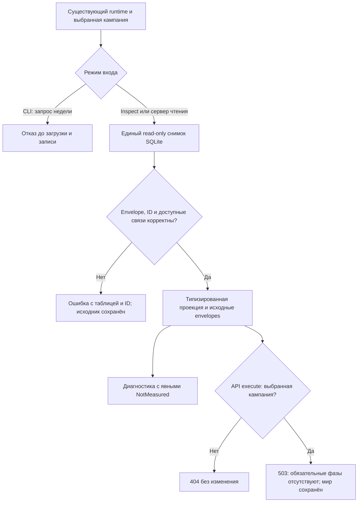

# Восстановление Rust-Кингмейкера: первый этап

Первый согласованный этап реализован, проверен и опубликован в запускаемых EXE. Исправлены загрузка идентичностей и товаров, финансовые связи, дата, атомарный перевод денег и ложные положительные проверки. **Полноценная Rust-экономика ещё не перенесена.** Полная неделя теперь явно отказывает до изменения мира; прежние 13–16 мс не являются замером работающей экономики.

Спецификация: `docs/superpowers/specs/2026-10-12-rust-recovery-design.md`. План: `docs/superpowers/plans/2026-10-12-rust-recovery.md`. Оба документа и выполнение здесь одобрены автором. Git отсутствует; изменения внесены в существующий проект с сохранением копии исходников, EXE и launcher в `work/rust-recovery-2026-10-12/before`.

## Границы и источник

Дата проверки: 12 октября 2026. Единственный источник — существующий JS `data/kingmaker/runtime.json`, `current-world.sqlite`, кампания `world-306`, revision **20**, дата **306-01-01**. Выбраны **storage=memory, workers=1, maxHeapMiB=16384**. Эти настройки читаются и сохраняются в диагностике; нативное ограничение памяти ещё не реализовано. Новая рабочая кампания не создавалась, исходные правила и авторские данные не изменялись, скрытого исполнения недели через JS нет.

Активная база открывалась только для чтения. Runtime побайтно совпадает с сохранённой копией. После проверок revision, дата и три подписи кампании совпадают с исходными, размер SQLite — **5 762 625 536 байт**. Полный digest базы не выполнялся; это не заявление о побайтном сравнении всей SQLite. Полных недель рабочего мира исполнено **0**. Малые тестовые состояния в RAM/временной SQLite использовались отдельно.

## Что исправлено и фактически проверено

| Область | Результат первого этапа |
|---|---|
| ID и codec | Настоящий словарь и shared-ссылки; `7` и `"7"` различаются. Только номер провинции имеет согласованную канонизацию. BigInt, extensions, неизвестные поля и специальные JS-типы сохраняются явно. |
| Ресурсы и запасы | Товар берётся из `goods_id`, место из `province_id`, владелец из `owner_id`. Непрозрачное имя запаса или номер холдинга ничего не подменяет. Неизвестный товар не становится зерном. |
| Финансовый граф | Счёт имеет отдельные ID, владельца, валюту, назначение и точную сумму; поиск по составному адресу. Несколько валют не разрешают угадывать первый счёт. Отсутствующие в источнике личные счета не создаются. |
| ПОПы и предприятия | Читаются настоящие классы, провинции, культура, религия, рабочая сила, занятость и финансовые связи. Диапазоны ПОПов населённых провинций восстановлены. |
| Перевод денег | Проверки адресов, валюты, суммы, средств и переполнения до записи. Самоперевод и нулевая сумма не создают денег. Совпадающий повтор идемпотентен; другой запрос с тем же event ID отвергается. |
| Инварианты | Изменения людей, денег и запасов сверяются по значениям и объясняющим реализованным операциям. Неперенесённые проверки труда/прав возвращают `NotMeasured`, а не успех. |
| Вход недели и API | Отказ `INCOMPLETE_NATIVE_ENGINE` до изменения данных, даже с переданными рецептами. Execute выбранной кампании — HTTP 503; чужой — 404. Полный viewer API пока не готов. |
| Запуск | Обновлены оба EXE в `bin` и оба `.cmd`. Launcher явно сообщает режим чтения, использует существующий runtime и не открывает браузер автоматически. |

Загрузчик удерживает **1 146 248 исходных entity-records**, **1 385 233 записи словаря**, shared-данные, campaign/static envelopes и metadata. Неисполняемые поля не выкидываются. Это не готовый механизм сохранения года: обязательная история в исходной SQLite остаётся нетронутой, а её нативное исполнение и новая фиксация ещё не реализованы.

| Показатель рабочего мира | Прочитано без изменения |
|---|---:|
| Провинции | 2 679 |
| Группы ПОПов | 65 916 |
| Люди | 94 955 590 |
| Счета | 70 050 |
| Предприятия | 15 229: 15 189 кустарных и 40 заводов |
| Запасы | 160 223 |
| Записи пищевого резерва | 158 446 |
| Найденные личные счета ПОПов | 58 576 |
| Личные счета, отсутствующие в источнике | 7 340 |

Полный read-only аудит независимо сверяет исходные wire-поля с типизированной проекцией: товар, владельца, провинцию и количество каждого запаса; идентичность, владельца, валюту, назначение и сумму каждого счёта; численность, рабочую силу, занятость и безработицу каждого ПОПа. Расхождений в этих проверенных полях **0**. Прежние 40 752 подмены товара и 16 269 подмен места не воспроизводятся. Это проверка загрузки, а не проверка здоровой экономики или полного выполнения всех имущественных правил.

## Проверки и независимое ревью

- `cargo test --workspace --locked`: **70 прошли, 0 упали, 0 пропущены**. Включает реальный JS codec oracle, малые SQLite, бухгалтерию, отказ недели, API и полный read-only аудит. Полный аудит в debug занял **116,16 с**.
- `cargo build --release --workspace --locked`: exit 0. Release CLI: **2 теста прошли** — выбор tiny runtime/даты и отказ без изменения файла SQLite.
- Полный мир отдельно загружен готовым release CLI: **22,706 с** внутри inspect, **24,041 с** на процесс целиком. Состояние дискового кэша не контролировалось; это один замер загрузки с проверками, не холодный benchmark и не время недели.
- Опубликованные EXE совпадают по SHA-256 с проверенной release-сборкой. Их help и отказ CLI проверены после копирования. `.cmd` проверены на UTF-8 без BOM, CRLF, правильные quoted пути и отсутствие автоматического браузера. Полный сервер через launcher для недельного расчёта не запускался.
- Свежий независимый reviewer нашёл I1: непрочитанный `@static` и неполные непренесённые envelopes; I2: противоречие SQL-ID и payload; M1: потерю таблицы/ID в ошибке суммы. Семь новых тестов подтвердили RED; все исправлены одним проходом. Дополнительный восьмой тест закрепляет только допустимую канонизацию провинции.
- Строгая проверка сначала отвергла законный строковый адрес провинции 1 при числовом `province_id`. Исправлено правило сравнения адреса провинции; исходные данные не переписывались. Итоговый полный аудит прошёл.
- Повторный запуск исходных малых reviewer-probes теперь отвергает все воспроизведённые повреждения и показывает `accounts id:901` в ошибке переполнения. Независимый отчёт и решение по каждому замечанию сохранены в `work/rust-recovery-2026-10-12/{final-review,review-resolution}.md`.

Первоначальные 19 проверок из аудита не удалены. Они адаптированы к явной модели ID и одобренному отказу недели: **10 проходят; 9 отложены с индивидуальной причиной**. Все девять отдельно запущены через `-- --ignored` и **все девять по-прежнему воспроизводят недостающие механики**. Их нельзя прибавлять к числу исправлений. Исторический результат 1 pass / 18 fail и оригинальные исходники сохранены. Логи: `work/rust-recovery-2026-10-12/{workspace-tests-final,updated-probes,deferred-probes,release-cli-tests,reviewer-probes-after}.txt`.

Gemini помог с предварительным разбором и черновыми предложениями; существенные сведения проверены по JS-коду и SQLite. Независимое итоговое ревью выполнено GPT-6 Astra. Их сообщения не заменяют выполненные проверки.

## Оставшиеся дефекты и следующий приоритет

1. **R4: производство.** Экспериментальная функция ещё выпускает без проверки/списания сырья и может записать отчёт без реального принадлежащего производителю запаса. Нужен перенос ДП, рецептов, кустарей, труда, прав и вместимости.
2. **R5: рынок и потребление.** Нет полного оплаченного заказа, передачи товара, фактического потребления, утверждённых профилей потребностей и доставки по срокам. Прототип использует чужие резервы и скалярное предложение для разных товаров. Нужны реальные сделки, предзаказ еды и её конверсия.
3. **R6 и сопутствующий бюджет.** Прототип госвыкупа списывает деньги без кредита продавцу и передачи собственности. Нужен настоящий бюджет, резерв служб, предел покупок и все действующие доходы/расходы, включая утверждённую эмиссию авантюристам.
4. **Труд, профессии, миграция, инвестиции и строительство** — не реализовано нативно. Полные валидаторы труда и имущественных операций — нет измерения.
5. **Сохранение и обязательная история между процессами**, годовой снимок, повторная загрузка и продолжение — не реализовано/не проверено на этом этапе. История нынешнего ledger относится к одной RAM-сессии.
6. **Полный viewer API и нативное ограничение памяти** — не реализовано. Проверенные диагностические endpoints не доказывают готовность карты к игре.

Приоритет после этого этапа — перенос действующих операций производства и оплаченных сделок с потреблением, а затем бюджет/труд/стройка и фиксация истории. Не подключать имеющиеся экспериментальные функции к полной неделе без выполнения их оставшихся контрактов. Баланс, цены, рецепты, рабочая сила и авторские ресурсы этим этапом не менялись.

## Fingerprints и результаты

Rust-исходники, тесты и Cargo manifests/lock, по алгоритму первоначального аудита: `37b0cf33a109e6f4806cb4106bb7516ee87da22ef624c8f089a53cddf2b4c3af`.

- `bin/kingmaker-cli.exe`: `c476769c41087f8c415bfed10cb71341fc2c5d8b33ee6af5c09c71354221ae82`.
- `bin/kingmaker-server.exe`: `8d5ff6d47de7bd6f5f6421c9c6bd420d3004123985e645d35bb5f8b499b17534`.
- Runtime: `e664337014e3181d31a872343c0c2b494f1df386b4d634fda8f8369195f3c7d5`.
- Исходный JS engine: `aa0843a303b55e625f1088f7169522c5ffaf6267bf4a2047b837fe17199c01e8`.
- Правила: `a39c5fb0460647d8ba092031ecaa35f80f46a651671838b9e9dfb91e904d535b`.
- Исходные данные: `9e7670ad84df91ae911526072fd96d55946ea063567c46c32a3d2f0bf43f0c3d`.

Машиночитаемые результаты: `results.json`; фактический inspect готового CLI: `world-inspect.json`. В `results.json` неподдержанные проверки указаны текстом, а не нулём. Проверка публикации воспроизводится `node work/rust-recovery-2026-10-12/publication-check.cjs` и не запускает неделю.
